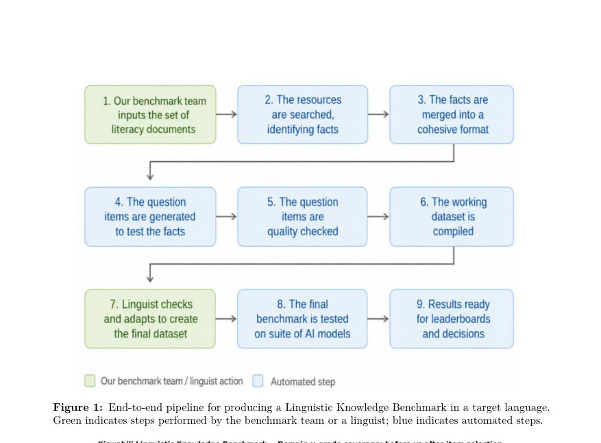
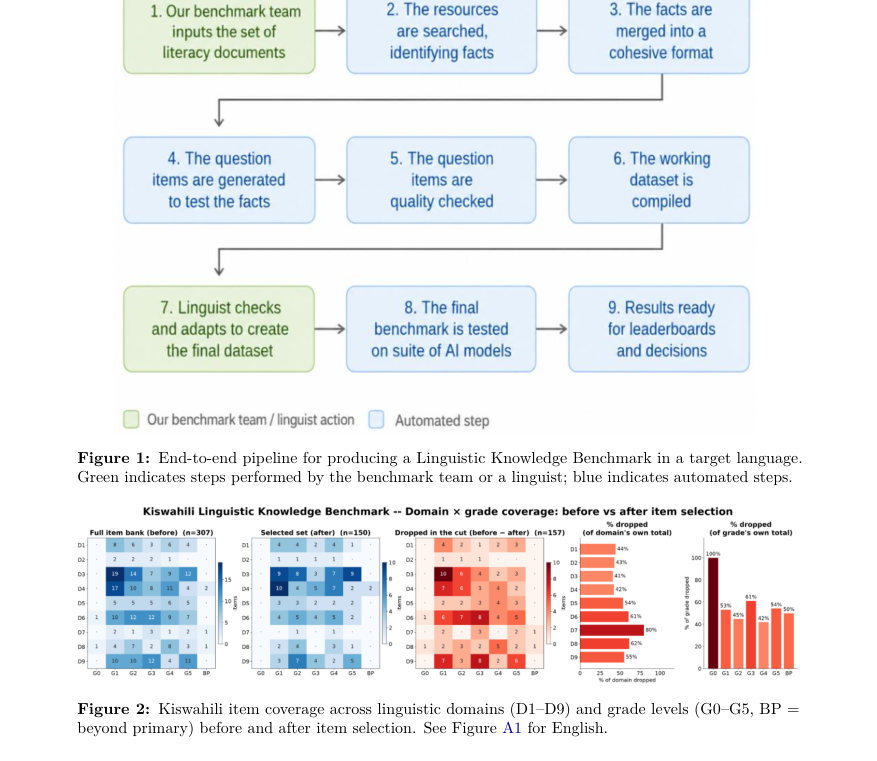
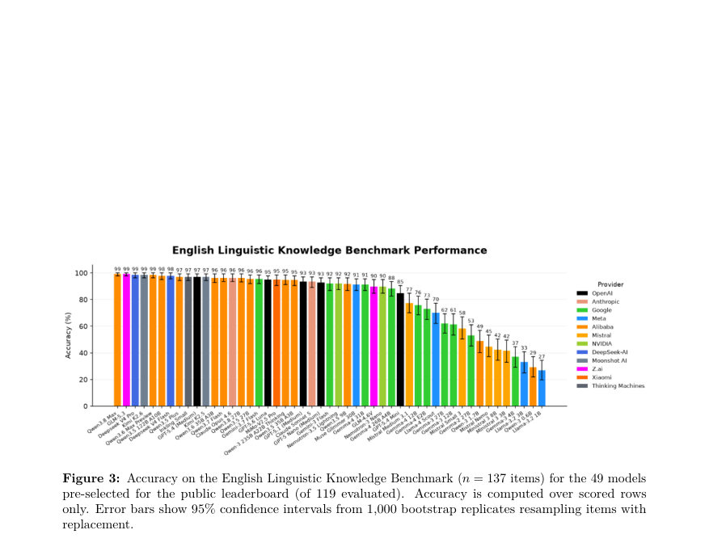

# The Linguistic Knowledge Benchmark: Do Language Models Know the Foundations of Early-Grade Literacy?

- **게시일:** 2026-11-27
- **arXiv:** [2611.34823v1](http://arxiv.org/abs/2611.34823v1) · [PDF](https://arxiv.org/pdf/2611.34823v1)
- **저자:** Maxime Lelièvre, Alasdair Mackintosh, Dominic Andrews, Tobias Murray, Moritz Boos, Oliver G. B. Garrod
- **분야:** cs.CL
- **선정 점수:** 4.41
- **선정 이유:** 최근성 0.7, 인용 영향 0.0 (인용 0회), 저자 영향 0.0 (최고 h-index 0), AI 주제 적합성 2.3, 개발자 관심 0.7, 학술 신호 0.8, 오픈 웨이트·주요 연구조직 신호 0.0

[← 2026-11-27 목록으로 돌아가기](../daily/2026-11-27.html)

<!-- paper-visuals:start -->
## 주요 Figure

> 원문 PDF에서 실제 Figure 캡션과 그림 영역이 함께 확인된 자료만 자동 추출했다.

*Figure · 원문 PDF 5쪽 · Figure 1: End-to-end pipeline for producing a Linguistic Knowledge Benchmark in a target language.*

*Figure · 원문 PDF 5쪽 · Figure 2: Kiswahili item coverage across linguistic domains (D1–D9) and grade levels (G0–G5, BP =*

*Figure · 원문 PDF 8쪽 · Figure 3: Accuracy on the English Linguistic Knowledge Benchmark (n = 137 items) for the 49 models*

<!-- paper-visuals:end -->

## 한 문장 요약

교육용 커리큘럼과 교재에서 자동으로 추출·정제한 문항으로 언어모델의 기초 문식성(phonics·morphology·syntax 등) 지식을 평가하는 재현 가능한 파이프라인과 벤치마크(Linguistic Knowledge Benchmark)를 제시하고, 키스와힐리(케냐)와 영어(영국)에서 대규모 모델군을 평가해 소형·온디바이스 모델의 현저한 성능 격차를 보여준다.

## 해결하려는 문제

저자들은 저·중소득국(LMIC)에서 수업 언어(예: Kiswahili)가 모델 학습 데이터에 적게 포함되어 있어, 언어모델이 초기 학년 문식성 교육에 필요한 언어 지식을 갖추고 있는지 불명확하다고 지적한다. 따라서 실제로 교실에 배포 가능한(저비용·온디바이스) 모델들이 그 언어들의 기초적 언어 지식을 보유하는지 평가할 필요가 있다. 기존 일반적 언어능력 평가로는 '왜 실패하는지'를 설명하기 어렵고, 교과서·교사 가이드 기반의 체계적·검증 가능한 질문지 생성 절차가 부족했다.

## 핵심 기여

- 언어·등급(9개 언어범주 × G0–G5) 고정 그리드와 커리큘럼·교사용 자료·학습자 자료를 입력으로 받아 자동화된 단계(자료 조사, 속성 병합, 문항 생성, 품질검사, IRT영감의 문항선택)와 최종 전문가 리뷰로 검증된 벤치마크를 만드는 재현 가능한 언어무관 파이프라인을 제시함(본문 §2).
- Kiswahili(케냐)용 135개 문항, English(영국)용 137개 문항으로 파이프라인을 두 언어에 인스턴스화하고 각 문항을 항목선택·전문가검토·채점 단계에서 검증함(§2.4–2.5).
- 121개(Kiswahili)·119개(English) 모델을 평가하여 프론티어 모델은 양쪽 언어에서 90% 이상을 달성하나, 소형·저비용 모델은 특히 Kiswahili에서 성능이 급락함을 실증(§3, 표 A8–A9).
- 모든 파이프라인 프롬프트·코드 일부를 오픈소스 공개하고(20개 퍼블릭 샘플 항목 포함), 결과 리더보드 운영과 향후 ‘Decodability Assessment’·‘Decodable Text Generation’ 두 단계 확장을 제안함(결론, 데이터·코드 가용성).

## 접근 방법

* 파이프라인(§2)은 다음 단계로 구성된다: (1) 자원 조사(Prompt A1): 커리큘럼·교사용 지침·학습자 교재 등(보통 6–11개 문서)을 문서별로 도메인(D1–D9)×학년(G0–G5,beyond_primary) 그리드에 따라 테스트 가능한 사실('testable facts')로 추출하고 원문 예시와 문서 위치를 기록한다.
* (2) 사실 병합(Prompt A2): 문서별 사실을 도메인·학년별로 통합하고 중복은 병합, 등급 충돌 시 높은 티어(커리큘럼>교사용>학습자>기타) 우선으로 처리한다.
* (3) 문항 생성(Prompt A3): 통합된 feature_map을 바탕으로 다지문형(MCQ) 또는 단답형(short_form) 문항을 과대샘플링 방식으로 생성(문항별 여러 후보).
* (4) 품질검사·중복표시(Prompt A4): 일련의 'anti-gaming' 규칙과 15개 QC 규칙으로 후보를 자동검사·중복군 편성·랭킹.
* (5) 항목선택(IRT영감): 10개 모델로 구성된 패널(Table A3)의 응답을 사용해 (a) 전 모델이 정답인 포화 아이템 제거, (b) 변별력 높은 문항 선호, (c) 도메인×학년 균형 유지 조건으로 풀을 트리밍(영어: 377→140, Kiswahili: 307→150).
* 최종으로 언어·교육 전문가가 각 문항을 리뷰·편집·제거하여 최종셋(영어 137, Kiswahili 135)을 확정(§2.3–2.4).
* 문항은 모두 영어로 작성되어 '타언어에 관한 지식의 회수(retrieval)'만을 측정하도록 설계됨(§2.3).
* 채점(§2.5)은 MCQ는 정규표현식 파싱 및 파싱 실패 시 단일 LLM 판정(대체판정), 단답형은 세 개의 서로 다른 제공자(Claude Sonnet 5, GPT-5.6 Terra, Gemini-3.6 Flash)를 판사로 다수결 채택하여 편향을 줄임.
* 체계적 검증이 이루어졌고(판사 합의율·fallback 비율·모델군 일관성 등, §2.6), 하드웨어 배포 가능성(온디바이스) 검토를 위해 모델을 기기 티어(모바일·태블릿·워크스테이션·클라우드)로 분류하는 추정 절차(파라미터 수, 가정된 양자화 비트 및 RAM 가용성 기반)를 적용함(부록 D).

## 주요 결과

- 평균적 관찰: 최고 성능 모델은 두 언어에서 거의 만점 수준(최고 약 99%)이며, 전체 모델군 정확도 범위는 약 99%에서 10%까지 분포함(§3, Fig.3–4).
- 프론티어 모델(클라우드·대형)은 양 언어에서 90% 이상을 기록했으나, 소형·저비용 모델 성능은 Kiswahili에서 더 크게 하락: 예시로, 10B 이하 모델 중 Qwen3.5 9B와 Gemma-4 E2B는 영어에서 각각 91.7%·73.0%를 달성했으나 Kiswahili에서는 각각 51.9%·40.7%에 그침(§3, Fig.5).
- 비용·배포 관점: 토큰당 $0.10 수준(3:1 입력:출력 가정)에서 Qwen3.7 Flash는 영어 96.4%·Kiswahili 69.6%를 기록(§3).
- 하드웨어 티어별 평균 정확도: 클라우드 티어 평균은 영어 91%, Kiswahili 79%; 워크스테이션 클래스는 61%·41%; 모바일·태블릿은 47%·24%로 하드웨어가 작아질수록 성능·Kiswahili 격차가 커짐(§3, Fig.6).
- 문항·채점 검증: 문항선택은 전체 후보풀 대비 모델 순위 보존(Spearman ρ=1.00, Kendall τ=1.00)했고, 패널을 바꾼 leave-two-out 테스트에서 선택 빈도 평균 0.90(영어), 0.89(Kiswahili)로 안정적(§2.4, Table A4). 단답형 판사 3인 합의율은 Kiswahili에서 97.0%(pairwise 97.5–98.7%, κ 0.944–0.970), 영어 92.1%(pairwise 92.8–96.4%, κ 0.773–0.897)였음(§2.6).

## 한계

- 저자 언급: 항목 매체(English-medium) — 모든 문항을 영어로 작성했기 때문에 타언어(목표 언어)로 문항을 제시했을 때보다 쉬운 조건이며, 결과는 '상한(upper bound)'으로 해석해야 한다(§4 'Medium of the items').
- 저자 언급: 구성 범위 — 본 벤치마크는 '회수(retrieval)' 테스트로서 언어 사실의 보유 여부만 검사하며, 이를 실제로 적용(예: 학습자 수준에 맞는 디코더블 텍스트 생성)할 수 있는지(기능적 역량)는 보장하지 못함(§4 'Scope of the construct').
- 저자 언급: 추론·디코딩 설정 고정 — 모든 모델을 단일 고정 구성으로 실행했기 때문에(기본 디코딩·온도 등) 다른 파라미터나 extended-thinking 예산을 탐색하면 소규모 모델의 성능이 달라질 가능성을 배제할 수 없음(§4 'Inference conditions').
- 검증 가능한 제약(본문에 근거): 데이터 공개·누출 제약 — 전체 데이터셋은 연구 요청으로만 제공되고 공개는 20개 샘플만 오픈(결론 'Data and Code Availability'), 이는 외부 완전 재현과 재평가를 제한할 수 있음. 또한 모바일·워크스테이션 티어의 모델 수가 작아(각 티어의 n이 작음) 평균 신뢰구간이 넓을 수 있음을 본문이 직접 지적(§3 'Cell counts are small and unevenly distributed').

## 개발자 관점

- 재현성: 파이프라인 전체 프롬프트(Prompts A1–A6)와 코드가 공개되어 있어 다른 언어로 보급·재현 가능하지만, 원자료와 완전 데이터셋은 일부(전체 문항)는 연구 요청으로만 제공되어 재현에는 추가 협의가 필요함(§2.3, 결론).
- 프롬프트 기반 자동화 + 전문가 집중검토 전략: 자료 조사→병합→문항생성→자동 QC→IRT영감 선택→전문가 리뷰의 흐름은 전문가 시간 절감과 추적 가능성(auditable trace)을 제공하므로 다른 언어로 확장 가능(§2.2–2.4).
- 채점·판정 설계: 단답형은 세 공급자 LLM 다중 판사 다수결로 편향 완화, MCQ는 우선 정규표현식 파싱 후 파싱 실패 케이스만 LLM 대체판정으로 해결(§2.5–2.6). 이 구조는 판정의 투명성(근거 근거화)과 오류 수정(예: 기대 정답 목록 보완)에 유리함. 다만 LLM 판사 자체의 편향·자기선호(self-preference)를 점검하는 절차가 필요하며 본 논문은 이를 점검했음(§2.6).
- 배포·비용 고려: 온디바이스(모바일·태블릿) 배포를 염두에 둔 모델 선택은 영어 성능만으로 판단하면 안 되며(영어 성능은 과대평가 요인), Kiswahili 등 LMIC 언어의 커버리지가 낮을 경우 소형 모델은 실무적 요구를 충족하지 못함(§3).
- 하드웨어·양자화 가정: 파라미터 수를 메모리 추정 수단으로 사용하고 4-bit(모바일)·8-bit(워크스테이션) 가정을 적용해 티어를 할당했으므로, 실제 온디바이스 성능/품질은 양자화 전략·라이브러리·런타임에 따라 달라질 수 있음(부록 D). 구현 시 실제 메모리·정밀도·추론 지연을 검증해야 함.

**근거 범위:** 이 분석은 제공된 논문 PDF 본문(본문, 부록 A–D, 표와 그림)을 근거로 작성되었음. 수치는 본문과 부록에 표기된 값만 사용했으며(예: 항목 수, 모델 수, 특정 모델 정확도, 판사 합의율, 티어별 평균 정확도 등), 원문에 없는 내부 구현·실험 반복·비교적 세부 하이퍼파라미터 값은 기술하지 않았다. 일부 구현 추정치(예: 하드웨어 티어의 실제 온디바이스 성능)는 논문 자체의 가정(부록 D)에 근거한 것이며, 전체 문항 데이터셋은 공개 샘플(언어별 20개) 외에는 연구 요청으로만 제공되어 외부 검증이 제한될 수 있음을 밝힌다.
