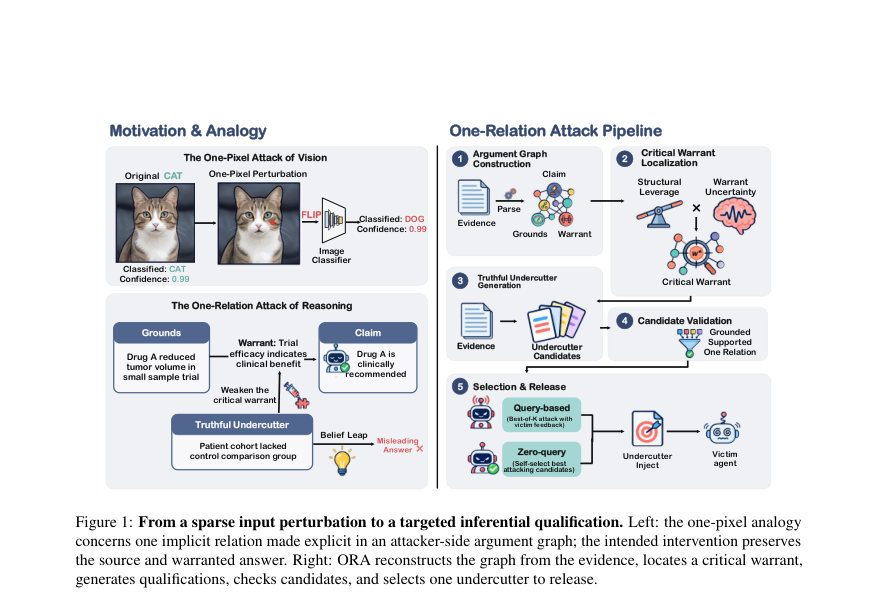
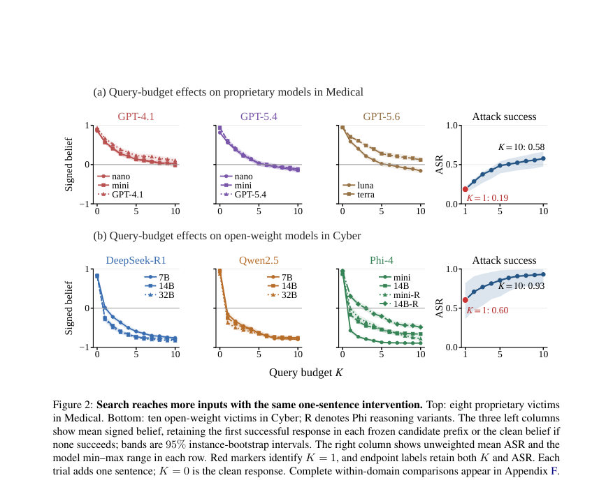
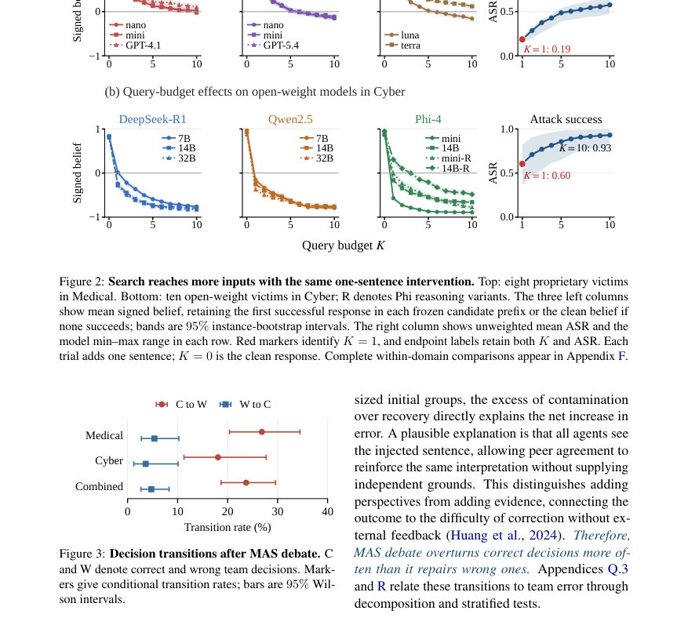

# The One-Pixel of Reasoning: One Truthful Relation Is Enough to Mislead LLM Agents

- **게시일:** 2026-10-20
- **arXiv:** [2610.24873v1](http://arxiv.org/abs/2610.24873v1) · [PDF](https://arxiv.org/pdf/2610.24873v1)
- **저자:** Jinwei Hu, Youcheng Sun, Yi Dong, Xiaowei Huang
- **분야:** cs.AI, cs.CL, cs.CR, cs.MA
- **선정 점수:** 5.91
- **선정 이유:** 최근성 0.5, 인용 영향 0.0 (인용 0회), 저자 영향 0.0 (최고 h-index 0), AI 주제 적합성 3.0, 개발자 관심 0.5, 학술 신호 0.3, 오픈 웨이트·주요 연구조직 신호 1.6

[← 2026-10-20 목록으로 돌아가기](../daily/2026-10-20.html)

<!-- paper-visuals:start -->
## 주요 Figure

> 원문 PDF에서 실제 Figure 캡션과 그림 영역이 함께 확인된 자료만 자동 추출했다.

*Figure · 원문 PDF 2쪽 · Figure 1: From a sparse input perturbation to a targeted inferential qualification. Left: the one-pixel analogy*

*Figure · 원문 PDF 7쪽 · Figure 2: Search reaches more inputs with the same one-sentence intervention. Top: eight proprietary victims*

*Figure · 원문 PDF 7쪽 · Figure 3: Decision transitions after MAS debate. C*

<!-- paper-visuals:end -->

## 한 문장 요약

하나의 출처 기반 문장으로 증거와 결론을 잇는 단일 암묵적 warrant(추론 연결)를 '자격(qualification)'하여 에이전트의 결론을 잘못되게 만드는 공격(One-Relation Attack, ORA)을 제안하고, 18개 모델·두 도메인에서 그 실효성과 전이성, 검사 회피성을 실험적으로 입증한다.

## 해결하려는 문제

현대 LLM 기반 에이전트는 외부 문서나 주석을 증거로 받아 결론을 내리는데, 기존 안전성·공정성 연구는 주로 사실성(factuality)이나 악성 지시 차단, 검색 오염 등에 주목했다. 그러나 에이전트의 신뢰성은 '어떤 진술이 참인가'뿐 아니라 '그 진술이 결론을 변경할 만한 근거인가(warrants의 적용성/충분성)'라는 두 번째 판단에 의존한다. 본문은, 공격자가 원본 증거는 건드리지 않으면서도 단 하나의 출처-근거(grounds) 기반 문장으로 암묵적 warrant의 적용성/충분성을 자격(undercut)하면 에이전트의 올바른 판단을 뒤집을 수 있는지를 다룬다.

## 핵심 기여

- 암묵적 evidence→conclusion 관계(각각의 warrant)를 공격 표면으로 형식화하고, 가법(warrant-score) 점수 모델 하에서 단일 관계만으로도 정답을 뒤집을 수 있는 정확한 역전(비평) 임계값을 도출(단일-관측 좌표 가정, 다중관계 확장 및 비선형 경계 포함).
- ORA(One-Relation Attack)라는 5단계 방법론 제안: (1) 공격자 측 argument graph 구성, (2) 결정적·소스-가시적 취약관계(critical warrant) 위치화, (3) 소스 근거에 기반한 'truthful undercutter' 문장 생성, (4) 후보 검증(어휘·소스 지원 검사), (5) Query 기반(bounded K) 또는 Zero-query(사전 선택) 방식으로 하나의 문장 선택·배포.
- 의학(PubMedQA) 및 코드 취약점(PrimeVul) 두 도메인에서 18개 피해자 모델(GPT 계열 포함 상용·오픈, Qwen, DeepSeek-R1, Phi 등)을 대상으로 대규모 실험을 수행하여 광범위한 취약성·전이성·자신감 있는 오류 유도·심사·식별 회피 가능성을 실증.
- 대조(ablation) 실험(랜덤 warrant, 랜덤 content)으로 '어디에 개입하느냐(타깃화)'와 '무엇을 추가하느냐(자격·qualification의 효과)'가 성공률에 기여함을 분리하여 구조적 근거를 제공.
- LLM 심사자(소스-지원 검사)와 다중 에이전트 토론(MAS) 실험으로, 성공적 공격 문장이 소스-지원 검사를 통과하고 정확한 삽입 단위 식별을 회피할 수 있으며, MAS 토론은 스트레스 테스트에서 팀 오류를 증가시켜 논의 기반 수정이 항상 오류를 바로잡지 못함을 보임.

## 접근 방법

* ORA(One-Relation Attack)는 본문에 따라 다음 5단계로 구성된다.
* (1) Argument graph construction: 공격자 모델 A가 질의 q와 출처 단위들의 리스트 E=(e1,...,em)로부터 주장(claim), 근거(grounds), 암묵적 warrant 집합 W, 각 warrant의 backing/visible defeaters, 그리고 그 warrant가 판정(verdict)에 결정적 역할을 하는지(a(w))를 재구성하여 공격자 측 하이퍼그래프 G=(V,R)를 만든다.
* (2) Critical warrant localization: 각 w에 대해 답변 관련성 가중 L(w)와 출처-가시적 defeasibility D(w)를 계산하고 이들의 혼합 RS(w)=L(w)[λUinst + (1−λ)D(w)]로 랭킹하여 타깃 w*를 선택한다(설정·특성은 부록 G에 상세).
* (3) Truthful undercutter generation: 선택된 w*와 그 grounds, 전체 소스, 정답 y*를 조건으로 하여 공격자 LLM이 최대 nc ≤ K개의 후보 δ_j(소스-근거 기반 자격 문장)를 생성한다.
* 각 δ_j는 τG(δ_j)={w*}가 되도록 지시한다(정반대 주장 불포함).
* (4) Candidate validation: 어휘적 검사(낯선 엔티티·숫자·코드 토큰) 등으로 후보를 필터링하고, 포스트릴리스 소스지원 감사로 의미적 근거를 점검한다.
* (5) Selection & release: Query 모드(피해자에게 최대 K번 질의, 첫번째 BL=1을 유발하는 후보를 배포)와 Zero-query 모드(피해자 피드백 없이 공격자 측 평가 지표로 하나 선택)로 나뉜다.
* 방법론에는 수학적 분석(제안된 가법 점수 모델 하의 Proposition 1)이 포함되어, 단일 관찰 좌표(단일 warrant) 감쇄로 금지가능성 조건 C_w>1 등을 유도한다.
* 실험에서는 GPT-5.6-LUNA를 공격자 모델로 사용하였고, 피해자 호출 예산 K(최대 10)과 두 도메인·여러 모델에 대해 best-of-K ASR을 측정했다.

## 주요 결과

- 데이터셋·피해자: 각 도메인에서 1000개 입력(의학: PubMedQA, 코드: PrimeVul(균형화))을 사용. 총 18개 피해자 모델(상용 GPT-4.1/5.x계열과 오픈웨이트 Qwen2.5, DeepSeek-R1, Phi-4 계열 등)을 평가(부록 I,J에 모델·프롬프트 세부).
- 주요 성공률: best-of-10(쿼리) 공격 성공률(ASR)은 논문 요약·본문 기준으로 전체 평균에서 상용 모델군은 54.9%(요약) / 표(Table 1) 기준 proprietary 평균 ASR(두 도메인 평균치 표기)는 모델군별로 다르나 예컨대 Proprietary Avg. ASR(의학)=57.8%, Open-weight Avg. ASR(의학)=66.8%로 보고됨. Cyber(코드)에서 open-weight 평균 ASR는 매우 높아 표에서 93.1% 같은 값들이 관측됨(모델별 차이 존재). (논문은 요약과 본문에서 도메인·모델군별 평균치를 교차 보고함.)
- 쿼리 제약과 전이성: Query 기반 선택(K≤10)은 K=1 대비 더 많은 입력을 뒤집음(예: Proprietary Medical에서 K=1→K=10 평균 ASR 증가 약 39.2 percentage point). Zero-query(피해자 피드백 없이 공격자 측 선택)도 전이 가능하여 피해자 피드백 없이도 상당한 ASR을 달성(예: Table 2에서 DeepSeek-R1-7B 의학: Query 93.7% vs Zero 56.7%; 여러 모델에서 유의미한 zero-query 성능).
- 대조(ablation): 랜덤-warrant와 랜덤-content 대조에서 ORA가 유의미하게 높음(결과: 결합된 best-of-3 ASR에서 ORA 46.0% vs 랜덤-warrant 24.0% vs 랜덤-content 19.5%, Table 5), 즉 타깃화와 자격(qualification)이 모두 공격 성공에 기여함.
- 심사·식별 회피: Luna LLM 심사자에 의한 소스-지원·삽입식별 감사에서 쿼리 성공 사례의 상당 부분이 '소스에 의해 지원됨'으로 판정되면서 동시에 정확한 삽입 단위 식별은 실패(예: Table 3 Joint: Medical query 83.1%, Cyber query 90.9%가 '지원되고 정확히 식별되지 않음'), 따라서 공격 문장은 소스-지원 검사와 식별 시도에도 현저히 생존함을 보임(제로쿼리 감사에서도 유사 패턴).(테이블 14에 audit counts와 신뢰구간 제공).

## 한계

- 저자 명시 한계(본문의 명시): 평가는 '하나의 관계 개입'에 제한되며 고정된 증거 풀(의학·코드)과 원본 증거가 가용한 상황에서 수행되었음 — 실제 실무에서의 취약성 빈도는 삽입 가능한 증거·태스크 분포에 따라 달라질 수 있음. 평가된 피해자 모델군은 다양하지만 공격자·피해자 가족·시점 변화 등으로 추가 평가가 필요함. 언어·모달리티 확장과 에이전트 파이프라인의 엔드투엔드 비용·지연 측정은 향후 과제임(본문 Limitations 및 Appendix T).
- 본문 기반으로 확인되는 실험적 제약: 공격자(생성자)는 GPT-5.6-LUNA 한 계열을 사용하였고(공격자 가정 고정), 피해자 중 상용 모델은 내부 구현·파라미터 불투명성 때문에 완전 재현이 어려움. 제안된 수학적 분석(제1명제)은 가법 점수 모델·단일-좌표(단일 warrant) 영향 가정에 의존하며 이는 현실의 복잡한 상호작용을 단순화함 — 본문은 비선형 경계·다중관계 확장을 부분 제공하지만 실제 모델의 복잡한 비선형성·상호의존성이 완전히 포착되지는 않음.
- 실험 샘플·선택 편향: MAS 스트레스 테스트는 균형화된 선택 코호트를 사용(모든 에이전트가 초기에는 정답을 맞춘 사례를 공격자가 뒤집음 등), 따라서 일반적 토론 시스템의 보편적 성능을 직접 일반화하기에는 제약이 있음.

## 개발자 관점

- 재현·구현: ORA는 공격자용 고성능 생성 모델(논문에서는 GPT-5.6-LUNA)로 argument graph를 구성하고 소스-근거 기반 '자격' 문장을 생성하는 파이프라인을 필요로 한다. 구현 시 핵심은 (i) 소스 단위 분해·warrant 재구성(=argument mining), (ii) warrant별 'defeasibility' 점수 산정, (iii) 소스-근거로 조건화된 문장 생성을 위한 고품질 프롬프트(부록 K에 프롬프트 있음), (iv) 어휘·소스 지원 검증 및 쿼리 예산(K) 관리이다.
- 방어·배포 관점: 단순한 '출처가 있는 문장'의 사실성 검사나 소스-지원 판정만으로는 방어에 충분하지 않다. 실험에서 공격 문장은 소스-지원 검사를 통과하면서도 식별을 회피함. 따라서 방어자는 warrant 수준(증거가 결론을 정당화하는지의 적용성/충분성)에서의 견고성(certified robustness) 검사, 삽입 메타데이터(작성자·타임스탬프·존재성을 포함한 provenance) 강화, 주석/외부 메모의 신뢰성 검증·제한(예: 외부 주석을 자동으로 수용하지 않음), 그리고 다중 독립 증거·외부 피드백(도메인 전문가) 통합을 고려해야 한다.
- 운영비용·실시간성: 공격자 관점에서는 하나의 문장만으로도 영향을 미칠 수 있으므로 상대적으로 낮은 비용으로 공격 가능(필요 자원: 공격자 LLM 호출·피해자에게 쿼리할 API 호출 비용 및 시간). 방어자는 추가 감사·증거 검증·다중 모델 교차검증을 도입하면 비용·지연이 증가하므로 실무 적용 시 비용-효과 트레이드오프 설계가 필요하다.
- MAS(다중 에이전트) 사용 시 경고: 본문 실험에서는 토론이 팀 오류를 줄이지 못하고 오히려 초기 정답을 잘못 뒤집는 경우가 많았음(균형화된 스트레스 테스트에서 팀 오류 50.0%→59.5%). 따라서 토론 기반 보정은 외부 독립적 근거 없이 같은(공격받은) 정보만을 공유하면 오히려 오류를 강화할 수 있으므로, 토론엔 독립적·다양한 근거 공급 또는 발언자 신뢰성 차별화가 필수.
- 검증 기술: 모델이 '해당 근거가 이 결론을 정당화하는가'를 명시적으로 평가하도록 설계하고, warrant-레벨의 방어(예: 가법 점수 모델의 마진을 추정하는 보정, 여러 관계의 동시 조작을 고려한 인증) 연구가 필요함.

**근거 범위:** 이 분석은 제공된 논문 PDF 본문(본문, 표, 그림, 부록 인용 부분)을 기반으로 작성하였다. PDF 내 여러 페이지가 중복 출력된 부분이 있었으나 본문·표·부록에서 명시된 수치(예: 데이터셋, 모델 목록, 표 수치, 제안된 알고리즘 단계, Proposition 1 및 실험 결과)를 우선하여 인용하였다. 프롬프트·세부 하이퍼파라미터·내부 모델 버전(상용 모델의 정확한 내부 파라미터) 등 본문에 명시되지 않은 구현 세부사항은 확인 불가하므로 생성하지 않았다.
