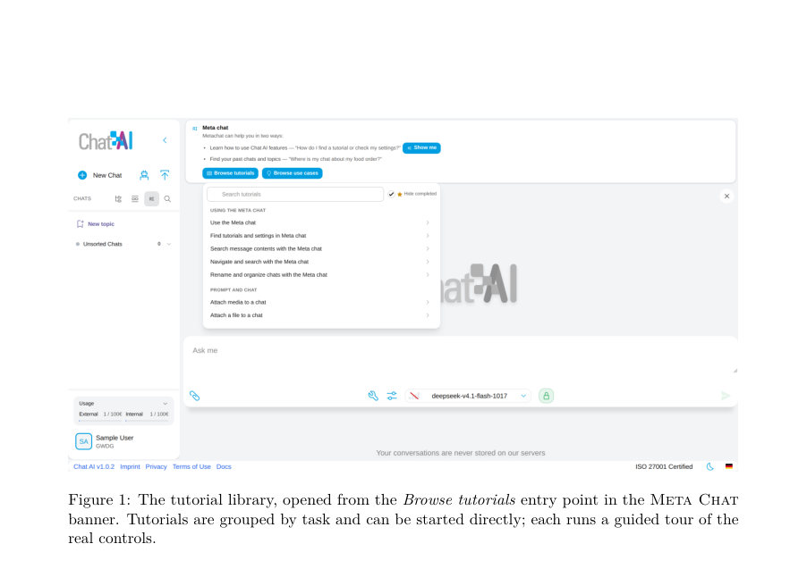
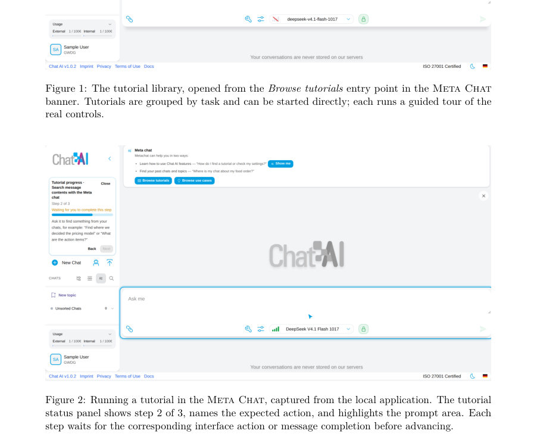
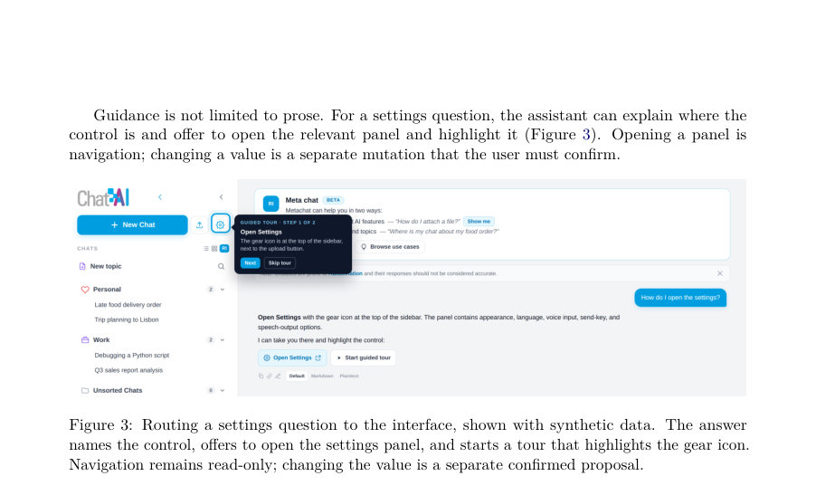

# The Power of Meta Access in the Software of the Future --- Demonstrated on LLM Chat UIs and Chat AI

- **게시일:** 2026-11-08
- **arXiv:** [2611.08428v1](http://arxiv.org/abs/2611.08428v1) · [PDF](https://arxiv.org/pdf/2611.08428v1)
- **저자:** Julian Kunkel, Ali Doosthosseini
- **분야:** cs.AI
- **선정 점수:** 5.86
- **선정 이유:** 최근성 0.5, 인용 영향 0.0 (인용 0회), 저자 영향 1.3 (최고 h-index 6), AI 주제 적합성 3.0, 개발자 관심 0.0, 학술 신호 0.3, 오픈 웨이트·주요 연구조직 신호 0.8

[← 2026-11-08 목록으로 돌아가기](../daily/2026-11-08.html)

<!-- paper-visuals:start -->
## 주요 Figure

> 원문 PDF에서 실제 Figure 캡션과 그림 영역이 함께 확인된 자료만 자동 추출했다.

*Figure · 원문 PDF 9쪽 · Figure 1: The tutorial library, opened from the Browse tutorials entry point in the Meta Chat*

*Figure · 원문 PDF 9쪽 · Figure 2: Running a tutorial in the Meta Chat, captured from the local application. The tutorial*

*Figure · 원문 PDF 10쪽 · Figure 3: Routing a settings question to the interface, shown with synthetic data. The answer*

<!-- paper-visuals:end -->

## 한 문장 요약

사용자 워크스페이스(대화, 토픽, 설정 등)에 대한 구조화되고 권한 기반의 접근권인 '메타 액세스'를 제안하고, Chat AI의 Meta Chat 프로토타입으로 대화형 검색·내비게이션·기능 튜토리얼·확인된 변경(되돌리기 가능) 등을 구현하여 채팅을 전체 워크스페이스의 제어 계층으로 확장하는 설계·가드레일·평가 의제를 제시한다.

## 해결하려는 문제

기존 LLM 채팅 어시스턴트는 현재 대화만 보지만 애플리케이션 전체 워크스페이스(과거 대화, 토픽, 페르소나, 설정, 메모 등)는 모델 시야 밖에 있어 검색·내비게이션·기능 발견·구성 변경을 자연어로 묻거나 자동화할 때 정확성·근거·권한·프라이버시 문제가 발생한다. 또한 범용 에이전트 하니스는 자기 설정을 바꿀 수 있어 ‘반사적(reflexive)’ 권한 상승 문제가 존재한다.

## 핵심 기여

- 메타 액세스의 수준별 사다리(ladder)를 제안: 기능 튜터링(level1), 메타데이터·설정 접근(level2), 요약·메시지 검색(level3), 확인된 변경(level4), 전체 오케스트레이션(level5)과 에이전트 하니스에 대한 반사적(self) 레이블(4S/5S)을 구분.
- 메타 액세스를 AI시대 인터페이스의 일반적 설계 요구사항으로 제시하고, 애플리케이션 메타모델·능력(캡빌리티)·증거·권한 계약·가드레일을 정의하여 채팅을 전체 워크스페이스의 진입점으로 확장하는 아키텍처적 관점을 제시.
- 증거·범위·목표검증·공개·확인·실패 동작으로 구성된 '가드레일 계약'을 제안하여 읽기·작업 능력을 단계별로 연결하고 보안·프라이버시 위험을 다루는 설계 원칙을 구체화.
- Chat AI 클라이언트의 Meta Chat 프로토타입을 통해 구현·시연: 요약 기반 바운디드 컨텍스트, 선택적 메시지 인용 검색, 기능 튜토리얼 및 가이드 투어, 페르소나 추천과 명시적 핸드오프, 확인·되돌리기 가능한 변이 제안 등을 구현하고 어떤 사다리 수준을 충족하는지 보고.
- 메타 액세스의 평가 의제(검색정확성, 과제 성공, 근거·보정, 안전·신뢰, 가드레일 효능)와 연구·공개 문제(요약 신선성, 표준화, 공급망 위험, 반사적 자기구성 등)를 제시.

## 접근 방법

* 설계·시스템 구축 기반의 포지션 논문이다.
* 핵심 방법은 (1) 애플리케이션의 내부 개념(대화, 토픽, 페르소나, 설정, 메모 등)을 추상화한 '워크스페이스 모델'과 이를 외부에 노출하는 '타입화된 능력(capability) 레지스트리'를 정의하고, (2) 모델에 전달되는 컨텍스트를 메타데이터(타이틀, 토픽, 최근성, 설정 값) + 사전생성된 대화 요약 + 필요시 로컬 전수 검색으로 선택적 메시지 발췌(인용 포함)로 구성하여 비용·노출을 제한하며, (3) 모든 변이 동작은 어시스턴트가 직접 실행하지 않고 '타입화된 제안 카드'로 만들어 UI에서 사용자 확인을 거쳐 적용·되돌리기를 허용하는 작업 플로우로 구현했다.
* 구현 세부사항으로는 기능 카탈로그(설명·키워드·가이드 투어 단계), 링크 어휘(대화·메시지·토픽·설정으로의 내부 링크), 로컬 인덱스 기반 전수 메시지 검색, 요약은 대화 종료 시 오프라인 생성, 페르소나 추천은 메타데이터만 노출하고 실제 임포트는 사용자 클릭으로 수행하는 핸드오프 모델을 사용한다.
* 또한 일반 목적 에이전트 하니스의 경우 설정·권한·도구 변경은 별도의 제어평면으로 분리해야 한다는 원칙을 제시했다.

## 주요 결과

- 프로토타입 구현 결과: Meta Chat은 기능 튜터링(가이드 투어·튜토리얼 라이브러리), 워크스페이스 메타데이터 접근(대화 식별자·타이틀·토픽·설정 값·페르소나 목록), 사전생성된 요약과 선택적 메시지 레벨 인용(로컬 전수 검색)을 통해 근거 기반 응답을 생성하고, 링크를 통해 클라이언트 내 해당 대화·메시지·토픽으로 직접 이동·하이라이트 가능하게 함.
- 확인된 변이(레벨4) 일부 구현: 대화 이동·이름 변경, 토픽 생성(이동의 일부), 전역·대화별 설정 변경(모델·온도 등), 메모 추가·편집·삭제·지우기 등은 어시스턴트 제안 → 클라이언트 검증 → 사용자 명시적 수락 후 적용·조건부 되돌리기 형태로 동작. 다만 영구 감사 로그은 미구현 상태로 남아 있음.
- 프로토타입의 범위 표기: 논문 본문에서 구현 범위는 '레벨1–3과 레벨4의 상당 부분(확인·되돌리기 가능한 변이 제안)'으로 명시되어 있으며, 레벨5(전면적 오케스트레이션)와 완전한 감사·토픽 삭제·대화 삭제·아카이브 기능 등은 향후 작업으로 남음.
- 정량적 사용자 연구나 표준 벤치마크 결과는 본문에 제시되지 않음. 대신 평가 의제와 측정 지표(리콜@k, MRR, 참조 정밀도, 작업 성공·시간·턴수, 위조 참조율 등)를 상세히 제안함.

## 한계

- 저자가 명시한 한계: (1) 프로토타입은 계층적·시맨틱 검색이나 임베딩 기반 하이브리드 검색을 사용하지 않고 로컬 전수(lexical) 검색 + 요약의 하이브리드로 구현되어 있어 재현률(특히 오래된 대화의 회수성)이 제한된다. (2) 요약은 손실적이고 오래될 수 있으며, 요약이 빠졌거나 오래된 경우 모델이 발화할 수 없는 정보를 발명하지 못하도록 프롬프트로 제어하고 있지만 신선도·정확성 문제는 남아 있다. (3) 레벨5(오케스트레이션)과 완전한 감사 로그, 일부 파괴적 작업(예: 대화 삭제·아카이브)은 미구현이다.
- 본문에서 합리적으로 확인되는 제약: (1) 프로토타입은 사용자 연구·정량적 비교 결과를 포함하지 않아 실제 사용자 효용(시간 절약·신뢰 등)을 본 논문에서 검증하지 않았다. (2) 메시지 발췌 검색은 어휘 의존적이므로 표현 차이로 인한 누락 가능성이 있으며, 임베딩·시맨틱 검색 미적용으로 장기 검색 성능이 제한된다. (3) 페르소나 공급망 리스크(설명·프롬프트의 신선성·악의적 정의)는 여전히 존재하며, 페르소나 프롬프트를 메타 어시스턴트가 읽지 않도록 하는 설계로 완화했으나 외부 저장소 호출 자체가 개인정보·추적 노출을 유발할 수 있다. (4) 반사적 메타 액세스(일반 목적 하니스에서 자기구성)는 본문에서 설계 원칙을 제시했지만 구현·검증·표준화된 제어평면은 미구현 상태이다.

## 개발자 관점

- 워크스페이스 모델과 타입화된 능력(capability) 레지스트리를 설계하라: 각 능력은 입력·대상 타입·전제조건·읽기/변이 여부·되돌림 가능성·확인 요구사항을 선언해야 한다(클라이언트가 강제할 수 있도록).
- 컨텍스트 조립은 계층화하라: 메타데이터(타이틀·토픽·설정) → 요약 → 필요시 메시지-레벨 발췌 순으로 구성하고 요약 신선도·크기 한계는 응답에 명시적으로 드러내라.
- 변이는 항상 '제안 카드' 패턴으로 구현하라: 어시스턴트는 변이 제안만 만들고 클라이언트가 목표 검증·프리뷰·diff·경고 아이콘을 제공한 뒤 사용자 명시 승인으로 적용하라. 되돌리기 가능성은 현재 상태 일치 검증을 통해 안전하게 구현하라.
- 페르소나·서드파티 정의는 메타 어시스턴트의 컨텍스트에서 비신뢰(untrusted)로 취급하라: 메타 계층에는 메타데이터(타이틀·설명)만 노출하고 실제 프롬프트·설정 임포트는 사용자가 명시적으로 실행하게 하라.
- 보안·프롬프트 인젝션 방어: 검색으로 가져온 텍스트를 '데이터'로 취급하고 명령 채널과 분리하라. 권한 상승(도구·플러그인 등록·네트워크 접근 등)은 어시스턴트가 자체 승인할 수 없게 제어평면 밖에서 관리하라(감사·롤백·드라이런 필요). 클라이언트 측에서 가드레일 계약(증거 출처·범위·타깃 검증·공개·확인·실패 동작)을 코드로 강제하라.  또한 페르소나 임포트나 외부 정의 fetch는 사용자에게 가시화하라(네트워크 호출·출처 표시).

**근거 범위:** 논문 PDF 본문(모든 페이지)을 기반으로 분석하였다. 본문에 구현된 기능·제약·설계 원칙과 평가 의제는 명시적으로 기술되어 있으나, 사용자 연구나 정량적 실험 수치(성능 지표)는 본문에 포함되어 있지 않아 해당 항목은 제공하지 않았다. 또한 프로토타입의 내부 구현 세부(예: 정확한 검색 알고리즘 파라미터, 모델 종류별 성능)는 본문에서 구체적 수치로 제시되지 않아 생성하지 않았다.
