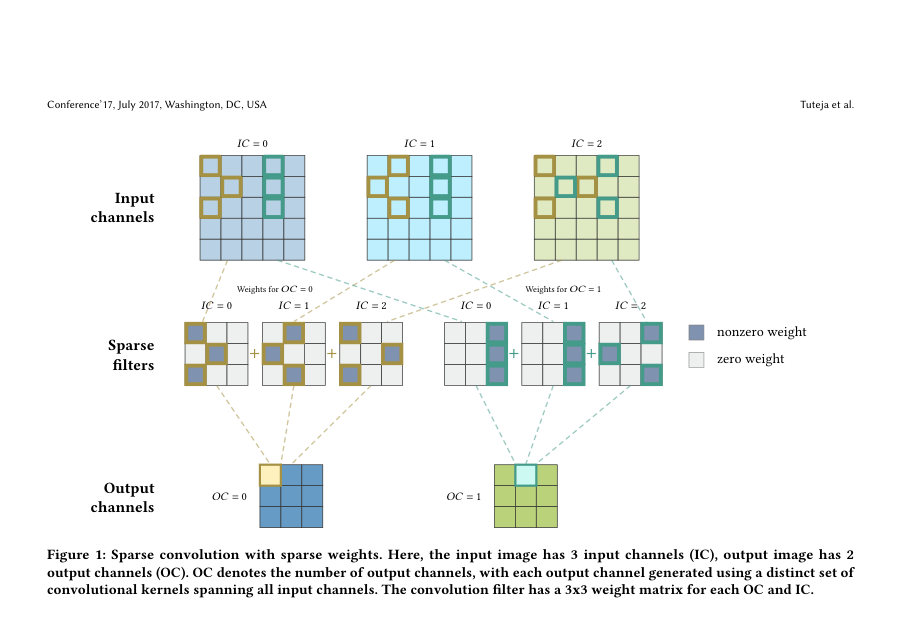
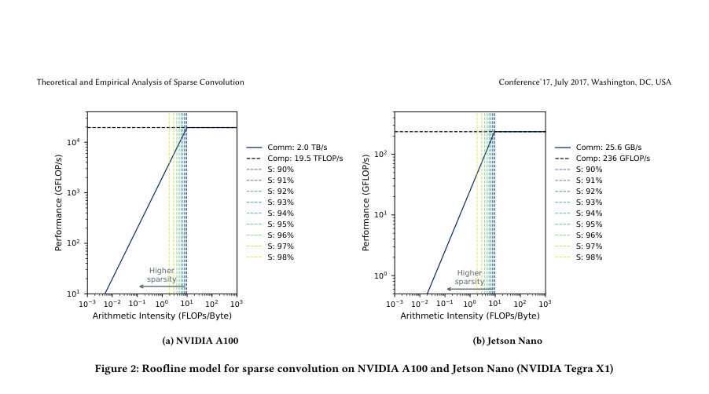
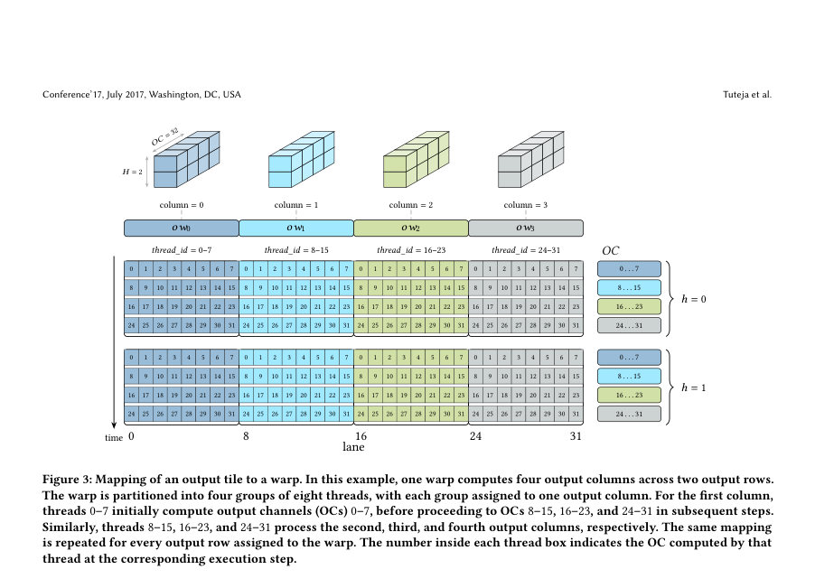

# Theoretical and Empirical Analysis of Sparse Convolution

- **게시일:** 2026-11-14
- **arXiv:** [2611.17212v1](http://arxiv.org/abs/2611.17212v1) · [PDF](https://arxiv.org/pdf/2611.17212v1)
- **저자:** Keshvi Tuteja, Yu-Hsiang Tsai, Gregor Olenik, Markus Götz, Achim Streit, Hartwig Anzt, Charlotte Debus
- **분야:** cs.PF, cs.DC, cs.LG
- **선정 점수:** 5.04
- **선정 이유:** 최근성 0.7, 인용 영향 0.0 (인용 0회), 저자 영향 0.0 (최고 h-index 0), AI 주제 적합성 1.9, 개발자 관심 0.7, 학술 신호 0.3, 오픈 웨이트·주요 연구조직 신호 1.4

[← 2026-11-14 목록으로 돌아가기](../daily/2026-11-14.html)

<!-- paper-visuals:start -->
## 주요 Figure

> 원문 PDF에서 실제 Figure 캡션과 그림 영역이 함께 확인된 자료만 자동 추출했다.

*Figure · 원문 PDF 4쪽 · Figure 1: Sparse convolution with sparse weights. Here, the input image has 3 input channels (IC), output image has 2*

*Figure · 원문 PDF 5쪽 · Figure 2: Roofline model for sparse convolution on NVIDIA A100 and Jetson Nano (NVIDIA Tegra X1)*

*Figure · 원문 PDF 6쪽 · Figure 3: Mapping of an output tile to a warp. In this example, one warp computes four output columns across two output rows.*

<!-- paper-visuals:end -->

## 한 문장 요약

3×3 컨볼루션에서 고비율 희소 가중치를 효율적으로 활용하기 위해 32-bit로 패킹한 희소 가중치 포맷, 공유 메모리 타일링, 워프·스레드 매핑을 결합한 direct sparse convolution 커널을 제안하고 roofline 분석 및 GPU/엣지 장치 실험으로 성능 이점을 보였다.

## 해결하려는 문제

딥넷에서 훈련 시 얻어지는 고비율(90%–98%)의 가중치 희소성은 이론적으로 FLOP·메모리 전송량을 크게 줄이지만, 런타임에서는 비연속적 인덱스 접근과 출력 채널·타일별 불균형으로 인해 메모리 비효율·로드 불균형이 발생해 이론적 이점이 실제 성능 이득으로 이어지지 않는다. 특히 3×3 커널의 경우 희소화로 연산 대비 메모리 비율(Arithmetic Intensity, AI)이 대폭 낮아져(예: dense ≈96 FLOP/byte → sparse ≈9.6 FLOP/byte@90% S) 메모리 대역폭 병목이 지배적이 된다.

## 핵심 기여

- 3×3 direct sparse convolution의 roofline 분석을 통해 희소성 증가가 AI를 얼마나 감소시키고 메모리-바운드로 이동시키는지 정량화함(예: Table 1: S=0.90→AI=9.6, S=0.98→AI=1.9).
- 32-bit packed weight 포맷(FP16 값 + 16비트 메타데이터)과 공유메모리 타일링, 워프·스레드 매핑을 결합한 CUDA 기반 sparse direct convolution 커널 설계 및 구현.
- A100(데이터센터 GPU)와 Jetson Nano(엣지 장치)에서 PyTorch의 dense convolution과 비교한 실험적 평가를 수행하여 최대 1.65×(A100) 및 1.52×(Jetson Nano)의 속도 향상을 보고함.
- 연구산출물(코드·벤치마크·플롯 스크립트)을 공개한 아티팩트 설명 및 재현성 안내 제공(저자 GitHub 리포지토리 언급).

## 접근 방법

* (아키텍처·알고리즘 개요) 기본 아이디어는 '가중치만 희소화된(sparse weights, dense activations) direct convolution'을 직접 수행하면서 메모리 병목과 불균형을 완화하는 것이다.
* 주요 기술 구성은 다음과 같다: (1) 공유메모리 타일링: 각 블록이 입력 타일(halo 포함)을 DRAM에서 한 번만 읽어 shared memory에 저장하고 블록 내의 모든 출력(여러 OC·행)에 재사용해 글로벌 메모리 트래픽을 줄임.
* (2) 32-bit packed weight 포맷: 각 비영(非0) 원소를 FP16 값(상위 16비트)과 하위 16비트의 인덱스·오프셋(입력 채널 8비트, 커널 컬럼 4비트, 커널 행 4비트)으로 패킹하여 하나의 32-bit 로드로 값과 메타데이터를 동시에 가져와 메모리 접근을 정렬·코얼레스팅 가능하게 함.
* (3) 워프·스레드 매핑: 워프를 여러 그룹(예: 4 그룹×8스레드)으로 나누어 각 그룹이 타일의 서로 다른 출력 열과 OC들을 처리하게 하여, 출력 채널별로 비슷한 희소성이 있을 때 스레드 간 부하 균형을 개선함.
* 구현 세부(본문 기준): FP16로 저장한 가중치는 로드 후 FP32로 변환하여 FMA로 누적하고 출력은 FP32로 기록한다.
* 알고리즘은 논문의 Algorithm 1과 유사하게 블록 협력 로드→비영 원소 순회(패킹 해제)→shared 메모리에서 입력값 불러와 누적→출력 기록 순으로 동작한다.

## 주요 결과

- 하드웨어/설정: NVIDIA A100 (HoreKa)에서 H=W=256, N=32, IC=32, K=3; Jetson Nano (Tegra X1)에서 H=W=128, N=8, IC=16. 비교 대상은 PyTorch의 dense convolution(주로 Winograd 가속 사용 가능)이며, 가중치는 랜덤으로 생성된 희소 커널(재현 스크립트 포함).
- Arithmetic Intensity/roofline: dense 3×3의 AI ≈ 96 FLOP/byte(본문 계산). 희소화에 따라 AI 감소: 예시 Table 1값: S=0.90→AI=9.6, 0.91→8.6, 0.92→7.7, 0.93→6.7, 0.94→5.7, 0.95→4.8, 0.96→3.8, 0.97→2.9, 0.98→1.9. A100의 FP32 ridge ≈9.75 FLOP/byte(본문 언급).
- 실측 속도: NVIDIA A100에서 최대 1.65× 속도향상(예: OC=80, S=98%) 보고. 성능 크로스오버 지점: OC=64 근방에서 ≈91% sparsity, OC=112/128 근방에서 ≈92% sparsity에서 sparse가 dense를 앞섬. 작은 OC에선 높은 희소도에서만 이득 발생. (그림·본문 상세 수치와 에러바: 평균·표준오차 기반, 각 실험은 10회 벤치마크(각 40회 실행)로 측정).
- Jetson Nano(엣지): OC=40에서 S=91%→속도비 1.19×, S=98%→1.52×; OC=48: 1.11×→1.42×; OC=32: 0.76×→0.94×로 희소성 증가에 따라 향상되나 OC 의존성 존재. 최대 보고값은 1.52×(Jetson Nano).
- 성능 관찰: 실제 측정 성능은 roofline 이론 상한(메모리 대역폭·연산 피크)보다 낮음. 저자 측정에서 비연속 메모리 접근과 코얼레스팅 손실로 HBM 대역폭 활용률 저하가 주요 원인으로 지적됨. 또한 FP16로의 1회 양자화와 합산 항 수 감소로 인한 최대 절대 오차가 존재(본문의 Fig.8, 에러가 희소도 증가 시 감소).

## 한계

- 저자가 명시한 한계(논문 본문에 명시): (1) 평가가 3×3 커널·stride=1에 한정되어 있으며 더 큰 커널·입력 차원에서 동일한 이득을 얻기 어려움. (2) roofline 모델은 이상적 메모리 거동·완전한 중첩·완전한 균형을 가정하므로 실험에서 이론적 상한에 도달하지 못함(불규칙 접근, 인덱스 디코딩 오버헤드, 캐시 지역성 저하, 불균형 등). (3) 범용 GPU/엣지 가속기는 본질적으로 정형·밀집 연산에 최적화되어 있어 희소 연산을 효율적으로 지원하려면 하드웨어 수준의 변경이 필요할 수 있음.
- 본문에서 합리적으로 확인되는 제약(저자와 구분): (a) 실험은 랜덤 희소 커널로 수행되었으며 실제 pruning된 네트워크(ResNet 등)에 대한 end-to-end inference·정확도 영향·에너지 효율 측정은 아직 수행되지 않음(저자도 향후 계획으로 언급). (b) 구현 세부(예: 블록·타일 크기, COL_PER_WARP 값, shared memory 레이아웃 파라미터)는 논문 본문에서 구체적 숫자로 모두 제시되지 않아 완전 동일 재현에 추가 튜닝이 필요할 가능성 있음. (c) 비교 대상은 PyTorch dense conv(프로그래머블 라이브러리)이며 Winograd 대비 이론적 비교표는 낙관적 가정(연산 감소 1.5×, 통신·연산 완전 중첩 등)을 포함함—실제 실무 환경에서의 상대적 이득은 달라질 수 있음. (d) FP16로 패킹하는 설계는 수치 오차를 유발(본문의 최대 절대오차 결과 보여줌)하므로 모델 정확도 관점에서 추가 평가 필요.
- developer_takeaways':['재현성·구현 요구사항: CUDA 기반 구현(CUDA 12.2 권장), pybind11 바인딩, CMake 및 Python 환경 필요. 논문 리포지토리(본문에 명시) https://github.com/keshvituteja/sparseconv 에 아티팩트·빌드 스크립트·벤치마크가 제공되어 재현 가능(논문부록에 설치·실행 안내와 예상 재현 시간 40–70분 제시).','성능 설계 시 고려사항: 희소 연산은 AI가 낮아 메모리 최적화(코얼레스팅·shared 메모리 재사용)가 핵심이며, packed weight 포맷(값+메타데이터를 32-bit로 합침)은 글로벌 메모리 접근 수·비연속성을 줄이는 데 효과적.','스케일·매핑 민감도: 제안 매핑은 출력 채널별 희소성이 유사할 때 부하 균형이 잘 맞음. 단, OC가 너무 크면 블록/그리드 분할로 오버헤드가 생기므로 레이어별 OC 수에 따른 매핑·타일 파라미터 튜닝이 필요함.','정확도·정밀도 영향: 가중치를 FP16으로 1회 양자화하여 저장하므로 수치 오차가 발생할 수 있음—정밀도 민감한 애플리케이션은 FP16 양자화 영향 검증 필요.','배포·비용: 엣지 장치(예: Jetson Nano)에서도 실측 이득 확인되나, 소프트웨어 스택(예: JetPack·PyTorch 버전)이 기기에 고정되는 경우가 많아 실제 배포 시 호환성·빌드 환경 제어가 중요함.','향후 실무 적용 제안: 전체 프루닝된 네트워크(예: ResNet 시리즈)로 end-to-end 평가(지연, 에너지, 정확도), 레이어별 희소도·OC·IC에 맞춘 자동 튜닝 도구, 혹은 희소 연산을 하드웨어적으로 지원하는 가속기와의 결합을 고려할 것.'], 
- keywords

## 개발자 관점

- 재현성·구현 요구사항: CUDA 기반 구현(CUDA 12.2 권장), pybind11 바인딩, CMake 및 Python 환경 필요. 논문 리포지토리(본문에 명시) https://github.com/keshvituteja/sparseconv 에 아티팩트·빌드 스크립트·벤치마크가 제공되어 재현 가능(논문부록에 설치·실행 안내과 예상 재현 시간 40–70분 제시).
- 성능 설계 시 고려사항: 희소 연산은 AI가 낮아 메모리 최적화(코얼레스팅·shared 메모리 재사용)가 핵심이며, packed weight 포맷(값+메타데이터를 32-bit로 합침)은 글로벌 메모리 접근 수·비연속성을 줄이는 데 효과적.
- 스케일·매핑 민감도: 제안 매핑은 출력 채널별 희소성이 유사할 때 부하 균형이 잘 맞음. 단, OC가 너무 크면 블록/그리드 분할로 오버헤드가 생기므로 레이어별 OC 수에 따른 매핑·타일 파라미터 튜닝이 필요함.
- 정확도·정밀도 영향: 가중치를 FP16으로 1회 양자화하여 저장하므로 수치 오차가 발생할 수 있음—정밀도 민감한 애플리케이션은 FP16 양자화 영향 검증 필요.
- 배포·비용: 엣지 장치(예: Jetson Nano)에서도 실측 이득 확인되나, 소프트웨어 스택(예: JetPack·PyTorch 버전)이 기기에 고정되는 경우가 많아 실제 배포 시 호환성·빌드 환경 제어가 중요함.,

**근거 범위:** 이 분석은 제공된 논문 PDF 본문(페이지 1–12)에서 직접 발췌한 내용에 기반함. 표·그림·알고리즘·아티팩트 표기(예: Table 1, Algorithm 1, Figures 2–8, Github 링크) 등 본문에서 확인 가능한 정보만 사용했으며, 논문에 구체적으로 기술되지 않은 런치 파라미터(예: 정확한 타일/블록 크기, COL_PER_WARP 값 등)나 추가 하드웨어 튜닝 수치는 임의로 생성하지 않았음. 일부 수치(예: AI, ridge point, speedup)는 논문 본문에 직접 명시된 값을 인용했으며, 제안된 방법의 적용 범위(예: 3×3 stride=1에 대한 평가 제한)와 랜덤 희소 커널 사용 등 본문에 명시된 한계는 분명히 구분하여 기술함.
