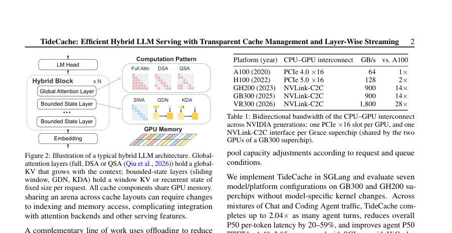
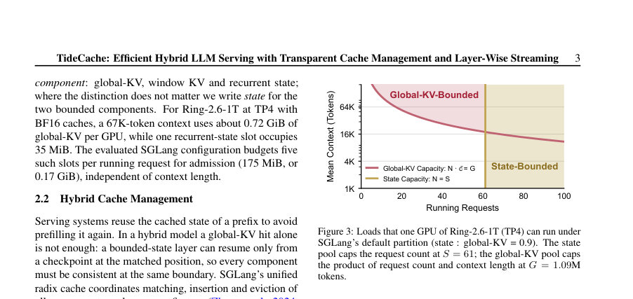
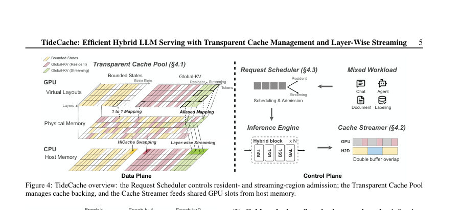

# TideCache: Efficient Hybrid LLM Serving with Transparent Cache Management and Layer-Wise Streaming

- **게시일:** 2026-11-21
- **arXiv:** [2611.26619v1](http://arxiv.org/abs/2611.26619v1) · [PDF](https://arxiv.org/pdf/2611.26619v1)
- **저자:** Jinbin Luo, Xiaozhe Yao, Shang Yang, Zhijian Liu, Song Han, Qinghao Hu
- **분야:** cs.DC, cs.LG
- **선정 점수:** 6.54
- **선정 이유:** 최근성 0.7, 인용 영향 0.0 (인용 0회), 저자 영향 0.0 (최고 h-index 0), AI 주제 적합성 2.9, 개발자 관심 1.0, 학술 신호 0.3, 오픈 웨이트·주요 연구조직 신호 1.6

[← 2026-11-21 목록으로 돌아가기](../daily/2026-11-21.html)

<!-- paper-visuals:start -->
## 주요 Figure

> 원문 PDF에서 실제 Figure 캡션과 그림 영역이 함께 확인된 자료만 자동 추출했다.

*Figure · 원문 PDF 2쪽 · Figure 2: Illustration of a typical hybrid LLM architecture. Global-*

*Figure · 원문 PDF 3쪽 · Figure 3: Loads that one GPU of Ring-2.6-1T (TP4) can run under*

*Figure · 원문 PDF 5쪽 · Figure 4: TideCache overview: the Request Scheduler controls resident- and streaming-region admission; the Transparent Cache Pool*

<!-- paper-visuals:end -->

## 한 문장 요약

하이브리드 LLM의 서로 다른 캐시(글로벌-KV, 윈도우/순환 상태)를 CPU–GPU 슈퍼칩의 호스트 메모리와 HBM 사이에서 투명하게 재분배하고, 각 글로벌-어텐션 레이어의 접두(prefix)를 레이어 단위로 스트리밍하여 HBM 사용률을 개선하는 서버 시스템 TideCache를 제안한다.

## 해결하려는 문제

하이브리드 아키텍처(몇 개 레이어만 전역 어텐션을 가지는 모델)는 글로벌-KV와 bounded-state(슬라이딩 윈도우·순환)로 heterogeneous한 캐시를 유지하며, 요청의 문맥 길이와 동시성에 따라 어느 구성요소가 병목이 될지 달라진다. 기존 방식(정적 파티셔닝)은 한 구성요소가 포화될 때 다른 구성요소가 유휴인 반면 메모리를 고정 배분해 비효율이 생긴다. 동적 공유(예: SGLang UMP, vLLM Hybrid KV Manager)는 레이아웃·인덱싱 변경이나 백엔드 수정이 필요하거나 HiCache 같은 호스트오프로드는 복원된 접두가 토큰 생성 동안 계속 GPU에 상주해 HBM을 차지한다. 또한 디코드 동안 CPU–GPU 링크가 대부분 유휴인 기회를 활용하지 못하고 있다.

## 핵심 기여

- 하이브리드 모델 서빙에서 ‘유휴 파티션 용량’과 ‘디코드 시간대의 유휴 CPU–GPU 대역폭’이라는 두 지점의 최적화 기회를 규명함.
- Transparent Cache Pool(TCP)를 설계·구현하여 각 캐시 구성요소마다 고정된 가상 주소 레이아웃을 유지하면서 물리 페이지만 재맵핑해 GPU 페이지 아레나를 런타임에 무복사(repartitioning)로 재분배함(기존 백엔드·인덱싱 불변).
- Cache Streamer를 도입해 bounded-state 레이어가 계산하는 간격을 이용하여 다음 글로벌-어텐션 레이어의 접두를 호스트→디바이스로 레이어-단위로 프리페치하고, 레이어들 사이에 M(예:2)개의 공유 슬롯을 alias 매핑해 이중버퍼로 전송을 연산과 겹치게 함.
- Request Scheduler를 제안해 헤드 요청에 대해 resident/streamed 실행을 선택하고 큐·요청 크기에 따라 TCP의 용량 조정을 트리거하여 스트리밍으로 확보된 HBM을 다른 캐시 구성요소와 추가 요청에 재할당하도록 조율함.

## 접근 방법

* 시스템 아키텍처(요약): TideCache는 세 구성요소로 동작한다.
* (1) Transparent Cache Pool(TCP): CUDA 가상 메모리 API(cuMemMap/cuMemUnmap)를 사용해 2MiB 페이지 단위의 물리 아레나를 한 번 할당하고, 각 캐시 구성요소(글로벌-KV, 윈도우 KV, 순환 상태)는 넉넉한 가상 주소 범위를 예약하되 실제 페이지 수는 런타임에 증감시킨다.
* TCP는 E=8 포워드 패스(epochs) 단위로 최대 한 건의 페이지 이동을 비동기 워커로 수행한다(계획→주차(park)→step fence→unmap/map→apply).
* 성장 자원은 순서대로: 자유 페이지, 다른 서브풀의 아이들 행(row) 회수, τ초 이상 접근하지 않은 '콜드' 접두의 강제 회수(저자 정책).
* (2) Cache Streamer: 글로벌-KV 서브풀을 resident 영역과 streaming 영역으로 나누고, streaming 영역의 L 계층 가상 범위를 M(예:2) 슬롯에 alias 매핑한다.
* 호스트에 있는 역사적 접두만 스트리밍 대상으로 삼고, 생성된 KV는 항상 resident로 둔다.
* 전송은 그래프 호환(handshake) 방식으로 설계되어, CUDA 그래프를 깨지 않고 cudaMemcpyBatchAsync로 선택적 호스트→디바이스 복사를 제출한다.
* 각 슬롯은 READY/FREE 플래그로 송수신 동기화하며 이중버퍼로 H2D 전송과 GPU 읽기를 겹치게 한다.
* (3) Request Scheduler: 각 요청 r에 대해 필요한 state 슬롯 ns, uncached global-KV 행 nf, 호스트에 있는 접두 길이 h를 고려해 resident 실행(nf+h) 또는 streamed 실행(nf resident + h streamed)을 결정하고, 스트리밍할 총 행 A가 대역폭-기반 바운드 C(오프라인 캘리브레이션으로 산출; 식(1): C = η·BW·T / (L·b)) 내에 들어야 허용한다.
* 만약 용량이 부족하면 TCP에 성장(GROW)을 요청한다.
* 스케줄러는 PRESSURE 추정(대기열의 요구, 평균 출력 길이·도착률 등)을 사용해 스트리밍을 할지 판단한다.
* 구현 세부: SGLang에 약 9K 라인 추가, CUDA graph와 attention 백엔드 변경 불필요, HiCache와 연동.

## 주요 결과

- 평가 환경: GB300(4 GPUs/각 288GiB HBM3e, NVLink-C2C, 측정 H2D 211 GB/s) 및 GH200(Grace+H100, NVLink-C2C)에서 7개 모델/플랫폼 조합(예: Kimi K3, Ring-2.6-1T, GLM-5.3-Flash, Qwen3.8 등)로 실험. 워크로드는 ShareGPT 트레이스(독립 요청)와 Claude Code multi-turn 세션을 혼합해 구성. 측정 지표는 turns/s(에이전트 세션 턴 완수율), P50 per-token latency(창출 토큰당 지연의 중앙값), P50 TTFT(세션 요청의 첫 토큰까지 지연 중앙값).
- 주요 정량 성능: TideCache는 SGLang with HiCache(최적 분할 사용) 대비 모델/설정에 따라 최대 2.04× 많은 agent turns를 완료했고, 전체 P50 per-token latency를 20–59% 감소시켰으며 agent P50 TTFT를 1.40–3.05× 향상시켰다(논문 본문 Fig.9).
- Transparent Cache Pool 단독 성능: GPU 전용 비교에서 TCP는 고정 파티션의 더 나은 설정 대비 96.3–113.6%의 turns/s를 달성(튜닝 없는 적응으로 고정 파티션과 유사하거나 더 좋음), UMP과 비교 시 Kimi K3에서 0–3.7% 높은 throughput을 보임(본문 Fig.11).
- 변동 워크로드 적응: Qwen3.8-27B / GH200의 3단계(300s 밀어 올림/다운) 실험에서 TideCache(스트리밍 포함)는 HiCache 대비 59% 더 많은 agent turns를 완료했고 전체 P50 per-token을 63.4→39.3 ms(38% 감소), agent P50 TTFT를 25.70→5.68 s(78% 감소)로 개선함(본문 Fig.10).
- 스트리밍 용량·오버헤드: GPT-OSS-120B ablation의 이론적 예시에서 L=18, b=2KiB, M=2, D=147,648, T=13.16 ms, BW(설정)≈400 GB/s, η=0.9이면 C≈128.5K 행으로 약 77% 용량 증가(실제 설정으로는 147K→260K 토큰(약1.76×)). 시스템 오버헤드는 decode-step에서 −1.1%에서 +6.3% 범위였고, 최대 sustained batch는 16→29로 늘었으며 피크 해독 처리량은 1.19K→1.47K tok/s(24% 증가)로 보고됨(본문 Sec.5.3, Fig.13).

## 한계

- 저자가 명시한 한계: (1) 구현은 SGLang 기반이며 평가 결과는 GB300/GH200 같은 NVLink-C2C급 고대역폭 슈퍼칩에서 얻은 것임(논문에서 측정 대역폭 211 GB/s 등 명시). (2) 시스템은 동일 가상 레이아웃 유지, 슬롯 개수 M과 슬롯 매핑은 시작 시 고정하고 스트리밍 슬롯 용량 C는 오프라인 캘리브레이션으로 산정한다고 명시함. (3) 구현은 전체 decode-step에 대해 최대 +6.3%의 추가 지연을 초래할 수 있음을 보고함.
- 본문에서 합리적으로 확인되는 제약(추정 아님으로 분리): (A) TideCache는 높은 CPU–GPU 양방향 대역폭을 전제로 설계되므로 PCIe4/5 수준의 낮은 링크 대역폭 환경에서는 이득이 크게 줄어들 가능성이 높음(평가에 NVLink 장비만 사용). (B) 스트리밍은 '호스트에 이미 있는 역사적 접두'만 대상으로 하며 새로 생성된 KV는 항상 GPU에 상주시키므로, 매우 긴 생성 동안에도 일부 HBM 부담은 남음. (C) TCP의 페이지 이동은 epoch(예: E=8) 단위 및 드라이버 수준의 cuMem* 호출에 의존하므로 드라이버·플랫폼 호환성(및 잠재적 레이턴시 버스트)이 필요함. (D) 평가 워크로드는 ShareGPT·Claude Code 기반의 합성 혼합이므로 실제 운영 환경(다양한 우선순위·SLO·다중 모델)에서의 일반화는 추가 검증이 필요함.

## 개발자 관점

- 재현·구현: 구현은 SGLang에 약 9K 코드 추가로 이루어졌고, 핵심은 CUDA 가상 메모리 API(cuMemMap/unmap)와 cudaMemcpyBatchAsync를 사용한 물리 페이지 재맵핑·선택적 H2D 전송, 그리고 CUDA 그래프 내의 소형 ‘핸드셰이크’ 커널(READY/FREE 플래그)이다. 따라서 재현하려면 드라이버가 cuMem* 가상 메모리 API와 배치 복사(cud aMemcpyBatchAsync)를 지원해야 하고, GPU↔호스트 고대역폭 인터커넥트(NVLink 등)가 필요하다.
- 배치·튜닝: 스트리밍 바운드 C는 오프라인 캘리브레이션(대역폭·레이어 수·계산시간 T 기반)으로 산정해야 하며, 초기 state:global-KV 분할을 고정해도 TideCache가 자동으로 재분배하므로 운영 중에도 재조정할 수 있다. hmin(최소 스트리밍 길이), τ(콜드 임계값), epoch 길이(E) 등 하이퍼파라미터가 성능과 캐시 유실 위험에 민감하므로 워크로드별로 모니터링·튜닝 필요.
- 운영·배포: 호스트에 있는 접두를 더 많이 활용하려면 HiCache(혹은 유사 백업)와 함께 동작시켜 접두를 호스트에 보관해야 한다. TCP가 콜드 접두를 회수할 수는 있으나 hot prefix를 실수로 제거하지 않도록 콜드 임계값과 성장 정책(대기 큐 길이에 따른 팩터)을 보수적으로 설정해야 한다.
- 비용·성능 균형: TideCache는 HBM을 더 효율적으로 재분배하고 호스트 대역폭을 활용해 동시 세션 수와 턴 완료율을 늘리므로, 동일한 GPU 자원에서 처리량을 늘리려는 서비스에 비용 효율적이다. 그러나 NVLink 같은 고성능 인터커넥트가 없으면 혜택 감소 가능성이 크다.
- 안전성·호환성: TCP는 가상 주소·인덱스 레이아웃을 유지하므로 기존 어텐션 백엔드·CUDA 그래프·HiCache와의 호환성이 높다. 다만 cuMemMap/unmap·페이지 액세스 권한 설정 등 저수준 메모리 조작에 의존하므로 드라이버 안정성·권한 정책을 검토해야 한다.

**근거 범위:** 이 분석은 제공된 논문 PDF 본문(본문 텍스트, 그림 캡션, 표 및 알고리즘 서술)을 근거로 작성되었음. 성능 수치·설정(예: GB300 H2D 211 GB/s, GPT-OSS 예시의 L,b,M,D,T,BW,η 수치, ±6.3% decode 오버헤드 등)은 전부 본문에 직접 명시된 값이다. 다만 그림·표의 시각적 요소나 부연 설명 일부는 텍스트 추출 과정에서 요약되어 표현했으며, 구현 세부(코드 경로·정확한 API 호출 순서 등)는 논문이 서술한 수준을 넘지 않아 추가 내부 구현 세부사항이 필요하면 원문 섹션(4,5)을 참조할 것을 권함.
