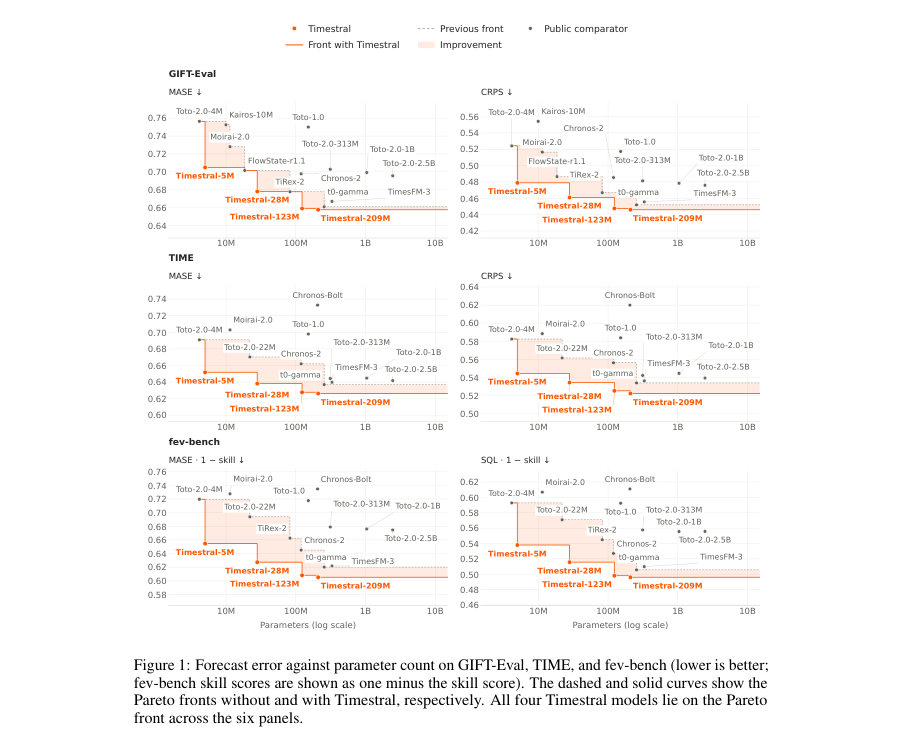
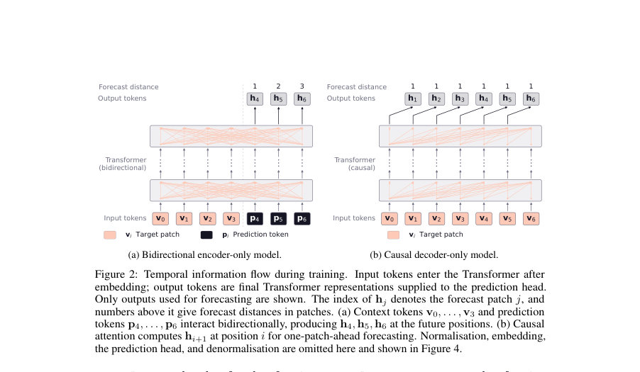
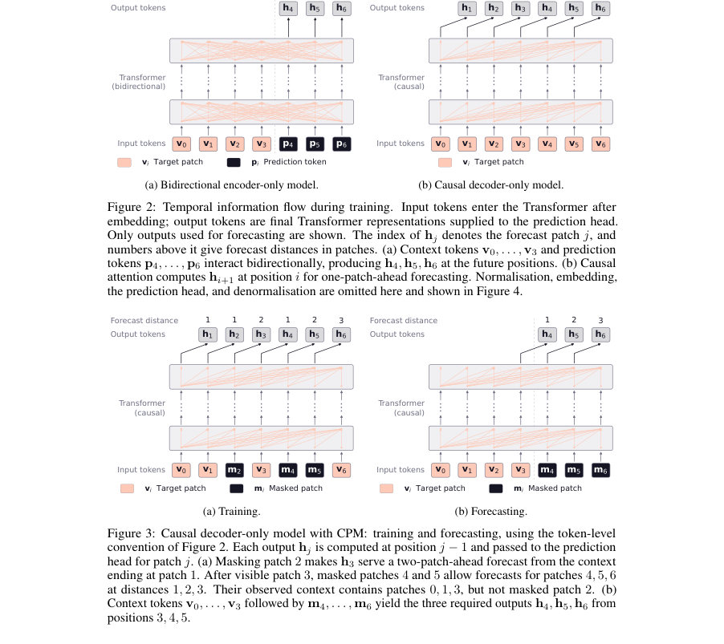

# Timestral

- **게시일:** 2026-10-29
- **arXiv:** [2610.37585v1](http://arxiv.org/abs/2610.37585v1) · [PDF](https://arxiv.org/pdf/2610.37585v1)
- **저자:** Adrien Petralia, Alexandre Gavaudan, Artjom Joosen, Etienne Goffinet, Richard Kurle, Yassine El Ouahidi, Yassir Bendou, Abdelaziz Bounhar, Abhijeet Somani, Aditi Kabra, Adrian Valente, Adrien Sadé, Ahmed Djermani, Alan Jeffares, Albert Jiang, Alberto Bietti, Aleksandr Timashov, Alexandre Cahill, Alexandre Laval, Alexandre Sablayrolles, Alexandros Sanchez Vassopoulos, Amélie Héliou, Amos You, André Jonasson, Andreas Fürst, Andrew Bai, Andrew Ehrenberg, Andrew Zhao, Andy Lo, Angele Lenglemetz, Anmol Agarwal, Antonia Calvi, Arata Suzuki, Arjun Majumdar, Arthur Fournier, Ashwani Kumar, Augustin Lombard, Avinash Sooriyarachchi, Aylin Guliz Akkus, Aysenur Karaduman, Baptiste Bout, Baptiste Rozière, Barna Pásztor, Baudouin De Monicault, Benjamin Holzschuh, Benjamin Tibi, Benno Stein, Bernhard Stadlbauer, Bhargavi Bhaskar, Binbing Hou, Błażej Osiński, Boris van Breugel, Camille Le Scao, Chaoran Yu, Charlotte Cronjäger, Chen-Yo Sun, Chris Bamford, Christian Wallenwein, Christophe Renaudin, Clémence Lanfranchi, Colin Bonatti, Corentin Barreau, Corentin Sautier, Cristiana-Diana Diaconu, Cyprien Courtot, Daniel Lopes, Daniel Marczak, Darius Dabert, Diego de las Casas, Dominik Nuss, Dylan Rubini, Dzmitry Soupel, Elizaveta Demyanenko, Elliot Chane-Sane, Emilien Fugier, Emmanuel Gottlob, Erik Aas, Etienne Duchesne, Fabian Paischer, Fabian Schlager, Faruk Ahmed, Federico Baldassarre, Félix Rosseeuw, Filip Szatkowski, Filippo Vicentini, Florian Wiesner, Gabrielle Berrada, Gaëtan Ecrepont, Gaspard Blanchet, Gaspard Donada-Vidal, Gaurav Mahajan, Gauthier Guinet, Genevieve Hayes, Georgii Novikov, Georgios Christoglou, Giada Pistilli, Gonzague de Carpentier, Graeme Nail, Guillaume Breton, Guillaume Kunsch, Guillaume Lample, Guillaume Martin, Guillaume Raille, Guillaume Richard, Guillem Simeon, Gunjan Dhanuka, Gunshi Gupta, Hamza Senhaji Rhazi, Han Zhou, Hédi Hadiji, Himanshu Jaju, Hope McGovern, Hubert de Parseval, Hugo Cisneros, Hugo Germain, Hugo Thimonier, Hugo Venturini, Hyeonju Lee, Hyunwoo Oh, Iliass Lasri, Ilyas Oulkadda, Jacques Sun, Jan Ludziejewski, Jason Rute, Jean de Becdelièvre, Jean Quentin, Jean-Malo Delignon, Jessica Chudnovsky, Jianchao Li, Jie Zhang, Jin Bin Ou, Joachim Studnia, Joep Barmentlo, Johannes Brandstetter, John Harvill, Jonas Amar, Jonas Schweizer, Jonathan Roberts, Joséphine Delas, Josselin Somerville, Jules Depersin, Julien Denize, Julien Tauran, Julien Verlaguet, Kartik Khandelwal, Khyathi Raghavi Chandu, Kilian Tep, Konstantin Mishchenko, Kris Szczepaniak, Kush Jain, Larissa Laich, Laura Calem, Laurence Aitchison, Laurent Callot, Laurent Fainsin, Léo Cotteleer, Léonard Blier, Loïc Chadoutaud, Loïck Chambon, Lorenzo Proietti, Louis Faucon, Louis Martin, Louis Serrano, Lu Li, Luc Boudier, Lucas Fernandes Martins, Lucas Mebille, Lucile Saulnier, Ludovic Ho Fuh, Luis Montero, Łukasz Borchmann, Maarten Buyl, Malik Hassan Raza, Manon Chossegros, Marcin Możejko, Margaret Jennings, Markus Hennerbichler, Martin Alexandre, Mathieu Poirée, Mathieu Schmitt, Mathilde Guillaumin, Mathis Felardos, Matthieu André, Matthieu Dinot, Matthieu Futeral, Maurits Bleeker, Mauro Comi, Max Mynter, Maxim Berman, Maxime Darrin, Maxime Langelier, Maxime Louis, Maximilian Augustin, Maximilian Müller, Mehdi Bouaziz, Melina Jingting Laimon, Mert Unsal, Mia Chiquier, Michael Pilcer, Michał Pietruszka, Michał Zając, Mickaël Seznec, Mikhail Biriuchinskii, Minh-Quang Pham, Minwoo Kang, Mircea Lica, Morgane Rivière, Namit Katariya, Natasha Ørregaard Klingenbrunn, Nathan Bout, Nathan Grinsztajn, Nathan Simpson, Neeraj Aggarwal, Neil Ashton, Neil Mallinar, Nick Bührer, Nicolas Moreau, Nicolò Lucchesi, Ola Mysiak, Oliver Leicht, Olivier Bousquet, Olivier Koch, Parag Jain, Patricia Wang, Patrick Blies, Patrick von Platen, Patryk Saffer, Paul Jacob, Paul Teiletche, Paul Wambergue, Paula Kurylowicz, Pavan Kumar Reddy, Pavel Kuksa, Philippe Formont, Philippe Pinel, Philomène Chagniot, Pierre Glandon, Pierre Stock, Pierre-André Savalle, Piotr Miłoś, Poojan Shah, Prateek Gupta, Pravesh Agrawal, Pui Ki Chan, Quentin Desreumaux, Quentin Selle, Quentin Torroba, Quentin Wargnier, Quercus Hernandez, Ram Ramrakhya, Randall Isenhour, Ranjit Parva, Raphaël Balouka, Raphaël Rialland, Raul Perez Pelaez, Reinhard Sonnleitner, Remi Delacourt, Rishi Shah, Rob Romijnders, Rohan Shah, Rohin Arora, Romain Sauvestre, Roman Soletskyi, Ronan Riochet, Rosalie Millner, Rupert Menneer, Sagar Vaze, Samuel Barry, Samuel Belkadi, Samuel Humeau, Samuele Papa, Sanchit Gandhi, Sandeep Cranganore, Sandeep Subramanian, Sarthak Mittal, Saskia Adaime, Scott Matthews, Sean Cha, Sebastian Kaltenbach, Seungjae Jung, Shashwat Verma, Sherif Waly, Shrimai Prabhumoye, Siddhant Waghjale, Siddharth Gandhi, Simon Lepage, Simon Sorg, Soham Ghosh, Sophie Marbach, Srijan Mishra, Stanislas Lange, Steve Hong, Sumukh Aithal, Szymon Antoniak, Tarun Kumar Vangani, Teddy Turquet, Teven Le Scao, Théo Cachet, Thibaut Lavril, Thomas Chabal, Thomas Coste, Thomas Defard, Thomas Foubert, Thomas Loux, Thomas Robert, Thomas Wang, Tianyu Zhang, Tim Lawson, Timothée Lacroix, Timothy Wallis, Tobias Kronlachner, Tom Bewley, Tom Edwards, Tomas Hodan, Triantafyllos Afouras, Tuhin Das, Tyler Wang, Udit Saxena, Ulrick Blé, Umar Jamil, Umberto Tomasini, Valentin Macé, Van Phung, Venkata Reddy, Vibha Masti, Victor Jouault, Victor Letzelter, Victor Paltz, Victor Poucheret, Vincent Maladière, Vincent Pfister, Virgile Richard, Vladislav Bataev, Wassim Bouaziz, Wen Ding Li, William Flanagan, William Havard, William Marshall, Witold Jędrzejewski, Xinghui Li, Xingran Guo, Xinyu Yang, Xuanyu Zhang, Yann Dreze, Yann Viegas, Yannic Neuhaus, Yassine Turki, Yessin Moakher, Yi He, Yihan Wang, Yimu Pan, Yuying Zhu, Yves Martin des Taillades, Zaccharie Ramzi, Zhenlin Xu, Zsófia Csákány
- **분야:** cs.AI
- **선정 점수:** 4.29
- **선정 이유:** 최근성 0.7, 인용 영향 0.0 (인용 0회), 저자 영향 0.0 (최고 h-index 0), AI 주제 적합성 2.0, 개발자 관심 0.5, 학술 신호 0.6, 오픈 웨이트·주요 연구조직 신호 0.5

[← 2026-10-29 목록으로 돌아가기](../daily/2026-10-29.html)

<!-- paper-visuals:start -->
## 주요 Figure

> 원문 PDF에서 실제 Figure 캡션과 그림 영역이 함께 확인된 자료만 자동 추출했다.

*Figure · 원문 PDF 2쪽 · Figure 1: Forecast error against parameter count on GIFT-Eval, TIME, and fev-bench (lower is better;*

*Figure · 원문 PDF 5쪽 · Figure 2: Temporal information flow during training. Input tokens enter the Transformer after*

*Figure · 원문 PDF 5쪽 · Figure 3: Causal decoder-only model with CPM: training and forecasting, using the token-level*

<!-- paper-visuals:end -->

## 한 문장 요약

대규모 합성 데이터로 사전학습한 인과적(causal) Transformer 기반 시계열 파운데이션 모델군 Timestral을 제안하고, Decoupled Horizon Forecasting(DHF)과 역할 기반 공변량 처리로 긴 예측거리·알려진 미래 공변량을 지원해 여러 벤치마크에서 SOTA를 달성함

## 해결하려는 문제

기존 시계열 파운데이션 모델들은 (1) 긴 예측거리 학습을 위해 입력을 패치 단위로 마스킹하면 마스킹된 패치가 이후 컨텍스트에서 사라져 예측거리와 사용 가능한 문맥이 결합되는 문제(CPM 계열), (2) 알려진 미래(known-future) 공변량을 인과적 구조 내에서 안전하게 활용하는 어려움, (3) 다양한 시계열·공변량 패턴을 포괄하는 훈련 prior(합성 데이터 생성기 설계)의 필요성 문제를 안고 있다. 이 논문은 이들 한계를 해결해 범용적이고 효율적인 확률적 예측(quantile forecasting) 모델을 만드는 것을 목표로 한다.

## 핵심 기여

- Decoupled Horizon Forecasting(DHF): 예측 토큰(prediction tokens)과 인과적으로 인코딩된 컨텍스트 토큰을 분리해 문맥을 마스킹하지 않고 다양한 예측 거리(다중 forecast distance)를 학습하도록 함.
- 역할 인식(role-aware) 공변량 프레임워크: target, past-only, known-future의 세 역할을 정의하고 비대칭(attention mask)·정규화 방식을 도입해 알려진 미래 공변량을 인과적 아키텍처에서 안전하게 활용.
- 대규모 합성 선행(pretrain) + 실제·합성 혼합 후학습(post-train) 2단계 파이프라인: 사전학습을 합성 데이터만으로 수행한 뒤 맥락 길이를 늘려 실세계 데이터와 섞어 후학습해 성능 향상.
- 경량화된 모델군 공개: 5M, 28M, 123M, 209M 네 가지 크기의 동일 아키텍처 모델을 공개해 정확도/지연의 트레이드오프 제공.
- 엔지니어링·성과: DHF·역할 기반 공변량·학습 파이프라인 조합으로 GIFT-Eval, TIME, fev-bench에서 Timestral-209M가 모든 보고 지표에서 1위, Timestral-123M이 2위를 차지하는 성능을 보임.

## 접근 방법

* 아키텍처 및 알고리즘 요약:
* 입력 표현: 패치 크기 P=32 시간 스텝으로 비중첩 패치 변환.
* 각 패치에 대해 P개의 정규화된 값과 P개의 결측 인디케이터를 MLP(2-layer residual)로 임베딩해 토큰 생성.
* Decoupled Horizon Forecasting(DHF): 컨텍스트 토큰(vi)과 예측 토큰(pi)을 분리해 같은 Transformer 백본에서 두 스트림으로 처리.
* 컨텍스트 토큰은 인과적(시계열) 어텐션만 허용하고, 예측 토큰은 자신의 forecast block 이전의 컨텍스트 토큰들 및 같은 블록 내의 이전 예측 토큰들만 참조함.
* 블록 길이는 학습 중 샘플링되어 다양한 예측거리(1..k)를 학습하되 컨텍스트는 마스킹되지 않음.
* 이로 인해 한 시퀀스에서 여러 시작점과 다양한 거리 예측을 재사용 가능.
* 공변량·다변수 처리: 각 변량에 역할(target, past-only, known-future)을 부여.
* 시계열(대상·past-only)은 시간축에서 인과적 처리, known-future 공변량의 컨텍스트 토큰은 전체 윈도(예측구간 포함)에 걸쳐 attend(즉 미래 값 사용)를 허용.
* 변량 간 교환은 variate attention으로 동일 패치 위치에서만 교환.
* 마스킹으로 정보 유출을 방지(예: known-future는 서로만 attend, past-only는 target에 attend하지 않음).
* Transformer 백본: pre-norm, RMSNorm, SwiGLU FFN, 게이트드(gated) attention(요소별 sigmoid 게이트), temporal attention은 rotary positional embeddings의 절반 차원 사용.
* variate attention은 매 4번째 블록마다 적용.
* 드롭아웃/스토캐스틱-데스 없음.
* 역할/타임스탬프/주파수 임베딩은 별도 추가하지 않음.
* 예측 헤드·손실: 마지막 출력 hj를 2-layer residual MLP로 21개 분위수(0.01,0.05,0.10,...,0.95,0.99) 예측(P time-steps per patch).
* 중복 crossing 방지를 위해 중앙값을 직접 예측하고 나머지는 누적 양수(softplus) 증가분으로 구성.
* 손실은 핀볼(pinball) 손실을 각 분위수·스코어된 위치에 평균하여 최적화.
* 학습 파이프라인: (1) 사전학습(pretrain) — 합성 데이터 전용, 컨텍스트 길이 8192 스텝; (2) 후학습(post-train) — 실데이터와 합성 혼합, 컨텍스트 길이 32768 스텝, 적은 스텝 수로 수행.
* 학습 데이터: 다양한 합성 univariate 신호와 구조화된 multivariate 종속성 생성기(구체적 생성기 구성 세부는 본문에 서술된 패턴 범주에 한정).
* 추론: 단일 포워드 패스로 최대 블록 길이(학습 시 최대 32 패치 → 1024 time steps)까지 예측 가능.
* 더 긴 수평선은 블록 단위로 진행(이전 블록의 예측 median을 컨디셔닝).
* 배포용 추론은 대칭 평균(symmetric averaging, 시계열 부호 반전 후 평균)을 사용해 두 번의 forward 필요.

## 주요 결과

- 평가 데이터셋: GIFT-Eval, TIME, fev-bench(및 부록의 IND-Eval). 비교 지표: MASE, CRPS(또는 SQL/skill score), fev-bench에서는 MASE·SQL skill(%).
- Timestral-209M: GIFT-Eval MASE 0.6575, CRPS 0.4460; TIME MASE 0.6262, CRPS 0.5223; fev-bench MASE skill 39.49%, SQL skill 50.39% (Table 3).
- Timestral-123M는 모든 보고 지표에서 2위로 기록되며, Timestral-28M과 Timestral-5M도 경쟁 모델 대비 우수한 성능을 보임. 모든 네 모델이 정확도 대비 모델 크기(Pareto) 관점에서 프런트에 위치함(Figure 1).
- IND-Eval(부록): Timestral-209M nMASE 0.646, nCRPS 0.435로 비교 대상 중 1위. Timestral-123M·28M도 모든 비교 모델(패밀리 외)을 앞섬.
- 추론 성능(대표적 워크로드: univariate, 컨텍스트 2048 스텝, 예측 96 스텝, symmetric averaging): CPU(8스레드) 중앙 지연: Timestral-5M 17 ms, Timestral-28M 31 ms, Timestral-123M 85 ms, Timestral-209M 113 ms. GPU(H100) 처리량: Timestral-5M 18,770 sps, Timestral-28M 10,730 sps, Timestral-123M 4,990 sps, Timestral-209M 3,650 sps (Table 2).

## 한계

- 저자 명시 한계: DHF는 장점이 있지만 학습 중 토큰 수를 대략 두 배로 늘려 학습 메모리·계산 비용 증가를 초래한다고 저자도 명시함.
- 저자 언급·암시된 제한: 모델 정확도는 크기 증가에 따라 개선되어(123M→209M) 더 큰 모델 훈련의 필요성을 시사함—즉 추가 성능 향상을 위해 더 큰 모델과 더 많은 리소스가 요구될 수 있음.
- 본문에서 합리적으로 확인되는 제약(저자가 직접 명시하진 않음): (1) 사전학습을 합성 데이터만으로 수행한 설계상 prior가 합성 생성기에 크게 의존하므로 생성기 분포가 특정 실제 도메인과 불일치하면 불확실성 추정 또는 성능이 저하될 가능성. (2) 컨텍스트 길이가 학습에서 사용한 범위(최대 32,768 스텝)를 벗어나거나 변량 수가 급증하면 추론 지연·메모리 비용이 크게 증가함(실험에서 컨텍스트·변량 증가에 따른 지연 선형 증대 보고). (3) 논문은 합성 데이터 생성기 구체 파라미터·비율(예: 각 패턴별 샘플 비율)을 본문에서 상세히 제시하지 않아 동일한 사전학습 재현에 제약이 있음.

## 개발자 관점

- 재현·배포: 모델 체크포인트(4개)와 추론 코드가 공개(Hugging Face, GitHub)되어 실무 배포·재현이 용이함(본문 상 언급).
- 핵심 하이퍼·구현 포인트: 패치 크기 P=32, 출력 21개 분위수(T = {0.01,0.05,...,0.95,0.99}), 핀볼 손실, causal 표준화(각 패치 종료 시점까지의 통계 사용), known-future 공변량은 전체 윈도 통계로 정규화. Transformer는 RMSNorm + SwiGLU, gated attention, rotary embeddings 사용. 드롭아웃·stochastic depth 미사용(훈련 안정성·정규화 기법 고려 필요).
- 훈련 비용·설계 고려: DHF는 학습 시 토큰 수가 거의 2배가 되어 메모리·연산 요구가 증가하므로 대규모 배치·긴 컨텍스트 사용 시 GPU 메모리 계획 필요. 사전학습은 합성 데이터 전용(컨텍스트 8192)이고 후학습은 실·합성 혼합(컨텍스트 32768)이므로 후학습 단계에서 긴 컨텍스트에 맞춘 인프라가 필요함.
- 추론·운영 시사점: 단일 블록으로 최대 1024 스텝(32패치) 예측을 한 번에 수행 가능해 실무에서는 대부분 CPU만으로도 실시간 또는 배치 예측이 가능(예: Timestral-28M은 31ms/forecast on 8 threads). 그러나 컨텍스트가 길어지거나 변량·공변량 수가 많으면 지연이 선형으로 증가하므로(실험적 관측) 스루풋 요구에 따른 코어 수·GPU 고려 필요.
- 안전성·모델 행동: 공변량 역할 마스킹으로 미래 타깃 유출 위험을 설계적으로 방지했으나, 실사용에서 데이터 전처리(roles 지정·정규화)가 모델 행태에 직접적 영향을 주므로 파이프라인에서 역할 할당·결측 인코딩을 엄격히 재현해야 함.

**근거 범위:** 이 분석은 제공된 논문 PDF 본문(본문, 표, 그림, 부록)을 기준으로 작성함. 성능 수치·설정(예: Table 3, Table 2, P=32, quantile 목록, 컨텍스트 길이 등)은 본문에 명시된 값을 사용함. 합성 데이터 생성기의 세부 파라미터, 학습 스텝 수, 학습 배치 크기 등의 일부 구현 세부는 PDF 본문에서 구체 수치로 제공되지 않아 기술하지 않았음.
