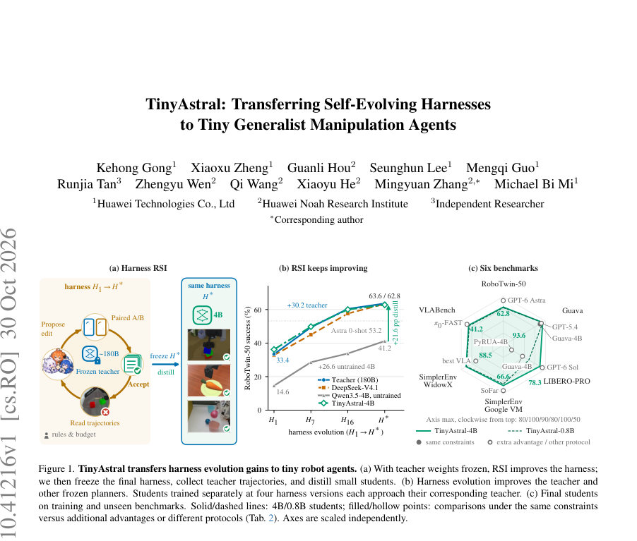
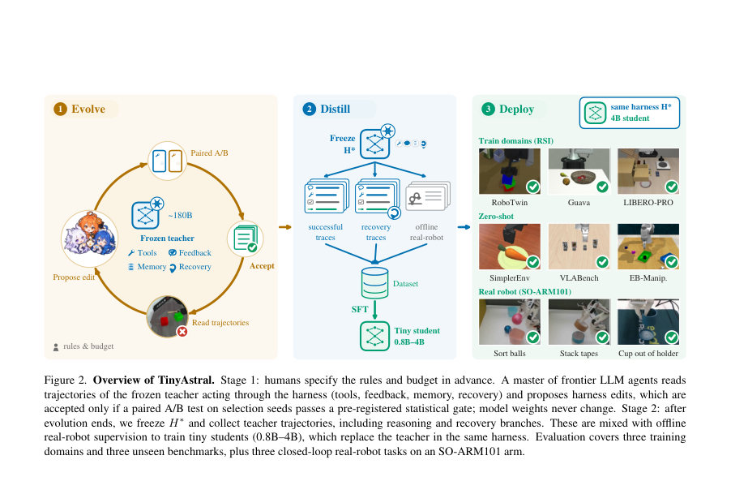
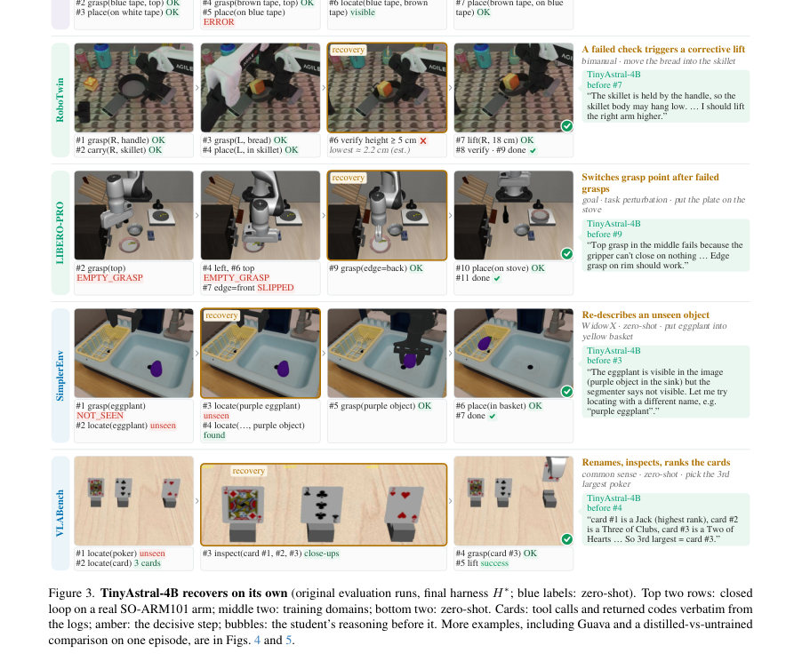

# TinyAstral: Transferring Self-Evolving Harnesses to Tiny Generalist Manipulation Agents

- **게시일:** 2026-11-02
- **arXiv:** [2610.41216v1](http://arxiv.org/abs/2610.41216v1) · [PDF](https://arxiv.org/pdf/2610.41216v1)
- **저자:** Kehong Gong, Xiaoxu Zheng, Guanli Hou, Seunghun Lee, Mengqi Guo, Runjia Tan, Zhengyu Wen, Qi Wang, Xiaoyu He, Mingyuan Zhang, Michael Bi Mi
- **분야:** cs.RO, cs.CV
- **선정 점수:** 6.06
- **선정 이유:** 최근성 0.4, 인용 영향 0.0 (인용 0회), 저자 영향 0.0 (최고 h-index 0), AI 주제 적합성 2.6, 개발자 관심 1.0, 학술 신호 0.5, 오픈 웨이트·주요 연구조직 신호 1.6

[← 2026-11-02 목록으로 돌아가기](../daily/2026-11-02.html)

<!-- paper-visuals:start -->
## 주요 Figure

> 원문 PDF에서 실제 Figure 캡션과 그림 영역이 함께 확인된 자료만 자동 추출했다.

*Figure · 원문 PDF 1쪽 · Figure 1. TinyAstral transfers harness evolution gains to tiny robot agents. (a) With teacher weights frozen, RSI improves the harness;*

*Figure · 원문 PDF 4쪽 · Figure 2. Overview of TinyAstral. Stage 1: humans specify the rules and budget in advance. A master of frontier LLM agents reads*

*Figure · 원문 PDF 8쪽 · Figure 3. TinyAstral-4B recovers on its own (original evaluation runs, final harness H∗; blue labels: zero-shot). Top two rows: closed*

<!-- paper-visuals:end -->

## 한 문장 요약

개선된 ‘하네스(harness)’를 고정된 대형 플래너에서 반복적 자기개선(RSI)로 진화시키고, 최종 고정 하네스에서 교사(teacher)의 추론 및 실패 복구 궤적을 수집해 소형 학생(student)으로 증류함으로써 하네스 개선 효과를 저용량 로봇 에이전트로 이전하는 두 단계 방법을 제안한다.

## 해결하려는 문제

비전-언어 플래너 기반 로봇 에이전트의 성능은 플래너(모델)뿐 아니라 이를 둘러싼 하네스(도구 인터페이스, 피드백, 메모리, 실패 복구 로직)에 크게 의존한다. 기존 연구는 (1) 고정 플래너 주변의 하네스를 진화시키는 접근과 (2) 강한 에이전트의 궤적을 소형 모델로 증류하는 접근을 따로 연구해 왔으나, “대형 교사의 하네스 개선을 계산 비용이 낮은 소형 에이전트로 어떻게 이전할 수 있는가”라는 질문은 남아 있다. 즉, 하네스 개선의 이득을 추론 비용이 적은 소형 모델에 실질적으로 전이할 수 있는지와 그 절차·검증 방법이 문제이다.

## 핵심 기여

- 하네스 진화 후 증류라는 두 단계 파이프라인(TinyAstral)을 제안해 대형 고정 교사의 하네스 개선을 소형 에이전트로 이전하는 절차를 명시했다.
- 교사 하네스를 frontier LLM 마스터가 읽고 제안한 수정안을 사전 등록된 쌍별(페어드) 통계 검정으로 자동 수용/거부하는 반복적 자기개선(RSI) 루프를 설계·시연했다.
- 진화된 하네스를 고정한 뒤 교사의 추론(reasoning)과 실패 복구 분기를 포함한 엄선된 성공 궤적을 수집·증류하여 0.8B–4B 규모의 소형 학생들이 각 하네스 스냅샷의 교사 성능에 근접하도록 학습됨을 실험적으로 보였다.
- 하네스 개선이 다른 고정 플래너에도 전이되며(플래너 재학습 없이 재사용 가능), 진화의 후기 스냅샷에서 증류한 학생일수록 성능이 향상된다는 증거를 제시했다.
- 실제 배포 관점에서 최종 4B 학생이 동일 하네스에서 교사 대비 약 1/5의 가속기 시간으로 동작하면서도 훈련·제로샷 벤치마크에서 높은 성능을 유지함을 정량적으로 보고했다.

## 접근 방법

* 전체 절차는 두 단계로 구성된다.
* (1) 하네스 진화(RSI): 교사 π_T(Qwen3.8-Flash-Next, 고정)와 하네스 H, 그리고 인간이 사전 등록한 규칙·예산을 따르는 마스터 M(여러 frontier LLM 에이전트)으로 구성된 시스템이 작동한다.
* 루프마다 현재 하네스 H_k로 개발(선택) 시드를 실행해 로그(이미지, 툴 호출, 툴 결과, 교사 추론)를 수집하고, 마스터가 실패를 10개 클래스(예: 오프타깃 배치, 잘못된 완료판정, 누락 프리미티브, 태스크 메모리 오류 등)로 분류하여 특정 실패 클러스터를 목표로 수정안(새 도구, 더 정직한 툴 리턴, 인지·복구 개선, 태스크 메모리 변경 등)을 제안한다.
* 제안은 일반성 제약(태스크 이름으로 분기 불가 등), 트리거 마커 로깅, 코드 감사 등을 만족해야 한다.
* 후보 H'는 사전 등록된 페어드 A/B 통계 게이트(타깃 클러스터 J·비타깃 U 정의, J에서의 군집부트스트랩(one-sided 97.5% 하한이 양수여야 수용), U에서의 2pp 이상 회귀가 95% 상한으로 확인되면 거부 등)를 통과하면 채택된다.
* 주요 수락 로직에는 방향 스크린과 중간 중단 규칙(무효성·정지 기준)이 포함된다.
* (2) 증류: 최종 하네스 H*를 고정하고 교사로부터 엄격한 성공 에피소드(본문의 strict success 기준)만 수집한다(주 에피소드는 온도 0; 실패 시 최대 2회 온도 0.7로 재시도).
* 교사의 추론 텍스트(<think>...</think>)를 타깃으로 유지하고, 성공 에피소드로부터 복구 분기를 생성하기 위해 k번째 호출까지 재생하고 인위적 교란(예: 물체 미끄러짐, 대상 이동, 놓침 등)을 주어 교사가 여전히 성공하는 복구 궤적을 보관한다.
* 또한 공개 실로봇 데이터셋을 하네스 포맷(상태/실패 판정, 하위목표 계획, 다음 호출)으로 가공해 보조 데이터로 포함한다.
* 학생 모델은 Qwen3.5-4B를 전수(fine-tune)하며 교사의 마지막 어시스턴트 턴(추론+툴콜)을 감독 타깃으로 하고(추론 포함), 하이퍼파라미터는 논문 본문 Sec. F에 따라 LR=1e-5, 배치 글로벌 32, max tokens 12288, 2 epoch 등으로 학습한다.
* 배포 시 학생은 H* 내에서 교사를 대체해 bf16 단일 가속기에서 서비스된다.

## 주요 결과

- 하네스 진화로 교사(Qwen3.8-Flash-Next)의 RoboTwin-50 엄격 성공률이 H1에서 H*로 33.4% → 63.6%로 +30.2 percentage points(p.p.) 향상함(Tab.1, Tab.8).
- 같은 하네스 스냅샷들에서 각각의 학생(4개 스냅샷 기준)은 해당 교사에 근접하는 성능을 보였음(학생 성능: H1=36.2%, H7=49.8%, H16=60.0%, H*=62.8%).
- 하네스 개선은 다른 고정 플래너에도 전이되어 DeepSeek-V4.1-Flash는 32.8%→63.4%(+30.6 p.p.), 미학습 4B 초기화(planner)는 14.6%→41.2%(+26.6 p.p.)로 향상했다(Table 1).
- 최종 TinyAstral-4B의 주요 벤치마크 성능(같은 하네스 H*, strict protocol): RoboTwin 62.8%(교사 63.6%), Guava 93.6%(교사 94.7%), LIBERO-PRO 78.3%(교사 80.0%) (Tab.2, 보수적 비교에 대해 동일 에피소드 페어드 비교 적용).
- 제로샷(미사용 벤치마크) 일반화: SimplerEnv, VLABench, EB-Manipulation에서 학생은 교사 대비 5.0 p.p. 이내로 근접하며, 동일 하네스에서 552B DeepSeek와도 근접한 성능을 보였다(Tab.2). 자세 비교 예: Guava 동일 에피소드에서 TinyAstral-4B 93.6%는 Guava 하네스에 같은 교사를 넣은 결과(78.9%)를 상회함. 이는 하네스 설계·증류가 실질적 이득을 만듦을 시사한다.」「증류 레시피의 핵심성분별 영향: 교사의 추론 텍스트를 유지하는 것이 중요하여 이를 제거하면 LIBERO-PRO에서 −19.3 p.p., SimplerEnv Google VM에서 −11.2 p.p., VLABench에서 −10.0 p.p. 성능 하락이 관찰되었다(Table 3). 오프라인 실로봇 데이터 추가는 실로봇 '다음 호출' 정확도를 0.235 → 0.923로 크게 개선했으나(오프라인 측정) 시뮬레이션 7개 설정의 성공률에는 통계적으로 유의한 변화가 감지되지 않았다(Table 3).」「배포 비용: 같은 20 SimplerEnv 에피소드에서 학생은 median wall-clock 25.3 s, Accel·s(가속기 수×시간) 25.3을 사용했고, 교사(4 accel, FP8/TP4)는 Accel·s=123.8로 학생 대비 약 4.9× 더 컸으며, DeepSeek(8 accel)는 249.6으로 약 9.9× 더 컸다(Table 4).

## 한계

- (저자 명시) 논문은 앞으로 더 많은 RSI 환경으로 접근을 확장하겠다고 밝히며 현재 결과가 특정 RSI 환경과 하네스 설계에 기반함을 인정한다(‘Future work will extend the approach to more RSI environments’).
- (저자·본문 근거) 하네스 진화는 공개 가중치 교사(Qwen3.8-Flash-Next)에 의존하며, 인간이 사전 등록한 규칙·예산·수락 기준에 따라 마스터가 작동한다. 즉, 시스템은 사전 설계된 규칙과 선택 시드 구성에 민감하고 외부 개입(규칙·감사)이 필요하다(본문 Sec.3.2).
- (본문 근거로 합리적 추론) 실험은 제한된 벤치마크 세트(RoboTwin, Guava, LIBERO-PRO 등)와 사전정의된 시드/예산 하에서 수행되어, 제안 방식의 범용적 일반화(다양한 로봇 플랫폼·더 복잡한 현실 환경)에는 추가 검증이 필요하다(본문은 제로샷 테스트를 일부 보고하지만 범위는 한정됨).
- (재현 관련 추론) 하네스 수정 수락 규칙과 마스터 에이전트의 구체적 내부 구현(제안 알고리즘 세부, 감사 기준 자동화, 트리거 구현 세부 등)은 논문이 설명하지만 완전한 코드·파라미터 수준 재현을 위해 추가 구현 세부가 필요하다(본문 Sec. E·F는 절차와 일부 하이퍼파라미터 제공).

## 개발자 관점

- 재현·구성요소: 파이프라인은 (a) 공개 가중치의 강한 교사 모델 고정, (b) 하네스의 세밀한 로깅(이미지, 툴콜·결과, 추론 텍스트), (c) 실패 분류·클러스터링 및 수정 제안자(프론트어 LLM 집합), (d) 페어드 A/B 통계 게이트, (e) 최종 하네스에서의 엄선된 교사 궤적 수집, (f) 추론 포함 증류로 구성된다. 각 구성은 논문 본문에 명확히 기술되어 있어 모듈별로 구현·교체 가능하다.
- 하네스 설계·안전성: 하네스 수정은 일반성 제약(태스크 이름으로 분기 불가 등), 트리거 로깅, '트리거 미발동 시 부모와 동일 동작' 보장과 같은 규칙으로 통제되어야 한다. 또한 후보는 방향 스크린과 페어드 통계 검정을 거쳐 회귀를 방지하므로 실제 배포 전에 유효성 검증 파이프라인(선택·평가 시드 분리, 부트스트랩 기반 신뢰구간 계산 등)을 재현해야 한다(Sec. E).
- 증류 실무 팁: 교사 추론 텍스트를 타깃으로 유지하는 것이 성능에 결정적(특히 LIBERO-PRO). 성공 샘플만 엄선(strict success)하고 복구 분기를 인위적으로 생성하여 실패 복구 행동을 포함시키는 것이 중요하다(Sec.3.3). 오프라인 실로봇 데이터는 실환경 판단(next-call)에 큰 도움이 되나 시뮬레이션 성공률 향상은 보장되지 않으므로 데이터 선택·정제에 신경 써야 한다.
- 배포·비용: 소형 학생(4B)은 bf16 단일 가속기에서 동작 가능하며, 본 실험에서 배포 시 Accel·s는 교사 대비 약 1/5로 절감되었다(Table 4). 따라서 실제 제품화 시 가속기 수·형태(FP8·TP·스펙ulative decoding 유무)에 따라 비용-성능 트레이드오프를 설계할 수 있다.

**근거 범위:** 이 분석은 제출된 논문 PDF 본문(주요 본문과 부록의 표와 절차 설명 포함)을 기반으로 작성되었음. 본문과 표(Tables 1–8, Sec.3–4, 부록 Sec. E·F)에 명시된 수치와 절차를 사용했으며, 논문이 제공하지 않는 세부 구현 코드나 내부 매개변수(예: 마스터 LLM의 내부 하이퍼파라미터, 트리거 코드 라인 단위 등)는 재현 불가 혹은 불확실하므로 명시적으로 생성하지 않았다.
