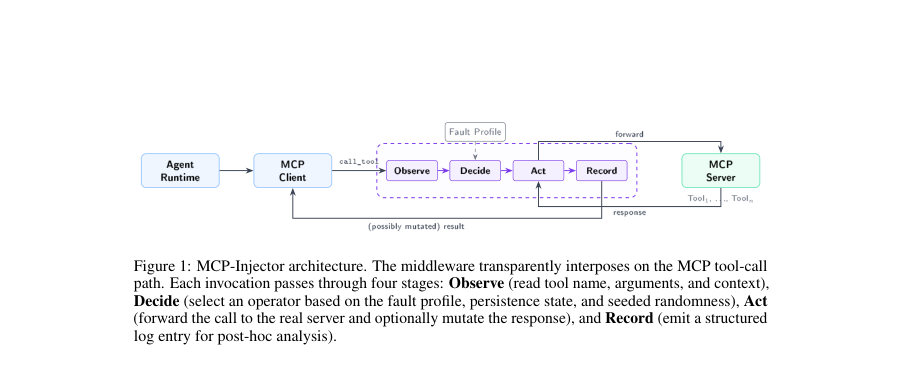
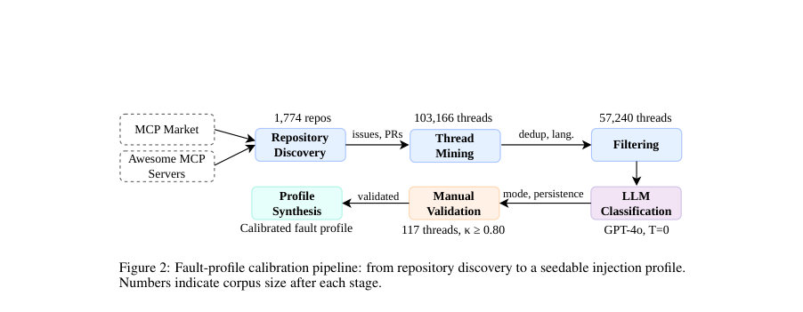
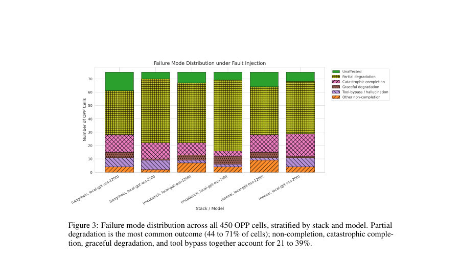

# Tool-Calling LLM Agents Under Realistic MCP Faults: Scale Does Not Purchase Fault Tolerance

- **게시일:** 2026-10-26
- **arXiv:** [2610.32555v1](http://arxiv.org/abs/2610.32555v1) · [PDF](https://arxiv.org/pdf/2610.32555v1)
- **저자:** Antonio Ken Iannillo, Joshua Segun Owotogbe, Roberto Natella, Francesco Avallone, Kristina Kudryavtseva, Indika Kumara
- **분야:** cs.SE, cs.AI
- **선정 점수:** 7.29
- **선정 이유:** 최근성 0.4, 인용 영향 0.0 (인용 0회), 저자 영향 0.0 (최고 h-index 0), AI 주제 적합성 3.0, 개발자 관심 0.7, 학술 신호 0.7, 오픈 웨이트·주요 연구조직 신호 2.5

[← 2026-10-26 목록으로 돌아가기](../daily/2026-10-26.html)

<!-- paper-visuals:start -->
## 주요 Figure

> 원문 PDF에서 실제 Figure 캡션과 그림 영역이 함께 확인된 자료만 자동 추출했다.

*Figure · 원문 PDF 3쪽 · Figure 1: MCP-Injector architecture. The middleware transparently interposes on the MCP tool-call*

*Figure · 원문 PDF 4쪽 · Figure 2: Fault-profile calibration pipeline: from repository discovery to a seedable injection profile.*

*Figure · 원문 PDF 7쪽 · Figure 3: Failure mode distribution across all 450 OPP cells, stratified by stack and model. Partial*

<!-- paper-visuals:end -->

## 한 문장 요약

MCP-Injector라는 MCP(모델 컨텍스트 프로토콜) 경계에 끼워 넣는 프로토콜-인식 결함 주입 미들웨어와, GitHub 이슈/PR로부터 보정한 영구·간헐·일시성 혼합 결함 프로필을 이용한 1,350셀 실험으로 도구 호출 장애가 LLM 에이전트 성능을 심각하게 저하시킨다는 것과(60% 점수 하락), 모델 크기(20B→120B)가 결함 복원력을 보장하지 않는다는 점을 실증했다.

## 해결하려는 문제

기존 도구사용 에이전트 벤치마크는 도구가 올바르고 시한 내에 응답한다는 가정을 전제로 하므로, MCP를 통해 도구를 호출하는 에이전트가 현실적인 도구 실패(내용 오류, 스키마 위반, 지연, 무응답 등) 앞에서 어떻게 동작하는지, 어떤 설계가 완화하는지, 모델 규모가 운영상 취약성을 줄이는지를 통제된 방식으로 평가할 수 없다.

## 핵심 기여

- 공개 MCP 생태계(1,774개 리포지토리의 57,240개 이슈/PR 스레드)를 마이닝하여 (실패 모드 × 지속성) 분포로 보정된 MCP 경계 결함 프로필을 제안·패키징함(프로필은 18개 항목: 6개 연산자×3개 지속성).
- MCP 도구 호출 경계에 투명하게 개입하는 drop-in 미들웨어 MCP-Injector를 구현·공개하고, 영구/간헐/일시성 일정을 지원하는 연산자(OP1..OP6) 및 관찰-결정-행동-기록 파이프라인을 설계함.
- 20B/120B 두 개 gpt-oss 백본, 세 개 에이전트 스택(MCPBench plan-and-execute, OpenAI Agents SDK, LangChain), 세 가지 프록시 조건(Proxy-off, OP0 null, OPP 보정 프로필)을 교차한 1,350셀 전수 실험을 수행해 결함 영향과 복원력(및 스택 차이)을 분석함.
- 실험 결과: 보정된(영구-편중) 결함 프로필 하에서 작업완료 점수가 8.08→3.23으로 60% 하락함을 보여주고(부분 열화가 가장 흔한 거동), 모델 스케일(20B→120B)이 결함 복원력을 제공하지 않음을 보고함(복원비율 모델 p=0.96).
- MCP-Injector와 보정 프로필, 실험 데이터·분석 노트북 등 재현 가능한 아티팩트를 공개함.

## 접근 방법

* MCP-Injector는 MCP 클라이언트와 서버 사이의 call_tool 훅에 프록시로 개입하는 경계 수준 fault-injection 미들웨어다.
* 각 도구 호출에 대해 Observe(도구명·인수·문맥 읽기) → Decide(보정된 결함 프로필, 지속성 상태, 시드된 RNG로 연산자 선택) → Act(실 서버로 전달하거나 응답 변형 또는 지연·무응답·명시적 오류 반환) → Record(구조화된 로그) 순으로 처리한다.
* 구현된 연산자는 OP0(패스스루), OP1(경미한 오차: 문자 치환), OP2(잘못된 출력: 단어 대체), OP3(무효 출력: 타입 강제), OP4(명시적 오류), OP5(지연), OP6(무응답)이며, 지속성은 PERMANENT/TRANSIENT/INTERMITTENT 스케줄로 시드 가능하게 구현된다.
* 결함 프로필 보정은(1) 공개 MCP 레지스트리 결합으로 1,774개 리포지토리 수집→(2) GitHub API로 최대 200개 이슈·PR 스레드 수집(초기 103,166 스레드)→(3) 키워드·언어 필터링으로 57,240개 영어 스레드로 축소→(4) gpt-4o API(템퍼처 0, 고정 JSON 스키마)로 각 스레드를 (실패모드, 지속성)에 분류하고(추출된 파라미터 포함) 소수 샘플(117개)에서 인간 검증(κ=0.93 실패모드, κ=0.80 지속성)을 수행해 18-rule(6모드×3지속성) 선택 가중치와 간헐 활성/비활성 확률을 산출했다.
* 실험은 MCP-Bench로부터 생성한 25개 단일-서버 작업(도구 노출), 두 백본(gpt-oss-20B/120B, 로컬 LM Studio serving, MXFP4, 16k context), 세 스택, 세 프록시 조건(Proxyoff, OP0, OPP) 및 3개 시드로 2×3×3×3×25=1,350셀(full-factorial)을 수행했다.
* 실행 정책은 작업당 최대 3,000초 타임아웃과 스택별 루프 한도(40 라운드 등)이며, 완료된 각 실행은 gpt-4o-mini로 다중 채점(5회, 룰렛화된 루브릭 순서, 중앙값 보고)했다.
* 주요 측정항목은 루브릭 기반 작업 품질 점수, 시스템 수준 결과(타임아웃·언핸들 예외), 지연 분해다.

## 주요 결과

- 주요 효과: 보정된(영구-편중) OPP 조건에서 전체(스택·모델 풀링) 작업완료 점수가 8.08→3.23으로 약 60% 감소(쌍별 차이 −4.85점, 95% CI [−5.22, −4.48]), 도구 선택 59% 감소, 계획 효과성 67% 감소 등 모든 항목이 유의하게 하락(페어드 Wilcoxon, Benjamini-Hochberg 보정, p < 0.001).
- 완료율: OP0(프록시 비개입) 시 95–100%였으나 OPP에서 88–97%로 하락. 백본별 풀링 완료율은 20B 95.6% vs 120B 91.1% (차이 4.4 포인트, 95% CI [−0.2, 9.3], 기술적 서술), 모델 크기에 따른 복원비율 회귀에서 모델 크기 계수는 유의하지 않음(β_model = −0.009, 95% CI [−0.39, 0.37], p = 0.96): 즉 120B이 더 큰 비율의 무결성 점수를 유지하지 못함.
- 행동 유형: 450개 OPP 셀 분류에서 '부분적 열화(partial degradation)'가 가장 흔함(전체의 56%), 비완료·재앙적 완성·도구 우회·우아한 열화 등은 21–39% 범위. 도구 우회(근거 없이 모델이 정답 생성)는 OPP에서 6.0%의 셀을 차지함.
- 스택 차이: LangChain이 OPP에서 가장 높은 완료율(95–97%), OpenAI 에이전트가 가장 낮음(88–95%), MCPBench가 중간(91–95%). 혼합효과 모델에서 MCPBench는 LangChain 대비 추가 −0.93점(95% CI [−1.86, −0.01], p = 0.048), OpenAI는 −0.84점(95% CI [−1.77, 0.08], p = 0.074)으로 프레임워크 수준의 에러 처리 차이가 복원성에 영향(증거는 제안적).
- 노출 차이·후보 설명: 120B는 평균 더 많은 결함 주입을 받음(셀당 평균 4.6 vs 3.9), OP0 시 더 긴 출력(평균 2,063 vs 1,711 토큰)을 생성했고 재시도 루프가 더 길었음(평균 4.5 vs 3.9 연속 재시도). 작업 특성에 따라 취약성 차이가 큼(예: live API 연동 작업 −97%, 긴 순차 체인 −82% 대 계산 단축 체인 −19%).

## 한계

- 저자 명시(구성 타당도): LLM 판정자(LLM-as-a-judge)가 확률적이며 5회 채점 중앙값으로 노이즈를 완화했으나 완전히 제거하지 못함. GitHub 이슈의 보고 바이어스로 인해 보정된 프로필은 '스트레스 프로필'로 취급되어 실제 운영 빈도와는 다름. 내용 연산자는 스키마 드리프트, 페이로드 절단, 부분 결과 누락을 포함하지 않음.
- 저자 명시(내부 타당도): 프록시는 비간섭임이 검증되었고(Appendix B), per-run 결함 추출이 프로필을 따름(Appendix C). 그러나 노출(호출량)과 프레임워크별 오류 처리 동작이 얽혀 있어 메커니즘(노출이 복원성 저하를 증폭한다)은 가설 수준이며 확정되지 않음. 제로-도스(도구 호출을 전혀 하지 않는 셀) 비율(12.2%)과 셀당 세 시드 제한이 희귀 상호작용 분석의 통계적 힘을 제한함.
- 저자 명시(외부 타당도): 두 백본이 동일 모델 계열(gpt-oss) 및 단일 서빙 환경(Apple Mac Studio, LM Studio)에서 실험되어 일반화가 제한됨. MCP-Bench 작업은 결함이 없을 때 쉬운 편(OP0 평균 점수 8.08)으로 더 어려운 작업군에 대한 일반화는 불확실함. 또한 데이터에서 PERMANENT 항목(91.3%)이 우세하므로 TRANSIENT/INTERMITTENT에 대한 서술력 부족(발화 이벤트 1,905개 중 두 유형은 9건의 fired event만 발생) 이 있음.
- 내 분석에서 확인된 추가 제약: 보정 프로필은 '분포 비율'을 일치시키는 것이지 실제 운영 고장률을 추정하는 것은 아님(본문 명시). 프로필의 세부 파라미터(예: d=0.3, 30s 지연, OP1/OP2 강도, TRANSIENT 활성화 등) 중 일부는 부록에 하이레벨으로만 공개되고 원시 JSON의 파라미터들은 제공된 본문 발췌에서 일부가 잘려 있어 완전한 검증이 제한됨.

## 개발자 관점

- 배포 전 테스트: MCP-Injector 같은 프로토콜-인식 결함 주입기를 스테이징 경로에 끼워 넣어 현실적(보고된) 실패 모드와 지속성으로 에이전트를 스트레스 테스트하라. 보정된 프로필은 '스트레스 테스트' 용도로 활용하되 인증 수단으로 과신하지 말 것.
- 프레임워크 설계 우선순위: 에이전트 오케스트레이션 수준(프레임워크)의 오류 처리 전략(재시도, 툴 전환, 폴백)이 모델 크기보다 복원성에 더 큰 영향을 줄 수 있으므로 프레임워크·플래너 수준의 실패 처리 로직을 개선하라(예: 도구 실패 후 재시도 정책·툴 전환 정책·증거 기초 검증 강화).
- 노출 관리: 도구 호출 체인을 짧게 유지하고 불필요한 도구 호출을 줄여 '결함 노출량'을 관리하라. 긴 출력·긴 맥락 창은 더 많은 도구 호출과 더 높은 결함 노출로 이어질 수 있다(실험에서 120B가 더 많은 결함에 노출됨).
- 실험·재현: MCP-Injector는 시드 가능한 스케줄과 모든 fired fault 로그를 제공하므로 실험 재현이 용이하다. 저자 제공 아티팩트(코드·프로필·캠페인 결과·분석 노트북)를 활용해 동일 조건에서 재현·확장 테스트를 수행하라.
- 운영·안전성: 인젝터 응답에 결함 헤더를 태그하고 기본값을 OP0로 제공하는 등 투명성·감사성 확보. 미들웨어는 이중 사용 가능성(공격 용도로 전환될 위험)을 가지므로 배포 시 접근 제한 및 사용 지침을 명확히 할 것(저자 제안: 스테이징 전용, OP0 기본).

**근거 범위:** 이 분석은 제공된 논문 PDF 본문(주요 본문과 부록 요약)을 근거로 작성했다. 본문에 명시된 모든 수치(예: 57,240 스레드, 1,350셀, 점수 및 CI, 완료율 차이 등)는 PDF에서 직접 인용했다. 다만 프로필의 JSON 세부 파라미터와 일부 부록 표·수치의 원시 행은 제공된 발췌에서 잘려 있거나 생략되어 있어(본문은 요약·참조 수준으로 제시) 그 부분의 세부 구현값은 별도로 검증하지 못했다.
