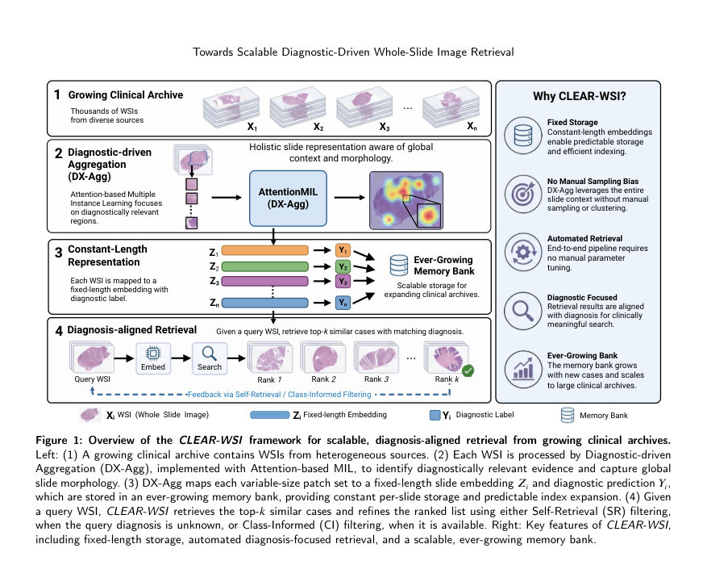
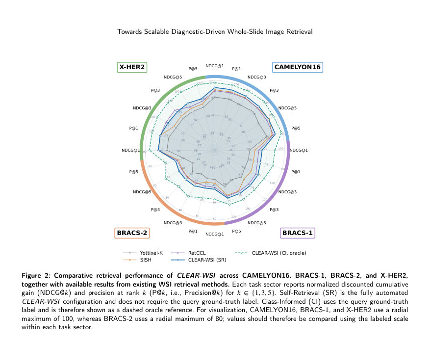

# Towards Scalable Diagnostic-Driven Whole-Slide Image Retrieval for Pathology Archives

- **게시일:** 2026-11-06
- **arXiv:** [2611.07935v1](http://arxiv.org/abs/2611.07935v1) · [PDF](https://arxiv.org/pdf/2611.07935v1)
- **저자:** Jingsong Liu, Youssef Wally Han Li, Weiwei Zhou, Jing Dai, Elisabeth Wetzer, Peter J. Schüffler
- **분야:** cs.CV, cs.AI
- **선정 점수:** 4.77
- **선정 이유:** 최근성 1.1, 인용 영향 0.0 (인용 0회), 저자 영향 0.0 (최고 h-index 0), AI 주제 적합성 1.5, 개발자 관심 1.1, 학술 신호 1.1, 오픈 웨이트·주요 연구조직 신호 0.0

[← 2026-11-06 목록으로 돌아가기](../daily/2026-11-06.html)

<!-- paper-visuals:start -->
## 주요 Figure

> 원문 PDF에서 실제 Figure 캡션과 그림 영역이 함께 확인된 자료만 자동 추출했다.

*Figure · 원문 PDF 5쪽 · Figure 1: Overview of the CLEAR-WSI framework for scalable, diagnosis-aligned retrieval from growing clinical archives.*

*Figure · 원문 PDF 9쪽 · Figure 2: Comparative retrieval performance of CLEAR-WSI across CAMELYON16, BRACS-1, BRACS-2, and X-HER2,*

<!-- paper-visuals:end -->

## 한 문장 요약

디지털 병리 Whole-Slide Image(WSI) 아카이브를 대상으로 패치 수준의 파운데이션 모델 피처와 Attention-based MIL 기반의 진단지향 집계(DX-Agg)를 결합해 모든 슬라이드를 고정 길이 임베딩으로 표현하고, 예측(또는 실제) 진단 레이블로 후보를 필터링하며 점진적으로 확장되는 메모리 뱅크로 검색을 확장하는 스케일러블 WSI 검색 프레임워크 CLEAR-WSI를 제안한다.

## 해결하려는 문제

기존 WSI 콘텐츠 기반 검색(CBIR)은 (i) 슬라이드를 가변 개수의 대표 패치 집합(모자이크)으로 표현해 저장소·검색 비용이 케이스마다 달라지고 예측 불가능하며, (ii) 수작업 클러스터링·샘플링 설계에 의존해 진단상 중요한 영역을 놓칠 수 있고, (iii) 시각적 유사성이 진단적 일관성을 보장하지 않아 진단 연관 검색에 한계가 있다. 또한 대규모·지속 확장되는 임상 아카이브에서 저장·색인·지연(latency)을 예측·관리하기 어렵다. 논문은 위 문제들을 해결해 '고정 길이(슬라이드당 일정 저장량) 진단지향 표현'과 '라벨 유무에 따른 필터링'을 통해 스케일러블하고 진단에 정렬된 검색을 수행할 수 있는지를 묻는다.

## 핵심 기여

- 진단지향 집계(Diagnostic-driven Aggregation, DX-Agg): Attention 기반 MIL을 이용해 패치 풀에서 진단 근거에 가중치를 두어 가변 크기 패치 집합을 단일 고정 길이 슬라이드 임베딩으로 매핑하고 분류 예측도 함께 생성한다.
- 고정-길이 슬라이드 임베딩 + 성장하는 메모리 뱅크 설계: 모든 슬라이드는 동일한 차원의 임베딩과 예측 라벨을 저장해 슬라이드당 예측 가능한 저장 비용을 보장하고 아카이브가 점진적으로 확장되도록 함.
- 라벨-가용성에 따른 두 가지 검색 정제 모드: (1) Class-Informed(CI, oracle) — 쿼리의 실제 진단 라벨 사용, (2) Self-Retrieval(SR) — 쿼리의 예측 라벨로 후보 필터링하여 라벨이 없을 때 자동화된 진단정렬 검색 제공.
- 공개·임상 데이터셋 기반 종합 벤치마크 및 정량적 향상: CAMELYON16, BRACS-1/2, 사내 X-HER2 데이터에서 기존 강력한 기법 대비 Precision@5 기준 일관된 성능 향상 보고.
- 아키텍처·메커니즘의 기여도 분석(암묵적): 패치 인코더 비교(일반 도메인 vs 병리 특화), 집계 방식( PCA vs DX-Agg), 필터 전략(SR/CI) 및 성장 메모리뱅크의 개별·복합 영향과 실험적 지연(latency) 분석 제공.

## 접근 방법

* 아키텍처 및 알고리즘: (1) 전처리로 조직 분할(tissue segmentation) 후 WSI를 타일(패치)로 테셀레이션한다.
* (2) 패치 인코더 f_theta로 각 패치를 d차원 피처로 변환한다.
* 실험에서 비교한 인코더는 DeiT, MoCo v3, Prov-GigaPath, UNI이며 최종 구성은 병리 특화 사전학습된 UNI를 선택했다.
* (3) Diagnostic-driven Aggregation(DX-Agg)는 Attention 기반 MIL 모듈로, 각 패치에 대해 비음수 정규화 가중치 beta_lj를 학습하여 슬라이드 임베딩 Z_l = sum_j beta_lj * h_lj를 계산한다.
* 동일한 Z_l에 분류 헤드 g_phi를 적용해 슬라이드 예측 라벨 y_tilde_l를 얻는다.
* 학습: DX-Agg는 슬라이드 수준 진단 레이블로 학습된다(패치 레이블 불필요).
* (4) 메모리 뱅크 초기화: 검증 세트에 대해 학습된 인코더+DX-Agg를 적용해 (Z_i, y_tilde_i) 쌍을 저장해 초기 뱅크 M(0)을 만든다.
* (5) 검색·정렬: 쿼리 슬라이드에서 동일 경로로 (Z_q, y_tilde_q)를 얻고 코사인 유사도로 메모리 항목과 정렬(pi(q))한다.
* (6) 필터링: (a) CI 모드 — 쿼리의 실제 진단 y_q가 있으면 메모리 항목의 예측 라벨 y_tilde_i == y_q인 후보만 유지 (oracle로 취급), (b) SR 모드 — y_q가 없으면 쿼리의 예측 y_tilde_q와 일치하는 후보만 유지.
* (7) 반환된 top-k를 결과로 제공하고 쿼리의 (Z_q, y_tilde_q)를 메모리 뱅크에 추가해 은행을 점진 확장한다(모델 파라미터는 온라인으로 업데이트하지 않음).
* 비교군·구성: 고정 뱅크(fixed-bank) 실험과 다양한 패치 인코더/집계 조합으로 ablation 수행.
* 평가 지표는 Precision@k( k=1,3,5) 및 NDCG@k.

## 주요 결과

- 데이터셋 및 분할: CAMELYON16 (train/val/test = 243/27/129, 전체 399), BRACS (393/64/87, 전체 544), X-HER2(사내: 43/18/16, 전체 77).
- 주요 비교성과(Precision@5 기준): CLEAR-WSI(SR, 자동화 구성)는 기존 최고 성능 기법 대비 Precision@5에서 CAMELYON16 +3.10% (86.82 → 89.92), BRACS-1 +2.75% (68.28 → 71.03), BRACS-2 +1.95% (44.83 → 46.78), X-HER2 +3.75% (72.50 → 76.25)를 달성했다(세부 수치 Table S1에 기록).
- 상세 지표 예시(표본): CAMELYON16에서 CLEAR-WSI(SR) Precision@1/3/5 = 90.02/89.15/89.92%, NDCG@1/3/5 = 90.02/89.56/89.07. BRACS-2에서 CLEAR-WSI(SR) Precision@5 = 46.78%, NDCG@5 = 47.67%. (모든 세부값은 Table S1에 수록).
- 아블레이션: (1) 패치 인코더·집계 영향: CAMELYON16에서 DeiT+PCA 평균 NDCG 63.66 / Precision 66.41 → DeiT+DX-Agg 로 NDCG 66.86 / Precision 69.00로 향상. UNI+DX-Agg(CLEAR-WSI)에서는 평균 NDCG 89.55 / Precision 89.66로 대폭 증가(Prov-GigaPath 대비 NDCG +20.51pp). (2) 필터·성장 은행 영향(BRACS Level-2): 필터 없음 평균 NDCG 41.72 / Precision 41.40 → SR 적용 시 NDCG 44.82(+3.10) / Precision 43.99(+2.59) → 성장 메모리 은행 추가 시 NDCG 46.55 / Precision 46.37로 추가 향상. CI(oracle) + 성장 은행은 NDCG 60.97 / Precision 57.79로 최고 성과를 보임.
- 지연(latency)·확장성: NVIDIA H100에서의 실험(메모리 뱅크가 테스트 중 점진 확장되는 순차 처리). 오프라인 피처 추출 비용: CAMELYON16 2646.99s(약 6.6s/슬라이드), BRACS 3209.60s(약 5.9s/슬라이드), X-HER2 ≈472.01s(약 6.13s/슬라이드). 온라인(피처 로딩 + 검색) 지연: CAMELYON16 총 7.17s(로딩 3.55s + 검색 3.62s), BRACS 5.83s(3.17s + 2.66s), X-HER2 1.72s(1.49s + 0.23s). 메모리 뱅크 성장 예: CAMELYON16 27→156, BRACS 64→151, X-HER2 18→34.

## 한계

- 저자가 명시한 한계(본문): (i) 실험이 세 개의 유방 병리 데이터셋(공개 2종 + 사내 1종)에 국한되어 다기관·다기관 장기(다장기) 일반화성 검증이 부족하다; (ii) 평가된 메모리 뱅크 크기가 수백 개 수준으로, 수백만 규모 병원급 아카이브에서의 지연·색인 효율성·스토리지 특성은 입증되지 않았다; (iii) 지연 측정은 단일 하드웨어(NVIDIA H100)에서 얻은 값으로 대형 임상 인프라 일반화가 제한적이며; (iv) 검색의 '관련성'을 데이터셋 라벨로 정의했기 때문에 실제 임상적으로 의미 있는 형태학적 유사성이나 사용자(병리과 의사) 관점의 유용성은 검증되지 않았다.
- 추가로 본문 실험·설계에서 확인되는 제약(저자 언급과 구별): (i) SR 필터는 DX-Agg의 예측 정확도에 민감하며 CI(실제 라벨)과 성능 차이가 있어 자동화 환경에서 예측 보정·불확실성 처리가 요구된다; (ii) 임베딩·유사도 검색은 논문에서 코사인 유사도 기반 순차 검색을 사용한 것으로 보이며(근사 최근접탐색(ANN) 등 대규모 색인 기법 통합은 수행되지 않아 대규모 확장 시 추가 구조·엔지니어링 필요), (iii) 모델은 메모리 뱅크에 새 케이스를 추가하나 온라인 파라미터 업데이트(온라인 러닝)는 수행하지 않아 시간이 지나면서 분포 변화에 대한 적응이 제한될 수 있다.

## 개발자 관점

- 재현을 위해 필요한 핵심 요소: WSI 전처리(조직 분할·패치 추출), 병리 특화 패치 인코더(논문에서는 UNI를 최종 선택; 공개 체크포인트 사용), AttentionMIL 기반 DX-Agg 구현(가중치 정규화 및 슬라이드 분류 헤드), 메모리 뱅크(임베딩+예측라벨) 설계와 SR/CI 필터 모듈. 논문은 구현 리포지토리(익명화) 제공을 명시함.
- 배포·스케일링 관점: 장점은 슬라이드당 고정 길이 임베딩으로 저장량 예측 가능성과 메모리 뱅크의 선형 성장예측이 쉬운 점. 반면 대규모(수십만~수백만 슬라이드) 아카이브에는 ANN 색인(예: FAISS, HNSW) 도입, 분산 저장 및 검색, 배치·스트리밍 피처 추출 파이프라인이 필요하다.
- 성능·신뢰성 고려사항: SR 모드는 분류 예측 성능에 의존하므로 모델 교정(calibration), 예측 불확실성(uncertainty) 처리 및 임계값 정책이 필요하다. CI(라벨 사용)는 oracle 수준의 상한을 제시하므로 실제 워크플로에서는 라벨 품질·가용성 정책을 설계해야 함.
- 비용·운영: 본문 실험에서 피처 추출은 온라인이 아닌 오프라인으로 수행되며 슬라이드당 약 5.9–6.6초(H100)를 소요했다. 대규모 배포에서는 피처 추출의 병렬화(클러스터/GPU 팜)와 저장소 IO 최적화가 비용·지연에 큰 영향을 미친다.
- 안전·프라이버시: 임상 데이터 사용 시 환자 식별정보 제거와 병원 규정(데이터 거버넌스·보안)을 준수해야 하며, 검색결과가 진단 보조로 사용될 경우 임상 리스크 관리를 위한 UX(경고, 불확실성 표시)와 검증(리더스튜디, 임상 시험)이 필요하다.

**근거 범위:** 이 분석은 제공된 논문 PDF 본문(본문·표·부록 표 S1)에서 직접 추출한 정보에 기반한다. 구현 세부(예: 하이퍼파라미터 세부값, 학습 스케줄, 데이터 전처리 파라미터)는 본문에 명시된 내용만을 사용했으며, PDF에서 확인하기 어려운 내부 체크포인트 경로·리포지토리 주소 등은 익명화되어 있어 포함하지 않았다.
