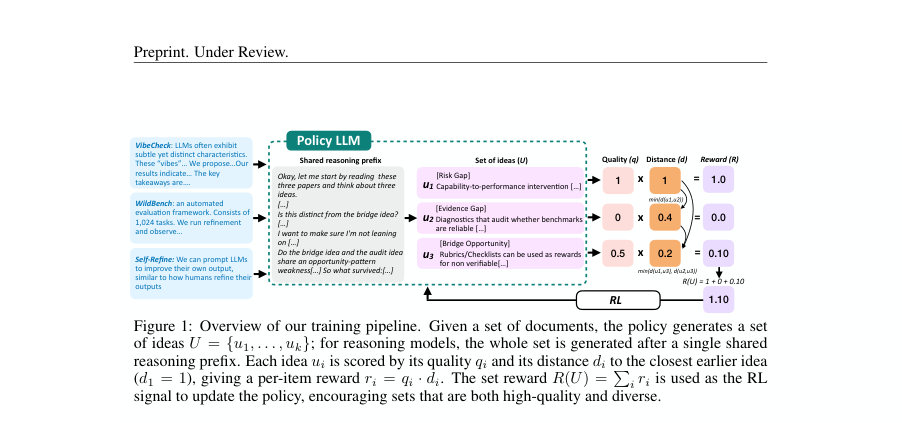
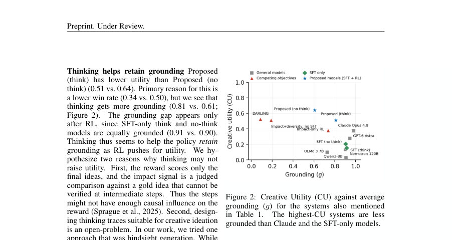
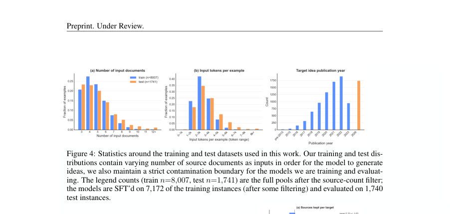

# Training Reasoning Models to Generate Diverse Scientific Ideas

- **게시일:** 2026-10-18
- **arXiv:** [2610.22324v1](http://arxiv.org/abs/2610.22324v1) · [PDF](https://arxiv.org/pdf/2610.22324v1)
- **저자:** Manya Wadhwa, Pranav Narayanan Venkit, Hiroaki Hayashi, Yu Li, Tuhin Chakrabarty, Chien-Sheng Wu
- **분야:** cs.CL
- **선정 점수:** 4.59
- **선정 이유:** 최근성 0.5, 인용 영향 0.0 (인용 0회), 저자 영향 0.0 (최고 h-index 0), AI 주제 적합성 3.0, 개발자 관심 0.2, 학술 신호 0.9, 오픈 웨이트·주요 연구조직 신호 0.0

[← 2026-10-18 목록으로 돌아가기](../daily/2026-10-18.html)

<!-- paper-visuals:start -->
## 주요 Figure

> 원문 PDF에서 실제 Figure 캡션과 그림 영역이 함께 확인된 자료만 자동 추출했다.

*Figure · 원문 PDF 2쪽 · Figure 1: Overview of our training pipeline. Given a set of documents, the policy generates a set*

*Figure · 원문 PDF 7쪽 · Figure 2: Creative Utility (CU) against average*

*Figure · 원문 PDF 15쪽 · Figure 4: Statistics around the training and test datasets used in this work. Our training and test dis-*

<!-- paper-visuals:end -->

## 한 문장 요약

문서-기반 연구 아이디어 생성에서, 모델이 한 번의 롤아웃으로 K개의 구조화된 아이디어 카드를 생성하도록 하고 각 아이디어의 품질을 이전 아이디어들과의 거리로 가중한 집합 수준 RL 보상(큐(q) × 최단 거리)을 사용해 Qwen3-8B(8B)를 SFT+GRPO로 학습하여 집합 단위의 품질과 다양성(Creative Utility)을 동시에 향상시킴.

## 해결하려는 문제

기존의 LLM 기반 아이디어 생성은 보통 개별 아이디어의 품질만 최적화하거나 반복 독립 샘플링으로 우연적 다양성에 의존한다. 결과적으로 집합 수준에서 서로 명확히 구별되는 고품질 후보군을 의도적으로 생성하지 못하며, RL로 실행 신호를 최적화할 경우 몇몇 안전한 모드로 수렴(mode collapse)해 다양성이 사라지는 문제가 있다. 문서 기반(선행 논문들에 근거한) 연구 아이디어 생성에서는 각 아이디어가 출처에 충실하면서도 서로 다른 방향을 고의적으로 탐색해야 한다는 요구가 있다.

## 핵심 기여

- 집합 단위(set-level) 강화학습 보상 함수 제안: 각 아이디어의 품질(q)과 그 아이디어가 앞서 생성된 아이디어들과 가지는 거리(d)의 곱을 합산해 집합 보상을 정의(Rset(U) = Σ_i q(ui) · min_{j<i} d(ui, uj)).
- 문서-근거(document-grounded) 아이데이션에 대한 보상·거리·품질의 구체적 실체화: 품질은 gold 아이디어와의 쌍별 영향도 비교(SciJudge-30B 사용, {1,0.5,0}), 거리는 문제/주장/방법 필드별 LLM 유사도(1–5 루브릭, gpt-oss-120b) 평균으로 산출.
- 학습 파이프라인과 구현: Qwen3-8B(8B)를 대상으로 (1) SFT(교사 LLM으로 K개 아이디어와 hindsight ‘thinking traces’ 생성)로 포맷·사고 패턴을 초기화하고, (2) GRPO(Group Relative Policy Optimization)를 이용해 제안한 집합 보상으로 RL 미세조정한 학습 레시피 제시.
- 객관적 평가 및 벤치마크: 저자 제작의 오염 없는 테스트 세트(2026년 논문을 대상, 1,740 인스턴스, 16개 도메인)와 기존 GiantsBench/IdeaSeed에 대해 Creative Utility, 거리 및 품질 지표로 비교; 학습된 8B 모델이 여러 강력한 closed-source 모델(Claude Opus 4.8, GPT-6 Astra)과 경쟁 품질-다양성 방법(DARLING 등)을 능가한다고 보고.
- 후속 검증: 소규모 전문가 인간 평가(4명)와 코딩 에이전트를 이용한 실행 증거(Proof-of-concept)로 생성된 아이디어 세트의 실용성·실행 가능성을 검사하여 다양성 증가가 실행 가능성에 큰 손실을 초래하지 않음을 보임.

## 접근 방법

* 학습·추론 파이프라인(본문 근거):
* 출력 단위와 보상: 하나의 프롬프트 x에 대해 모델은 하나의 롤아웃에서 K=3개의 구조화된 아이디어 카드 U={u1,...,uK}를 한 번에 생성(공유된 reasoning prefix 포함).
* 각 아이디어의 보상은 q(ui)·min_{j<i} d(ui,uj)이고 집합 보상은 이들의 합(Rset).
* 첫 아이디어의 거리는 1으로 정의.
* 품질(q) 측정: long-term scientific impact를 gold 아이디어 g와의 쌍별 비교로 모델링.
* q(u) = I(u,g) ∈{1,0.5,0}으로 SciJudge-30B(저자 사용)로 판정.
* 거리(d) 측정: 아이디어 카드의 problem gap, core claim, method 세 필드별로 LLM 유사도(1–5 루브릭)를 구한 뒤 정규화해 평균(각 필드 균등 가중).
* 판정 모델로 gpt-oss-120b 사용(본문 명시).
* 학습 절차: (1) SFT 단계 — 교사 LLM(claude-opus-4.8)이 K 아이디어를 생성하고 hindsight 방식으로 thinking trace(탐색·거절·검증 등)도 생성해 모델에 학습시켜 포맷과 사고 패턴을 익힘(데이터: 7,172 인스턴스, 검증/테스트 1,740 인스턴스).
* (2) RL 단계 — GRPO(Shao et al., 2024)를 사용해 집합 보상으로 파인튜닝(각 x에 대해 G rollouts 샘플링하고 그룹 평균 대비 advantage로 업데이트, 별도 critic 없음).
* 모델·하이레벨 세팅: 기본 모델은 Qwen3-8B(응답 길이 최대 16k 토큰), K=3.
* 두 변형 실험: think(사고(trace) 포함 SFT) vs no-think(사고 블록 비우고 최종 답만 학습).
* 경쟁 방법으로 DARLING, Impact-only RL, Impact+diversity no-SFT 등의 대조군 학습/평가.
* 평가 지표: 주요 지표는 Creative Utility(CU, γ=0.9, K=3)이며 별도 구성요소로 길이 보정된 승률(quality), 집합 내 평균 쌍(pairwise) 거리(distance), grounding(아이디어의 선언된 출처가 아이디어를 지탱하는 정도)을 LLM 판정으로 보고.

## 주요 결과

- 오염 없는 테스트(1,740 인스턴스, 16 도메인): Proposed (no think)이 가장 높은 Creative Utility(CU=0.64, std=0.23), LC win rate(q)=0.50, Avg. distance(d)=0.88(0.07). Proposed (think)는 CU=0.51, q=0.34, d=0.83.
- 비교 모델: Claude Opus 4.8 CU=0.38(q=0.21,d=0.80), GPT-6 Astra CU=0.28(q=0.15,d=0.86), Nemotron-120B CU=0.14(q=0.05,d=0.79). DARLING CU=0.52(q=0.38,d=0.67). Impact-only RL는 q가 높으나 거리(다양성)가 크게 낮아(CU=0.38, q=0.43, d=0.38) 세트 붕괴를 보임.
- SFT·warm-start 효과: Impact+diversity, no SFT(즉 SFT 없이 RL 시작)도 CU=0.51로 일부 성능은 맞추지만 grounding이 급락(g=0.19 vs SFT 포함 시 g≈0.81), 즉 SFT가 소스 문서에 대한 근거성을 지키는 데 중요함.
- GiantsBench(2,374 인스턴스): Proposed의 LC win-rate=68.3%, Avg. distance=0.939 대 GIANTS-4B의 win-rate=18.3%, distance=0.025 — 본 방법이 아이디어 다양성 및 gold 대비 우위 확보.
- IdeaSeed(샘플 500 인스턴스, 메소드 축): 인구 수준 엔트로피(Hnorm): 인간=0.87, Qwen3-8B·Claude≈0.77, Proposed(think)=0.73(TVD 0.30 vs 인간), Proposed(no think)=0.65(TVD 0.43) — 집합 내 다양성은 높으나 학습 후 인구 수준의 타입 분포는 일부 축소되는 경향 관찰됨(특히 no-think). DARLING는 유형 붕괴를 보임(Hnorm=0.01). 본 논문은 집합 내 다양성에 초점이므로 인구 수준 다양성은 남은 과제라고 보고함.
    
    인간 전문가 평가(파일럿): PhD NLP 연구자 4명, 각자 15 인스턴스(총 60 인스턴스)에 대해 블라인드 비교. Proposed 평균 promising 아이디어 수=2.17(±0.72), unique=2.83(±0.38), unique promising=2.05(±0.75); Claude Opus 4.8과 유사한 수준(promising 2.20, unique 2.72), 기본 Qwen3-8B보다 유의미히 높음.
    
    실행 평가(코딩 에이전트, 15 인스턴스): success@k (supports verdict 기준): Claude (k=1/2/3)=13%/20%/27%; Proposed (no think)=11%/22%/33%; Proposed (think)=10%/19%/29%. k=3에서 Proposed(no think)가 Claude보다 더 높은 성공률(33% vs 27%)을 보여 다양성 증가가 실행 가능성까지 해치지 않음을 시사.

## 한계

- 저자 명시 한계(논문 본문): 현재 연구는 문맥과 파라메트릭 지식에 기반한 과제(문서 요약된 소스 카드) 위주로 실험하며 검색/검색 기반(retrieval) 설정을 포함하지 않음. 학습 데이터는 영어·NLP 과학 논문에 국한됨.
- 저자·본문에서 확인되는 제약: (a) 인간 평가와 실행 평가는 소규모(각각 4명 전문가, 실행 15 인스턴스)로 확장성이 제한됨; (b) 품질(q)와 거리(d)를 판정하는 데 대형 LLM 판정자(SciJudge-30B, gpt-oss-120b 등)를 사용하므로 판정자 편향·오류에 의존함(평가가 LLM 판정자 품질에 민감); (c) SFT 없이는 RL이 소스에서 멀어져 grounding이 크게 하락함—즉, 집합 보상만으로는 근거성 유지 불가; (d) 제시한 보상은 집합 내 다양성에만 직접 최적화하므로 인구 수준(population-level) 아이디어 타입 분포의 넓이를 보장하지 못함(IdeaSeed 결과에서 관찰).
- 구현·재현 관련 누락/불확실성: 본문에 하이퍼파라미터(예: GRPO의 G, 배치크기, 학습률, RL 업데이트 상세), compute 비용·학습 시간 등의 구체 수치가 상세히 표기되어 있지 않거나 부록에 있으나 본문 추출본에서 완전 확인되지 않음.

## 개발자 관점

- 집합 단위 학습 목표를 설계하라: 집합 보상 Rset = Σ q(ui)·min_{j<i} d(ui,uj)처럼 각 아이디어가 이전 아이디어와의 거리에 따라 보상을 받게 하면 모델이 후속 아이디어를 고의적으로 다양화하도록 학습됨.
- SFT로 포맷·근거성(warm-start)을 먼저 가르쳐야 함: 저자 실험에서 SFT 없이 바로 RL을 적용하면 grounding이 크게 저하(예: g≈0.19)하므로 실제 응용에서는 SFT나 근거성 유도 초기화가 필수적임.
- 품질·거리 판정자는 신중히 선택·검증해야 함: 훈련·평가에 사용한 SciJudge-30B와 gpt-oss-120b 같은 LLM 판정자는 결과에 큰 영향을 줌. 외부 편향·오염(데이터 누출) 여부를 점검하고 가능한 contamination-free 테스트 설계가 필요함(저자도 2026년 논문을 분리해 테스트 세트 구축).
- thinking(trace) vs no-thinking 트레이드오프: 사고(trace)를 포함한 SFT는 RL 후 grounding 유지에 도움이 되지만(think variant의 grounding 높음), 본 실험에서는 no-think가 CU 측면에서 더 높게 나옴—사고 트레이스 설계가 결과에 민감하므로 적절한 trace 설계 연구가 필요.
- 평가·배포 실무: 집합으로 아이디어를 제공하면 상위-k(success@k) 기준에서 실험자가 더 높은 확률로 실행 가능한 아이디어를 얻을 수 있음. 따라서 제품화 시 포트폴리오(여러 아이디어 제공) UX와 함께 소규모 실행 검증(에이전트 기반) 파이프라인을 연계하는 것이 유용함(성공률이 k에 따라 증가함).

**근거 범위:** 이 분석은 제공된 논문 PDF 본문 텍스트(본문 및 표, 그림 캡션, 결론, 한계 등)를 근거로 작성함. 본문에서 직접 확인 가능한 주요 수치(테이블 1–3, 인간/실행 평가 표 등)와 방법적 세부(보상 식, 품질·거리 판정자, 모델·데이터 구성 등)를 인용했음. 다만 GRPO의 세부 하이퍼파라미터, 학습 스텝/배치/정밀한 compute 자원·시간과 일부 부록(프롬프트·정확한 판정 프롬프트·추가 예시)의 상세는 본문 추출본에서 완전하게 확인되지 않아 해당 항목들은 명시적으로 포함하지 않았음을 밝힘.
