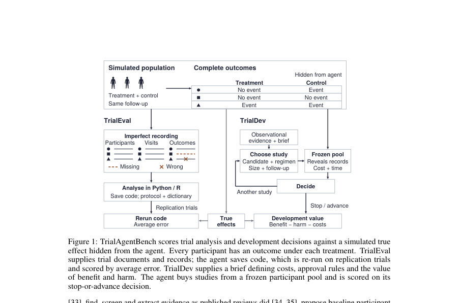
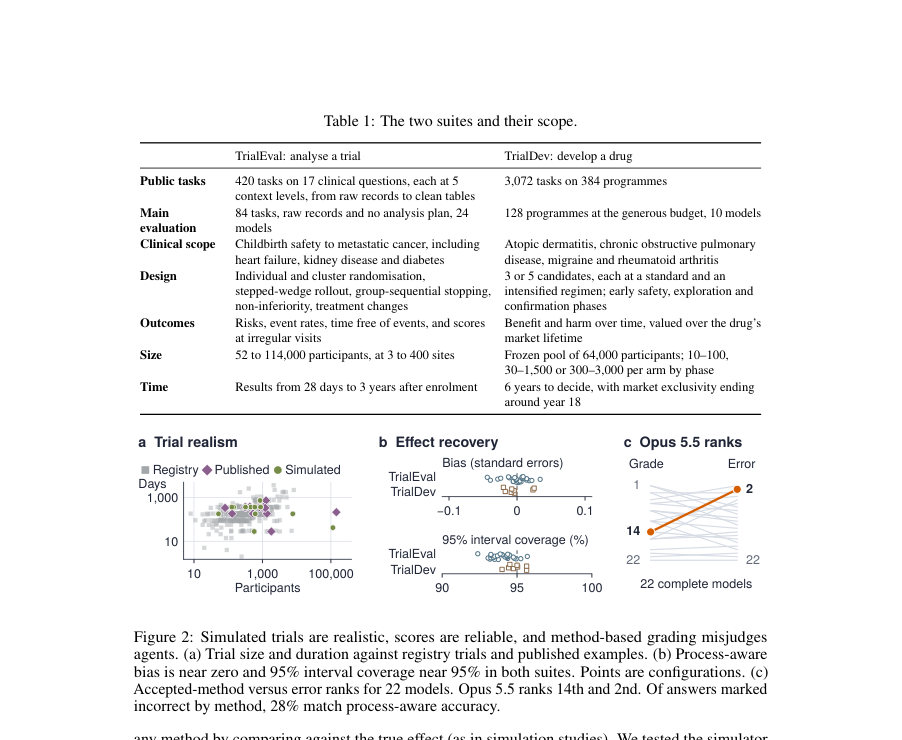
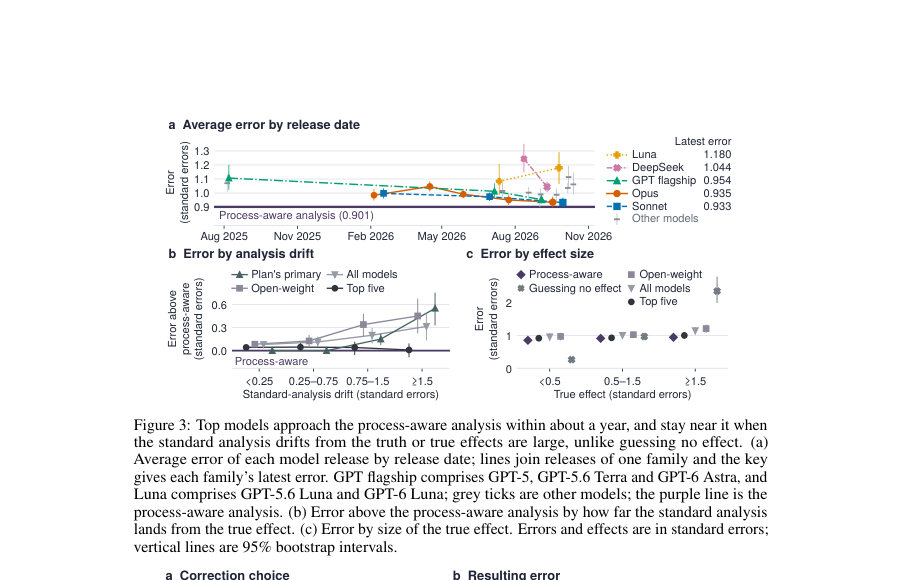

# TrialAgentBench: Evaluating AI Agents for Clinical-Trial Analysis and Long-Horizon Drug-Development Decisions

- **게시일:** 2026-11-24
- **arXiv:** [2611.30916v1](http://arxiv.org/abs/2611.30916v1) · [PDF](https://arxiv.org/pdf/2611.30916v1)
- **저자:** Bradley Segal, William Bolton, Philip Torr, David Clifton, Lei Clifton
- **분야:** cs.LG, cs.AI
- **선정 점수:** 5.97
- **선정 이유:** 최근성 1.1, 인용 영향 0.0 (인용 0회), 저자 영향 0.0 (최고 h-index 0), AI 주제 적합성 2.2, 개발자 관심 0.5, 학술 신호 0.6, 오픈 웨이트·주요 연구조직 신호 1.6

[← 2026-11-24 목록으로 돌아가기](../daily/2026-11-24.html)

<!-- paper-visuals:start -->
## 주요 Figure

> 원문 PDF에서 실제 Figure 캡션과 그림 영역이 함께 확인된 자료만 자동 추출했다.

*Figure · 원문 PDF 3쪽 · Figure 1: TrialAgentBench scores trial analysis and development decisions against a simulated true*

*Figure · 원문 PDF 5쪽 · Figure 2: Simulated trials are realistic, scores are reliable, and method-based grading misjudges*

*Figure · 원문 PDF 8쪽 · Figure 3: Top models approach the process-aware analysis within about a year, and stay near it when*

<!-- paper-visuals:end -->

## 한 문장 요약

임상 시험의 '진실'이 알려진 시뮬레이션 환경에서 AI 에이전트의 임상시험 데이터 정렬·분석 능력과 다년간의 약물 개발 의사결정(무엇을 언제 검사하고 언제 중단·진행할지)을 분리해 평가하는 벤치마크 TrialAgentBench를 제안하고, 3,492개 과제(TrialEval 420, TrialDev 3,072)와 시험용 시뮬레이터·복제시험·평가허브를 공개해 24개 모델을 정량평가한 연구.

## 해결하려는 문제

실세계 임상시험 데이터만으로는 분석·의사결정 자동화 에이전트의 신뢰성을 판단할 수 없다. 실제 시험은 비용이 크고 사람을 포함하며 반사실(counterfactual)을 알 수 없어, '분석 결과가 진짜 효과를 얼마나 잘 복구하는지'와 '그 결과로 장기 개발 결정을 잘 내리는지'를 평가할 수 없다. 기존 벤치마크는 관찰된 기록(출판·레이블)에 기반해 채점하므로, 인간 분석자의 편향이나 보고상의 오류를 학습한 에이전트를 오판할 수 있다.

## 핵심 기여

- TrialAgentBench: 시뮬레이션된 '진짜 효과'를 숨긴 채 에이전트가 원시·지저분한 임상시험 문서와 레코드를 읽고 분석 스크립트를 저장하면 이를 30개의 복제시험에 재실행하여 분석 정확도를 표준오차 단위로 평가하는 TrialEval과, 동결된 참여자 풀(64,000명)에서 검사(연구)를 구입·시행하고 6년·예산 제약 아래 어떤 연구를 언제 하고 언제 중단·승인할지를 결정한 뒤 그 결정의 가치를 오라클 대비 비율로 평가하는 TrialDev를 제안·공개함.
- 벤치마크·데이터 출시: 전체 공개 과제 수(≈3,500개; TrialEval 420, TrialDev 3,072), 복제시험·평가 허브·독립 검증기 및 규칙 기반 개발자(RBD) 구현을 공개해 재현 가능하게 함.
- 대규모 모델 평가: 24개(TrialEval)·10개(TrialDev) 모델을 평가하여, 최신 모델 세대의 분석 능력 향상(프로세스-인지적(process-aware) 분석에 근접)과 장기 의사결정에서의 여전히 남은 한계(증거 구입·수정·중단 판단)를 정량적으로 규명함.
- 평가 방법론적 기여: 분석 능력(TrialEval)과 의사결정 가치(TrialDev)를 분리하여 측정하는 평가 설계(코드 저장 후 복제시험 재실행, 개발 프로그램의 가치 산정)를 도입함.

## 접근 방법

* (요약) 논문은 임상시험 시뮬레이터와 두 개의 평가층으로 구성된다.
* 시뮬레이터는 사양(specification)을 받아 코풀라(copula)-기반으로 상관된 참여자 특성을 생성하고, 치료 배정·질병 진행 모델로 각 참여자에 대한 결과(처치/대조 하의 잠재결과)를 만든 뒤 관찰 모델로 실제 분석가가 받는 불완전·오류가 섞인 기록(결측·잘못·타임스탬프 불일치·사이트별 오류 등)을 생성한다.
* TrialEval: 에이전트에 원시 레코드와 문서를 주고(분석계획은 제공하지 않음) 데이터를 정렬·정제해 분석 스크립트(Python/R)와 사전(포맷·추출 규칙)을 저장하게 한다.
* 저장한 스크립트는 동일 사양의 30개 복제시험에 재실행되어 '평균 오차'를 표준오차 단위로 계산한다(오차 = 추정치 − 진짜 효과, 표준오차로 표준화).
* TrialDev: 3 또는 5 후보약을 가진 프로그램을 주고(각 후보에 표준·강화 투여 옵션), 고정된 참여자 풀(64,000명), 예산(최대 미화 3.14억)과 6년 시간제약 하에서 에이전트가 어떤 연구(페이즈·팔·사이즈·추적기간·방문계획)를 구매·진행·결과 열람·중단·확정·승인 제출 등을 결정하게 한다.
* 가치(value) 산정은 승인 약물의 할인된 임상 이익−해악 비용−연구비−운영비(일당 15,000달러)로 정의되며 오라클(진짜 효과를 아는 제한된 탐색 오라클) 대비 백분율로 보고한다.
* 오라클의 평균 프로그램 가치는 미화 3.43억이고, 가치 단위 환산 수치(예: 임상 이익 단위당 연간 2.5억 등)와 해악 가격(12.5–20.8M per %-year)은 브리프에 명시된다.

## 주요 결과

- 데이터·설정: 공개 과제는 총 ≈3,492개(TrialEval 420 과제, TrialDev 3,072 과제; 메인 평가용은 TrialEval 84 과제(원시레코드·분석계획 없음)와 TrialDev 128 프로그램), 복제시험 수는 30, TrialDev 고정 참여자 풀 64,000명.
- 분석 성능(TrialEval): 프로세스-인지 분석(process-aware analysis)의 평균 오차는 0.90 표준오차(SE)이며 95% 신뢰구간 포함률은 약 94%이다. 상위 모델들(Sonnet 5.5, Opus 5.5, Fable 5.1, Opus 5, GPT-6 Astra 등; 최신 릴리스들)은 프로세스-인지 분석 대비 평균 오차에서 3.5–5.8% 높음(예: Sonnet 5.5, Opus 5.5의 평균 오차 0.93 SE), 95% 신뢰구간 포함률 94–95%, 심각한 실패(serious miss)는 0–4% 수준(초기 모델(2025.8)은 15–17% 심각한 실패). 오픈-웨이트 모델들은 프로세스-인지 대비 10–38% 높은 오차를 보임.
- 핵심 오류 원인: 상위 모델들을 프로세스-인지 분석과 분리하는 단일 결정은 '기록 오류 교정(arm-specific correction) 여부 판단'임. 상위 5개 모델은 불필요한 경우에도 교정을 수행하는 경향(기록오류가 동일한 작업에서 83%가 교정 수행)으로 인해 불필요한 노이즈를 도입해 약간의 성능 손실을 입음. 프로세스-인지 분석은 불균등 기록오류가 있을 때만 교정(100%), 동일할 땐 거의 교정 안함(5%).
- 개발 가치(TrialDev): 오라클 대비 규칙기반 개발자(RBD)는 평균 57.7%의 가치를 달성함. 최상위 에이전트(Opus 5.5)는 48%(95% CI 30–62)로 RBD보다 낮음; 다른 에이전트들은 RBD보다 24–66 포인트 낮음. 오라클 평균 프로그램 가치는 미화 343M(한 포인트 ≈3.4M). 대부분의 가치 손실(평균 40.8 포인트)은 탐색(18.0)과 확인(10.4) 단계에서 발생하며 미완료(unfinished)로 인한 손실이 9.2 포인트, 최종결정 자체는 0.5 포인트에 불과함.
- 행동 패턴·자원 사용: 에이전트들은 규칙기반 개발자보다 더 넓게(더 자주) 후보를 테스트하나 확인·승인 단계에서의 성과는 개선되지 않음. 평균적으로 에이전트들은 예산의 약 43%만 사용하고 6년 시간의 약 67%만 사용(즉 시간·돈을 다 쓰지 않아도 성과를 못 냄).에이전트는 RBD보다 연구비를 약 40% 더 사용하지만, 제출된 승인 실패 사례의 상당수(93/165)는 '완료된 치료환자 수 < 300'의 공공 최소요건을 준수하지 않음(브리프에 명시). 이 '300명 완료' 가드레일을 적용하면 평균 4.3 포인트(2.5–6.3) 가치 개선이 가능함.

## 한계

- 저자 명시 한계: (1) 에이전트는 현재 '능숙한 분석가' 수준이지만 장기 의사결정(증거 구매·중단·추가 시험 설계)에서 신뢰할 수 있는 의사결정자는 아님. (2) 벤치마크는 시뮬레이션 현실에 기반하므로 실제 현장 배포 전 사람 감독이 필요하며, 우려 지점은 연구 설계·해악( harm ) 평가·중단 결정임. (3) 향후 확장 가능성으로 이전 질환군의 사전 정보 제공이나 순차적 프로그램 학습 등은 남은 연구 과제로 제시됨.
- 추론 가능한/본문에서 확인되는 한계(분리 표기): (1) 시뮬레이터 현실성 한계: 저자들은 시뮬레이터를 레지스트리·출판된 시험과 비교해 유사 범위임을 보였으나(크기·지속기간·효과 분포 등) 실제 임상현장의 모든 복잡성(비표준 보고 관행, 조직적·규제적 요인 등)으로의 일반화는 보장되지 않음. (2) 평가 대상은 공개적으로 접근 가능한 모델 릴리스와 설정에 제한되며, 실제 생산 시스템 통합·연산비용·데이터 보안·규제 준수 등 배포 비용·위험은 실험에서 다루지 않음. (3) TrialDev에서 오라클과 RBD 비교는 오라클이 제한적 탐색 그리드에 묶여 있음(운이 나쁠 수 있음) — 따라서 오라클이 절대상한은 아님(저자 명시). (4) 일부 수치(예: 가치 단위 환산, 해악 가격 범위, 운영비)는 벤치마크 브리프에 고정되어 있어 다른 경제적 가정에서는 결과가 달라질 수 있음.

## 개발자 관점

- 배포 전 인간 감독 필요 지점: 연구 설계(어떤 연구를 언제 살지), 해악의 시계열적 평가(가치 평가 시점·후속 영향), 중요한 중단·진행 결정의 리뷰를 반드시 사람과 함께 수행해야 함(논문 권고).
- 재현·검증: 에이전트가 저장한 분석 코드를 복제시험에 재실행하는 평가 절차는 지표 조작을 방지하고 분석이 실제로 데이터를 처치하는 방식을 검증하므로, 실무 도입시 '코드 저장·재실행' 로그 및 독립 재생성(replay) 테스트를 도입할 것.
- 간단한 규칙 가드레일로 상당한 개선 가능: 예컨대 '승인 제출 시 완치된(완료된) 치료환자 수 ≥ 300'을 강제하면 평균 4.3 포인트(오라클 가치 기준)를 회복할 수 있음. 따라서 배포 초기에 규칙 기반 안전장치(guardrails)를 추가하면 큰 이득이 있음.
- 훈련·개선 방향: 에이전트는 데이터 정리·레코드 정합성 검출(소스 문서 감사)과 통계적 추정에는 빠르게 능숙해졌으나, 장기적 가치 최적화를 위한 의사결정(증거 구매 비용-편익, 후속 가치의 시계열적 변화 예측)을 학습시키는 훈련 환경(시뮬레이터 기반 강화학습·메타학습)이 필요함.
- 운영상·비용 고려: 에이전트는 대체로 예산을 다 사용하지 않으며(평균 43% 사용), 불필요하거나 편향된 연구(짧은 추적기간으로 과대평가되는 강화요법 등)를 선택해 해악 비용을 증가시키는 경향이 있어 배포시 비용-리스크 모니터링과 해악 민감도 분석을 포함해야 함.

**근거 범위:** 이 분석은 제공된 논문 PDF 본문 전체에서 직접 발췌·요약한 결과에 기반한다(초록은 보조로만 사용). 본문에서 명시된 수치(과제 수, 모델 수, 평균 오차·신뢰구간, 가치 비율, 오라클 평균 가치, 복제시험 수 등)를 사용했으며, 본문에 명시되지 않은 구현 세부사항이나 외삽 수치는 포함하지 않았다. PDF 추출 과정에서 표·부록의 일부 세부 표기(예: 일부 모델별 보조 지표)는 축약해 본문에 명시된 핵심 수치 중심으로 정리했으므로, 특정 모델의 전체 보조 통계는 원문 부록을 참조하면 더 상세하다.
