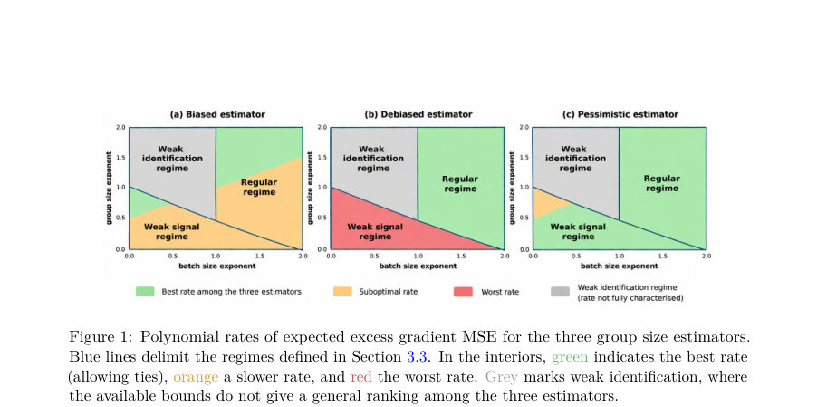
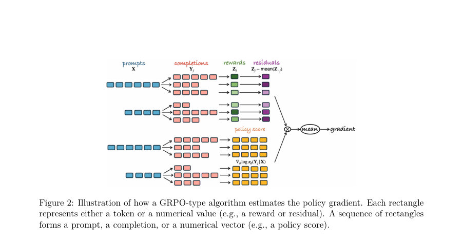
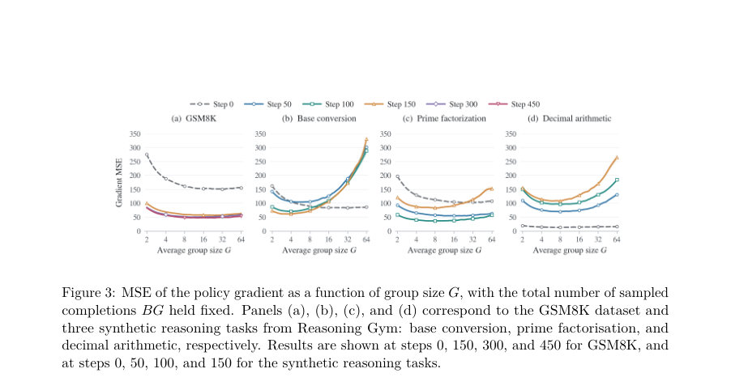

# U-Statistics-Powered LLM Reasoning

- **게시일:** 2026-11-25
- **arXiv:** [2611.33064v1](http://arxiv.org/abs/2611.33064v1) · [PDF](https://arxiv.org/pdf/2611.33064v1)
- **저자:** Shijin Gong, Kai Ye, Victor Chernozhukov, Xinyu Zhang, Chengchun Shi
- **분야:** cs.LG, stat.ML
- **선정 점수:** 6.39
- **선정 이유:** 최근성 1.2, 인용 영향 0.0 (인용 0회), 저자 영향 0.0 (최고 h-index 0), AI 주제 적합성 2.8, 개발자 관심 0.2, 학술 신호 0.5, 오픈 웨이트·주요 연구조직 신호 1.6

[← 2026-11-25 목록으로 돌아가기](../daily/2026-11-25.html)

<!-- paper-visuals:start -->
## 주요 Figure

> 원문 PDF에서 실제 Figure 캡션과 그림 영역이 함께 확인된 자료만 자동 추출했다.

*Figure · 원문 PDF 2쪽 · Figure 1: Polynomial rates of expected excess gradient MSE for the three group size estimators.*

*Figure · 원문 PDF 5쪽 · Figure 2: Illustration of how a GRPO-type algorithm estimates the policy gradient. Each rectangle*

*Figure · 원문 PDF 6쪽 · Figure 3: MSE of the policy gradient as a function of group size G, with the total number of sampled*

<!-- paper-visuals:end -->

## 한 문장 요약

GRPO의 정책그래디언트가 갖는 U-통계 구조를 이용해 최적 그룹크기 G를 분산비(c3/c1) 추정 문제로 재정식화하고, 분모가 작아 불안정한 경우를 견제하는 ‘pessimistic’ 비율 추정기를 이론·실험적으로 제안하여 적응적 그룹크기 선택으로 그래디언트 MSE와 정책 최적화를 개선한다.

## 해결하려는 문제

GRPO 계열 알고리즘에서는 각 프롬프트마다 G개의 완성(completion)을 샘플링하여 그룹평균을 baseline으로 사용하는데, 고정된 총 샘플 예산 N = B·G 아래에서 그룹 크기 G는 그래디언트 추정기의 MSE에 큰 영향을 미친다. 기존에는 G를 경험적으로 설정하는 경우가 많았으나, GRPO의 그래디언트가 2차 U-통계량 구조를 갖는다는 관찰로부터 최적 G는 두 분산 성분의 비율(c3/c1)에 의해 결정되며(c.f. Lemma 1, G* = 1 + sqrt(c3/c1)), 따라서 이를 안정적으로 추정하는 것이 문제이다. 특히 분모(c1)가 작을 때 단순한 plug-in(및 debiasing) 추정은 불안정하게 동작할 수 있다.

## 핵심 기여

- GRPO 정책그래디언트의 MSE에 대한 U-통계 기반 분해(분산 성분 c1, c2, c3)와 예산 고정 하에서의 최적 그룹 크기 해석(G* = 1 + sqrt(c3/c1))을 제시(‘GRPO scaling law’, Lemma 1).
- 편향(biased)·편향제거(debiased) plug-in 추정기들의 통계적 성질과 trade-off를 이론적으로 분석: 편향제거는 불편추정·약한 조건에서도 일관성을 제공하지만 분모가 작을 때 음수화 가능성과 비율추정 불안정성을 초래할 수 있음을 증명(Thm.1, Eq.(7),(8),(10)).
- 분모 추정의 불확실성을 고려한 'pessimistic' 비율 추정기 제안: 표준오차 항을 손실추정에 페널티로 추가하여 과소추정으로 인한 과도한 G 선택을 억제하는 알고리즘 정의(식(15),(16),(18)).
- 샘플 크기 성장률에 따른 세 가지 (regular / weak signal / weak identification) 표본-크기 체계에서 편향·편향제거·pessimistic 추정기의 초과 MSE 수렴률을 이론적으로 비교(Thm.2, Figure 1 및 Figure 4).
- Reasoning Gym(합성 문제), GSM8K, DAPO-Math-17k, AceCode, HumanEval+, MBPP+ 등 수학 및 코드 생성 벤치마크에서 적응적 그룹 크기 선택(특히 pessimistic)이 그래디언트 MSE 감소와 최종 정책 성능 향상(정량적 결과 및 학습 시간 오버헤드 측정)을 보이는 광범위한 실험 결과 제공.

## 접근 방법

* 핵심은 GRPO의 RLOO(leave-one-out) 기반 정책그래디언트 추정치가 2차 U-통계량임을 이용해 Hoeffding 분해로 MSE를 세 개 성분(c1: between-prompt, c2: first-order within-prompt, c3: degenerate second-order)으로 나눈 뒤(식(5)), 총 샘플 예산 N 고정 시 G에 대한 MSE 식을 유도하여 최적 G* = 1 + sqrt(c3/c1) 도출(Lemma 1).
* 그룹 크기 선택을 위해 파일럿 샘플(b prompts, g completions each prompt)을 별도로 수집하고 이 데이터로 c1,c3을 추정한다(Algorithm 1).
* 추정기 유형은 (i) biased: finite-group 편향을 무시한 plug-in, (ii) debiased: 선형식으로 표현되는 편향을 보정한 ec = A^{-1} bc, (iii) pessimistic: ec에 대해 표준오차 σ(G)를 계산(식(15))하고 Q_k(G) := (G·(ec1)+) + ec3/(G-1) + k·σ(G)를 최소화하여 G 선택(식(16),(18)).
* 구현에서 per-completion score norm(∥∇θ log πθ∥^2)을 하나의 backward로 microbatch 내 레이어별로 계산하고(prompt들을 소규모 덩어리로 스트리밍 처리) 잭나이프 분산추정으로(V_jack) 공분산을 추정해 σ(G), τ1 등을 산출(C.1–C.4).
* 파일럿 추정은 모든 반복에서 독립 표본을 사용하며(재사용 시 선택과 추정의 의존성 회피), 실제 구현에서는 t=0,25, 그 후 매 50 step마다 재계산.

## 주요 결과

- 분산비 추정치(표본 크기 b=g=3200 사용) 예시(표 1): c3/c1 = 6.97(Base conversion), 40.87(Prime factorisation), 28.20(Decimal arithmetic), 290.93(GSM8K), 507.31(DAPO-Math-17k). c3/c2는 모든 데이터셋에서 ≈0.9–1.01로 c2와 c3가 유사하고 둘 다 c1보다 훨씬 큼을 보여줌.
- 정책 최적화 성능(표 4, Qwen2.5-1.5B-Instruct): Reasoning Gym 및 GSM8K에서 Pessimistic 선택은 최종 평균 정확도 Avg = 64.38%로 고정 G 후보들(예: G=4 Avg=63.73, G=8 Avg=63.39 등)보다 우수함(예: Equations 55.71%, Baseconv. 70.58%, Decimal 50.98%, GSM8K 80.24%).
- 코드 생성 성능(표 5, DeepSeek-Coder-1.3B-Base): Pessimistic은 Greedy Avg = 39.27%(HE+36.59, MBPP+54.23, AceCode27.00), Average@8 Avg=38.06%, Pass@8 Avg=54.93%로 여러 고정 G 설정과 비교해 동등하거나 우수한 성능을 보임(예: G=32 Greedy Avg=39.35, Pessimistic Greedy Avg≈39.27).
- 그래디언트 MSE 측정(본문·그림 참조): pessimistic이 biased/debiased보다 평균적으로 더 낮은 gradient MSE를 기록(그림 5). (참고: 그림·수치세부는 본문 그림에 제시되어 있으나 본문 표에서 요약된 수치로는 위 결과들이 주요 개선을 시사).
- 추가 계산비용: 파일럿 기반 그룹선택의 평균 학습시간 점유율은 대략 7–10% 수준(Table 6). 예: GSM8K 전체 학습 시간 238.29 min 중 추정(파일럿) 시간 24.62 min (10.33%). DAPO(Qwen3-8B)에서는 809.70 vs 58.26 min (7.20%).

## 한계

- 저자 명시 한계: 분석은 보상·파라미터 차원 및 정책 점수(∥∇θ log πθ∥)의 상한 가정(Assumption 1)과 c2,c3 등의 하한 조건(Assumption 2)에 의존하며, 이론은 고정 차원 설정에 초점을 둠(차원 확장시 추가 복잡성 필요).
- 데이터·모델 범위: 실험은 Reasoning Gym 합성작업, GSM8K, DAPO-Math-17k, AceCode 등 특정 수학·코드 데이터와 Qwen 계열·DeepSeek-Coder 모델에 한정되어 있으며 훨씬 더 큰 모델·다양한 도메인에 대한 일반화성은 직접 검증되지 않음.
- 약한 식별·약한 신호(regimes)에서는 플러그인 추정기 간 우열을 일반적으로 판정할 수 없고(weak identification), debiased 추정기는 분모가 약할 경우 음수화·극단적 G 선택으로 성능 악화 가능(Thm.1(c), Thm.2).
- 실제 구현에서 비용·메모리 절감을 위해 policy score를 모델의 일부(마지막 Transformer 블록 일부) 차원만으로 계산했으며, 전체 파라미터에 대해 동일 성능·비용이 보장되지는 않음(본문 구현적 선택).

## 개발자 관점

- 재현을 위해서는 Algorithm 1에 따라 파일럿 단계(독립 샘플링 b prompts × g completions)를 별도로 두고 G 선택 후 실제 업데이트용 샘플을 독립적으로 수집해야 함(파일럿 샘플 재사용은 선택-추정 의존성 유발).
- 파일럿에서 얻은 bc = (bc0,bc1,bc2,bc3)을 이용해 행렬 A를 역산하여 debiased ec를 얻고, 잭나이프(또는 K-덩어리 삭제)로 Var(ec1), Cov(ec1,ec3), Var(ec3)을 추정해 σ(G) 계산(식(15)). 구현상 per-completion score norm은 microbatch backward와 레이어별 블록 누적으로 단일 backward로 계산해 메모리·시간 절감(C.1).
- 메모리 한계 해결: prompts를 K 서브셋으로 나눠 스트리밍 합산하면 GPU 메모리 요구를 O(d)로 낮출 수 있음(C.2). 잭나이프 공분산은 서브셋 합을 이용해 추가 forward/backward 없이 계산 가능(C.3).
- 하이퍼파라미터: 파일럿 크기(b,g)·최대그룹크기 Gmax·페널티 상수 k(신뢰구간 quantile)·표준오차 바닥 ε0(완성스케일·프롬프트스케일 항 포함) 등을 튜닝해야 하며, 실험에서 기본적으로 t=0,t=25,이후 50 스텝 간격으로 재추정함.
- 실전 운영 팁: 분모 c1이 작아 약한 신호 상황일 가능성이 높다면 pessimistic 규칙을 권장(데비아싱 단독은 위험). 또한 debiased ec1 ≤ 0 처리를 위해 논문처럼 ec1 ≤0이면 G=Gmax로 설정하거나 다른 보수적 규칙을 사용해야 함(식(12)).

**근거 범위:** 이 분석은 제공된 논문 PDF 본문(제시된 절·정리·표·알고리즘·부록 섹션 C 등)에 근거해 작성했습니다. 본문에 수록된 그림(예: 그림 5, 6)과 일부 정량적 비교는 텍스트·표로 요약된 수치가 제한적이므로 해당 그림의 세부 숫자는 본문 표나 부록에서 직접 확인한 수치(예: 표 1, 표 4, 표 5, 표 6)를 우선 사용했습니다. 그림 기반의 개별 체크포인트별 MSE 값 등 세부 수치는 PDF의 도표 해석에 의존하였고, 본문에 명시적 수치가 없는 경우에는 일반적 비교 결과·추세로 기술했습니다.
