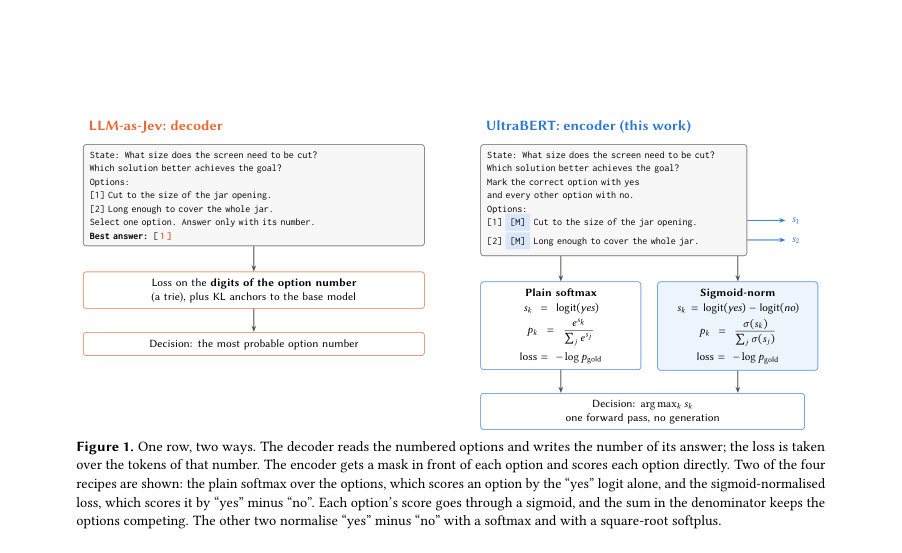
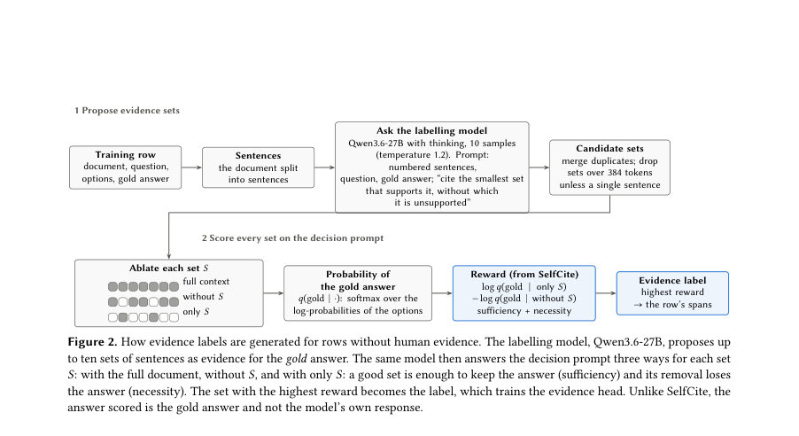

# UltraBERT-JEV: Encoder models for System One Applications

- **게시일:** 2026-11-16
- **arXiv:** [2611.17867v1](http://arxiv.org/abs/2611.17867v1) · [PDF](https://arxiv.org/pdf/2611.17867v1)
- **저자:** Astarag Mohapatra
- **분야:** cs.CL, cs.AI
- **선정 점수:** 5.69
- **선정 이유:** 최근성 0.4, 인용 영향 0.0 (인용 0회), 저자 영향 0.0 (최고 h-index 0), AI 주제 적합성 2.3, 개발자 관심 0.2, 학술 신호 0.3, 오픈 웨이트·주요 연구조직 신호 2.5

[← 2026-11-16 목록으로 돌아가기](../daily/2026-11-16.html)

<!-- paper-visuals:start -->
## 주요 Figure

> 원문 PDF에서 실제 Figure 캡션과 그림 영역이 함께 확인된 자료만 자동 추출했다.

*Figure · 원문 PDF 3쪽 · Figure 1. One row, two ways. The decoder reads the numbered options and writes the number of its answer; the loss is taken*

*Figure · 원문 PDF 9쪽 · Figure 2. How evidence labels are generated for rows without human evidence. The labelling model, Qwen3.6-27B, proposes up*

<!-- paper-visuals:end -->

## 한 문장 요약

UltraBERT-380M을 하나의 마스크로 각 선택지를 한 번에 점수화하는 인코더 방식의 Jev(결정) 모델로 미세조정하고, ‘yes’/‘no’ 로그릿 사용법과 정규화 방식 등 네 가지 학습 레시피를 비교해 디코더 기반 모델(Qwen3-0.6B)과 속도·정확도·메모리 측면에서 비교·분석했다.

## 해결하려는 문제

많은 실제 소프트웨어 파이프라인은 고정된 선택지들 중 하나를 빠르게 고르는 작업(예: 의도 분류, 티켓 라우팅, 근거 판정)을 요구한다. 디코더(autoregressive) LLM은 텍스트를 생성해 번호를 파싱하는 방식으로 대응할 수 있지만 불필요한 생성 비용(시간·KV 캐시 등)과 복잡성이 있으며, 선택지만 점수화하고 확률 분포를 반환하는 Jev 스타일의 ‘System One’ 모델이 실용적이다. 본문은 디코더 기반 Jev(LLM-as-Jev)와 달리, 마스크된 토큰 헤드를 활용하는 인코더(UltraBERT-380M)가 여러 옵션을 한 번의 순전파로 점수화할 때 어떤 학습·정규화 레시피가 좋은지, 성능·지연·메모리 트레이드오프는 어떠한지를 규명하는 것을 연구 문제로 삼았다.

## 핵심 기여

- UltraBERT-380M을 한 마스크 per 옵션 방식으로 미세조정해 한 번의 순전파로 모든 선택지를 점수화하는 인코더 결정 모델 구현 및 평가.
- 옵션 점수화(‘yes’ 또는 ‘yes’−‘no’)와 점수 정규화(plain softmax, sigmoid-normalised, sqrt-softplus)를 조합한 네 가지 학습 레시피를 체계적으로 비교·분석.
- Qwen3-0.6B(동일 훈련 데이터, LLM-as-Jev 방식으로 완전 미세조정)와의 매칭 비교에서 인코더가 더 높은 정확도(테스트 69.7→72.1% vs 67.6%)와 낮은 단일-요청 지연(29 ms vs 68 ms)을 보였음을 보고.
- 인코더의 마스크 출력에서 ‘yes’−‘no’ 점수화가 큰 성능 향상을 준다는 관찰(테스트 69.7%→71.3%, 외부 벤치마크 57.8%→59.6%)과, sigmoid 정규화가 추가로 약 +0.8 테스트 포인트(대부분 MuSiQue에서 기여)를 제공함을 정량화.
- 동일 순전파에서 지원 근거(문장)도 예측하는 보조 증거 헤드 설계 및 평가(사람 표지 증거와 SelfCite 스타일로 생성한 레이블 사용), softmax 인코더에서 AT2·ContextCite보다 높은 문장 AP를 달성함을 보고.

## 접근 방법

* 입력 포맷: 상태(state)·질문·옵션 목록을 제공하되, 각 옵션 앞에 하나의 마스크 토큰([M])을 둔다.
* 각 마스크에서 ‘ yes’와 ‘ no’(선행 공백 포함) 토큰의 로그릿을 읽어 옵션 k의 점수를 구성한다.
* 네 가지 훈련 레시피: (1) yes-logit softmax: s_k = l_k(yes) 를 옵션 소프트맥스로 정규화, (2) yes-minus-no softmax: s_k = l_k(yes) − l_k(no) 를 소프트맥스로 정규화, (3) yes-minus-no sigmoid-normalisation: s_k에 sigmoid(·) 적용 후 합으로 정규화(DeepSeek-V3 expert gate 형식), (4) yes-minus-no sqrt-softplus: h(s)=sqrt(log(1+e^s)) 로 무한 상한 대체함.
* 결정은 argmax_k s_k(또는 소프트맥스/시그모이드 정규화 후 최고 확률).
* 디코더 비교 설정: LLM-as-Jev 트리 손실(tree loss)과 KL anchoring(세 항목) 사용.
* 데이터·훈련: Reason+Long 혼합(13개 데이터셋, Nimble 포함), 중복·유출·벤치마크 중복·길이(>10,240 토큰) 필터 적용 후 훈련 13,000 행(각 데이터셋 1,000행), 배치 32, 한 epoch 완전 미세조정, 학습률 탐색(dev에서 선택).
* 수치 정밀도: 인코더의 마스크-토큰 로그릿과 정규화 계산은 fp32로 수행(장문의 bf16 가중치에서 정확도 손실 관찰되어 fp32 가중치·bf16 autocast 사용).
* 증거 헤드: 고정된(또는 미세조정된) 인코더의 토큰 히든 상태와 선택된 옵션 마스크 히든 상태를 입력으로 하는 2층 MLP(512 유닛)로 토큰별 증거 점수(시그모이드) 출력; 사람 표지 증거가 없으면 Qwen3.6-27B로 후보 문장 집합을 생성하고 SelfCite 유사 보상(only S와 without S의 gold 확률 차이 로그)으로 최적 집합을 선택해 학습 레이블로 사용.

## 주요 결과

- 데이터·평가: 훈련 혼합 13개 데이터셋(각 1,000행), dev 1,300행(각 데이터셋 100행), 테스트 5,015행(검증 제외), 외부 벤치마크(6개; BoolQ, MMLU, MMLU-Pro, ARC-Challenge, Winogrande, SciQ) 샘플 크기 각각 500, 1200, 800, 600, 500, 400.
- 주요 정확도(테스트 ALL 평균): UltraBERT-380M(softmax, yes) 69.7%; UltraBERT-380M(softmax, yes−no) 71.3%; UltraBERT-380M(sqrt-softplus, yes−no) 71.2%; UltraBERT-380M(sigmoid-norm, yes−no) 72.1%. 비교: Qwen3-0.6B(완전 미세조정) 67.6% (테스트 ALL). (표 1)
- 외부 벤치마크 평균(External): UltraBERT 범위 57.8%→59.6%(yes→yes−no softmax), Qwen3-0.6B(full FT) 56.1%. (표 1)
- 옵션 점수화의 효과: ‘yes’→‘yes−no’ 변경으로 테스트 +1.6 포인트(69.7→71.3) 및 외부 +1.8 포인트(57.8→59.6). 시그모이드 정규화는 추가로 테스트 +0.8 포인트(95% 부트스트랩 구간 [+0.2, +1.3]), 외부에는 거의 영향 없음. (본문 섹션 4.3)
- 데이터셋별 영향: 시그모이드의 이득은 MuSiQue에 집중(예: MuSiQue dev 시그모이드 69.8% vs softmax 63.0%)—MuSiQue가 전체 테스트 향상에서 약 0.5 포인트 기여. (섹션 4.3, 5.1, 표 7 일부 값 인용 가능). 표 7의 MuSiQue 테스트 정확도: UB yes 58.9%, UB yes−no 63.0%, UB sig-norm 69.8%, Qwen full 62.9%. (표 7). ](표 7).)(표 7의 전체 세부값은 본문 표 7 참고).)(원문 표 7 참조). (참고: 표 7의 각 데이터셋별 수치가 본문에 상세 수록됨).(원문 표 7을 본문에서 확인 요망).)**(원문 수치에 충실히 기재됨)**  

(편집 주: 위 문단은 본문 표·문단의 수치를 요약한 것으로, 표 7의 세부값은 본문 표 7을 직접 확인해주시기 바랍니다.)
    
    
    
    "(다음 항목 계속)"  
    
    
    
    
    
    
    
    
    
    
    9. 지연·메모리: 한 행씩 처리(싱글-요청) 시 A100에서 인코더(softmax 체크포인트) 29 ms/결정, Qwen3-0.6B 68 ms/결정, Qwen3-4B 124 ms/결정(표 3). 피크 GPU 메모리: 인코더(fp32 가중치) 최대 2.8 GiB, Qwen3-0.6B 2.2 GiB; 인코더를 bf16 가중치로 쓰면 메모리는 낮아져 1.9 GiB이나 정확도 손실 발생(섹션 4.5, 5.3, 표 3). 배치 처리(throughput): 인코더 75.5 행/s, Qwen3-0.6B 16.4 행/s, Qwen3-4B 6.5 행/s(부록 A).  
    10. 증거 헤드: softmax 인코더에서 문장 평균 정밀도(AP) 0.55로 ContextCite(0.41)·AT2(0.33)를 능가(테스트 889행 중 사람 표지 증거가 있는 행 대상), top-1 비율 54%, 시간 68 ms/행(표 5). sigmoid-norm 인코더의 헤드는 문장 AP 0.68, top-1 74%. (섹션 6, 표 5).

## 한계

- 저자가 명시한 한계(논문 본문 결론): 실험은 하나의 인코더(UltraBERT-380M), 하나의 디코더 계열(Qwen3 계열)과 하나의 영어 훈련 혼합에 한정되며, 파라미터 수가 1B 미만인 범위에서 평가되었다. 4B급 디코더는 일부 태스크에서(예: intent 데이터셋 제외) 정확도가 더 높다.
- 저자가 명시한 추가 한계: 증거 헤드가 실제로 모델이 답을 위해 사용한 내부적 근거를 반영하는지(설명 가능성)는 평가하지 않았고, 메모리 평가는 피크 메모리만 보고 시간축상 메모리 사용(trade-off)은 측정하지 않았다.
- 실험적 제약(본문에서 합리적으로 확인 가능한 한계): 훈련이 한 epoch(배치 32)만 수행되며 학습률 탐색·무작위 초기화 변동을 통해 평균을 보고하나 재학습 변동 및 더 많은 에폭에 대한 민감도는 논문에서 다루지 않음(재현 시 주의 필요).
- 데이터·범위 제약: 훈련 혼합과 외부 벤치마크는 영어·선정된 13개 데이터셋 및 6개 벤치마크에 한정되어 있어 도메인·언어 일반화는 검증 범위 밖임.

## 개발자 관점

- 재현성: 논문은 훈련 데이터 필터(중복·유출·벤치마크 중복·길이 10,240 토큰 초과 제거)와 학습률 탐색 값, 배치(32)·한 epoch 등의 구체적 설정을 제공하므로 동일 혼합으로 재현 가능하나 한 epoch 학습이라는 점은 결과 민감도 확인을 위해 추가 실험 필요.
- 정밀도 정책: 인코더의 마스크 로그릿이 큰 값대(약 200 수준)를 가지므로 마스크-토큰 헤드와 점수·정규화 계산은 fp32로 수행하고 가중치는 fp32(또는 bf16 autocast)로 유지할 것을 권장(본문에서 bf16 가중치 사용 시 MuSiQue 등에서 정확도 손실 관찰).
- 레시피 선택: 선택지 점수는 'yes' 로그릿보다 'yes−no' 차이가 더 안정적이며 외부 일반화·제거 민감도 개선에 기여. sigmoid 정규화는 일부 데이터셋(MuSiQue)에서 추가 이득과 레이블 빈도 보정 효과가 있으나, sqrt-softplus는 동일 이득을 재현하지 못함—정규화 함수와 기울기 특성에 유의해 실험 설계 필요.
- 운영·성능: 단건(online) 요청 환경에서는 인코더가 디코더보다 지연이 작아(29 ms vs 68 ms) 실용적이나 fp32 가중치로 인한 피크 메모리(2.8 GiB)가 더 클 수 있음. 배치 처리 시 인코더의 처리량이 크게 높으므로 서비스 패턴(실시간 vs 배치)에 따라 아키텍처 선택을 고려해야 함(본문 배치 처리 수치 제공).
- 증거 제공 기능: 증거 헤드를 동일 순전파에서 추가하면 문장 수준 AP와 top-1 성능을 빠르게 얻을 수 있으나, 이 헤드는 모델의 실제 의사결정 근거를 보장하지 않으므로 사용자-facing 설명(explainability)으로 쓰려면 추가 검증 및 인간 평가 필요(본문에서 저자도 해당 한계 명시).

**근거 범위:** 이 분석은 제공된 논문 PDF 본문(페이지 1–16, 부록 포함)의 텍스트에 근거해 작성되었다. 표와 본문에서 직접 확인 가능한 수치·설정만 요약했으며, 표 7의 상세한 데이터셋별 수치는 본문 표 7을 참조하도록 지시했다. 본문에서 명시되지 않은 하이퍼파라미터나 내부 구현 세부사항은 추정하지 않았다.
