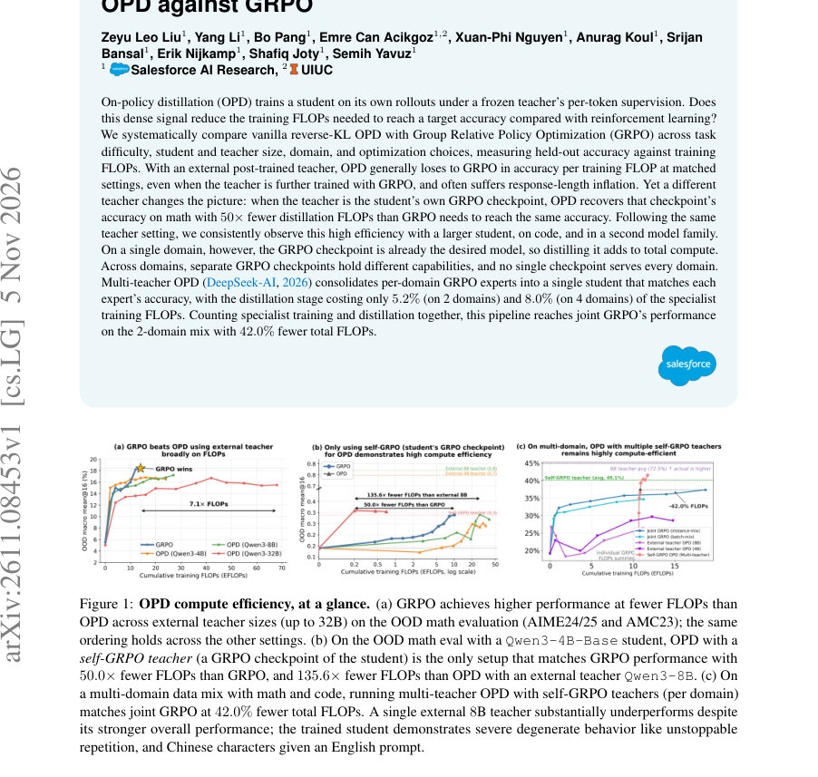
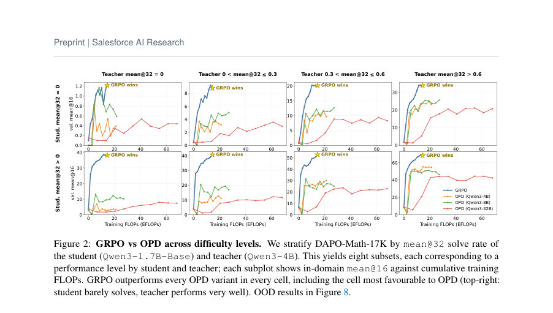
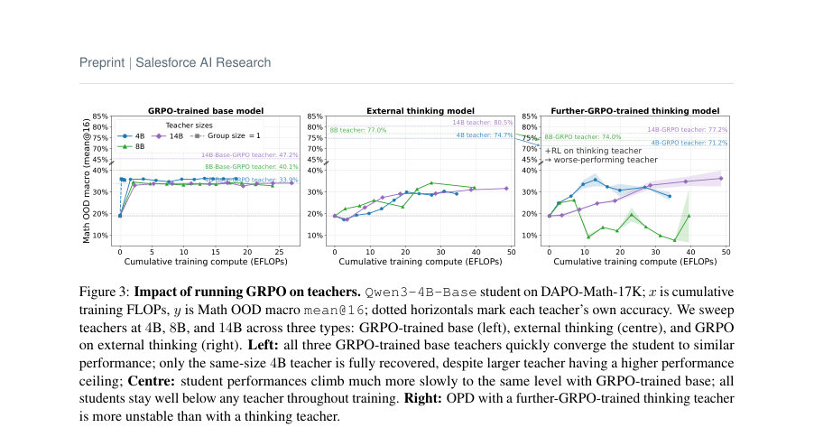

# Unpacking the Compute Efficiency of Strong-to-Weak OPD against GRPO

- **게시일:** 2026-11-07
- **arXiv:** [2611.08453v1](http://arxiv.org/abs/2611.08453v1) · [PDF](https://arxiv.org/pdf/2611.08453v1)
- **저자:** Zeyu Leo Liu, Yang Li, Bo Pang, Emre Can Acikgoz, Xuan-Phi Nguyen, Anurag Koul, Srijan Bansal, Erik Nijkamp, Shafiq Joty, Semih Yavuz
- **분야:** cs.LG, cs.CL
- **선정 점수:** 5.60
- **선정 이유:** 최근성 0.8, 인용 영향 0.0 (인용 0회), 저자 영향 0.0 (최고 h-index 0), AI 주제 적합성 1.5, 개발자 관심 0.2, 학술 신호 0.3, 오픈 웨이트·주요 연구조직 신호 2.8

[← 2026-11-07 목록으로 돌아가기](../daily/2026-11-07.html)

<!-- paper-visuals:start -->
## 주요 Figure

> 원문 PDF에서 실제 Figure 캡션과 그림 영역이 함께 확인된 자료만 자동 추출했다.

*Figure · 원문 PDF 1쪽 · Figure 1: OPD compute efficiency, at a glance. (a) GRPO achieves higher performance at fewer FLOPs than*

*Figure · 원문 PDF 5쪽 · Figure 2: GRPO vs OPD across difficulty levels. We stratify DAPO-Math-17K by mean@32 solve rate of*

*Figure · 원문 PDF 6쪽 · Figure 3: Impact of running GRPO on teachers. Qwen3-4B-Base student on DAPO-Math-17K; x is cumulative*

<!-- paper-visuals:end -->

## 한 문장 요약

본 논문은 vanilla reverse‑KL 기반의 on‑policy distillation(OPD)과 Group Relative Policy Optimization(GRPO)을 누적 학습 FLOPs 기준으로 체계적으로 비교하고, ‘self‑GRPO’ 교사와 다중 교사 OPD를 통해 어떤 상황에서 OPD가 계산 효율적(특히 specialist→generalist 통합)인지를 규명한다.

## 해결하려는 문제

기존 주장들은 OPD가 샘플 효율 또는 적은 optimizer step으로 RL(예: GRPO)보다 유리하다고 보고하지만, 교사 포워드 비용과 생성 길이 증가로 인해 실제로 목표 정확도(same held‑out performance)를 달성하는 데 필요한 총 학습 FLOPs가 줄어드는지는 불명확하다. 즉, dense per‑token 감독의 이점이 '전체 학습 FLOPs' 관점에서 GRPO 대비 실질적 이득으로 이어지는지(특히 외부 교사 vs 학생의 GRPO 체크포인트 등 교사 출처에 따라)는 검증되어야 한다.

## 핵심 기여

- 학습 FLOPs(누적 FLOPs)를 기준으로 reverse‑KL OPD와 GRPO를 광범위·통제된 설정(데이터 난이도, 학생/교사 크기·출처, 도메인, 그룹 크기 등)에서 비교한 최초의 체계적 실험을 제시한다 (§3–§4).
- 외부(post‑trained) 교사를 쓰는 vanilla reverse‑KL OPD는 대부분의 매칭 설정에서 동일한 FLOP 예산 기준으로 GRPO에 뒤지며 응답 길이 폭주 등 병적 동작을 자주 보인다는 실험적 증거를 제시한다 (§4, Appendix E).
- 교사(provenance)가 중요함을 입증한다: 학생 자신의 GRPO 체크포인트(self‑GRPO)를 교사로 쓰면 OPD가 해당 체크포인트 성능을 매우 적은 distillation FLOPs로 회복(예: math에서 G=1 기준 약 50× 절감, 기본 G=8에서는 ≈6×)하며 이 결과가 더 큰 학생·코드·다른 모델 가족에서도 재현된다 (§5, Appendix G).
- 실무적 파이프라인 제안: 각 도메인별로 GRPO로 전문가(특수화)를 만든 뒤 multi‑teacher OPD로 합치는 방식이, 합쳐진 다중 도메인 모델을 얻는 데 있어서 joint GRPO보다 전체 FLOPs 관점에서 유리함을 보인다(2도메인에서 증류 비용이 전문가 학습 FLOPs의 5.2%, 4도메인에서 8.0%; 전체 파이프라인은 2도메인에서 joint GRPO보다 42.0% 적은 총 FLOPs로 동등 성능 달성) (§6).

## 접근 방법

* 주요 비교 축은 '유효 누적 학습 FLOPs' 대비 보류용 데이터 성능(mean@16)이다.
* GRPO: Group Relative Policy Optimization(결과 reward 기반)로 각 token에 대해 학생 로그확률을 업데이트하며, 논문은 per‑generated‑token FLOP을 GRPO = 10·Ns(생성 2Ns, 로그확률 재계산 2Ns, 업데이트 6Ns)로 산정한다.
* OPD: 학생의 on‑policy rollouts 위에서 frozen teacher의 per‑token 확률을 이용한 closed‑form reverse‑KL(top‑k renormalized, k=16) 손실을 사용하며 OPD는 각 훈련 토큰에 대해 추가 교사 포워드 비용 2·Nt가 더해진다.
* 비교 대상 모델과 설정: Qwen3 계열(1.7B/4B/8B base), 외부 thinking 모델들(Qwen3-{4B,8B,14B,32B}), 학생 자신의 GRPO 체크포인트(self‑GRPO), 추가로 further‑GRPO 훈련된 교사들; 데이터셋은 DAPO‑Math‑17K, DeepMath‑103k(수학), LiveCodeBench v1–v5 및 CodeForces(코드), MMLU‑Pro·IFBench‑RLVR(멀티도메인).
* 기본 롤아웃 그룹 크기 G=8이나 G=1 ablation을 수행하고, 평가는 mean@16(16 샘플링) 및 수학 OOD 매크로(AIME24/25+AMC23)·LCBv6(코드) 등을 사용한다.
* 추가 진단으로 초기 top‑16 토큰 겹침과 스펙트럼(κspec, ρΣ, δΣ) 분석을 통해 교사‑학생의 가깝고 먼 관계를 측정한다 (Appendix H).

## 주요 결과

- 외부(post‑trained) thinking 교사를 쓰는 vanilla reverse‑KL OPD는 대부분의 매칭 설정에서 동일 FLOP에서 GRPO보다 낮은 정확도를 보임(수학·코드·다중도메인 전반). 데이터 난이도별 층화 실험에서도 GRPO가 모든 셀에서 OPD보다 우세한 경우가 많음(§4.1, Figure 2).
- external‑teacher OPD는 훈련 중 응답 길이(response length) 폭주를 일으켜 토큰당 FLOPs를 추가로 증가시키는 병적 행동을 자주 관측함(Appendix E, Fig.24 등).
- self‑GRPO 교사(학생 자신의 GRPO 체크포인트)를 교사로 쓰는 경우 OPD가 매우 계산 효율적임: 예시로 Qwen3‑4B‑Base 학생에서 self‑GRPO 교사(teacher OOD 매크로 33.9%)를 OPD로 distill하면 교사 성능을 복구하는 데 1.62 EFLOP 소요(학생 자체 GRPO가 동일 성능에 도달하는 10.1 EFLOP 대비 ≈6× 절감); 그룹 크기 G=1일 때는 약 0.2 EFLOP로 ≈50× 절감이 관찰됨(§5, Fig.3).
- 동일 패턴이 더 큰 학생(Qwen3‑8B‑Base)과 다른 모델 가족(Olmo‑3‑7B‑Instruct‑SFT) 및 코드 도메인으로 일반화됨: Qwen3‑8B 예에서 self‑GRPO는 teacher OOD 40.1%를 G=8에서 ≈3 EFLOP, G=1에서 ≈1 EFLOP로 회복(반면 GRPO 자체는 ≈27.9 EFLOP 필요) (Fig.25). Olmo 예에서는 OPD가 교사(40.0%)를 ≈0.36 EFLOP로 매칭하고 이후 51%까지 오버슈트(교사 대비 +≈11% 절대)함(Appendix G, Fig.27).
- multi‑teacher OPD(각 도메인의 self‑GRPO 전문가들을 라우팅하여 reverse‑KL로 distill): 2도메인(math+code)에서 전문가 학습 총 10.7 EFLOP 후 distillation은 추가 0.55 EFLOP(≈5.2%)로 전문가 성능을 복구; 4도메인에서는 전문가 학습 14.4 EFLOP 후 distillation 추가 1.15 EFLOP(≈8.0%). 전문가 학습+distill 파이프라인은 2도메인에서 joint GRPO와 동등 성능을 42.0% 적은 총 FLOPs로 달성(§6, Fig.5, Fig.31–32).

## 한계

- 저자 명시 한계: 본 연구는 vanilla reverse‑KL OPD와 closed‑form top‑k(k=16) 추정기만을 매칭 FLOPs 관점에서 비교했으며, hybrid objective(OPD+outcome reward), 대체 발산(다른 divergence), trajectory reweighting, 비동기·speculative rollout 파이프라인 등 최근 제안된 변형들은 FLOPs 기준에서의 우월성을 보일 수 있으나 본고에서는 평가하지 않았다(§Limitations).
- 저자‑및실험 범위에서 드러나는 제약(검증적): self‑GRPO의 큰 절감은 '증류 단계' FLOPs만 계산한 수치에 기반한다 — 즉 self‑GRPO 교사를 얻기 위한 GRPO 전문가 학습 비용을 따로 고려하지 않으면 단일 도메인에서는 총비용이 오히려 증가할 수 있다(§5 요지).
- 추가 관찰적 제약(본문에서 합리적으로 확인되는 한계): 본 실험은 특정 모델 패밀리(Qwen3, Olmo)와 공개 데이터셋에 한정되어 결과의 일반화(다른 아키텍처·스케일·하드웨어·인프라)는 보장되지 않는다. 또한 FLOPs 회계는 논문이 가정한 per‑token 비용 모델(예: GRPO=10·Ns, teacher forward=2·Nt, 프롬프트 컨텍스트 제외)에 의존하므로 실제 하드웨어·병렬화·메모리 동작에 따라 wall‑clock/energy 효율성과 차이가 날 수 있다.

## 개발자 관점

- 효율 주장 시 '학습 FLOPs(implementation‑invariant)'를 보고하라 — GPU‑시간/스텝 수만으로는 교사 포워드·응답 길이 변화에 따른 실 비용을 반영하지 못함(저자 권고, §7과 Reproducibility).
- 교사 선택은 출처(provenance)가 결정적이다: 외부 post‑trained 'thinking' 교사는 계산 효율성과 안정성 면에서 불리하고 응답 길이 폭주·붕괴 위험이 있으므로, 같은 가족·같은 초기화에서 GRPO로 학습된 학생의 체크포인트(self‑GRPO)를 교사로 쓰면 distillation 단계에서 큰 FLOPs 절감과 안정적 전이가 가능하다(§5).
- 멀티도메인 실무 전략: 도메인별로 전문가를 독립적으로 GRPO로 특수화한 뒤 multi‑teacher OPD로 병합하면(각 인스턴스를 해당 도메인 전문가로 라우팅) joint GRPO로 단일 모델을 훈련하는 것보다 전체 FLOPs를 줄이고 더 나은/동등 성능을 얻을 수 있음(예: 2도메인에서 종합 42.0% 절감) — 단, 전문가 학습 비용을 포함한 전체 회계를 고려해야 함(§6).
- 운영적 권고: 외부 교사 OPD를 쓸 경우 응답 길이와 degenerate 반복성(unstoppable repetition) 같은 병적 동작을 모니터링하고 길이 캡·토큰 재가중치 등 안전장치를 마련하라(Appendix E). 또한 G(rollout group size)를 G=1으로 줄이면 단일 도메인 수학에서는 FLOPs 이득을 얻지만(optimizer step은 더 많아짐) 코드·다중도메인에서는 회복되지 않으므로 도메인별 실험이 필요하다(§4.2, Appendix I).
- 재현성: 논문은 모든 하이퍼파라미터, 프롬프트, 모델·데이터 버전을 명시하고(Section 3, Appendix B/C/J) 스펙트럼 및 top‑k 오버랩 진단을 제시하므로 동일 파이프라인을 재현·검증하기에 실무자에게 유용하다.

**근거 범위:** 이 분석은 제공된 논문 PDF 본문(본문과 부록 내용 포함)을 근거로 작성하였다. 본문에서 제시된 수치(예: EFLOP, 비율, mean@16 성능, 50×/6×/5.2%/8.0%/42.0% 등)는 논문 텍스트와 도표에서 직접 인용한 값이다. PDF 추출 과정에서 일부 도표 수치가 도표 캡션과 본문에 분산되어 있어 본문에 명시된 수치와 부록의 상세표를 우선으로 하였고, 논문 외부의 추가 구현 세부(하드웨어·실제 wall‑clock 시간 등)는 포함하지 않았다.
