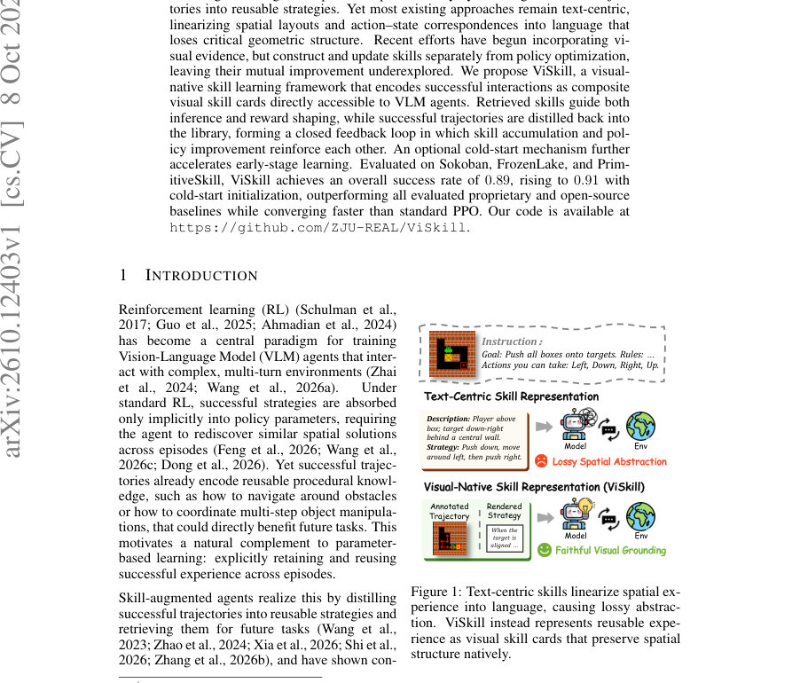
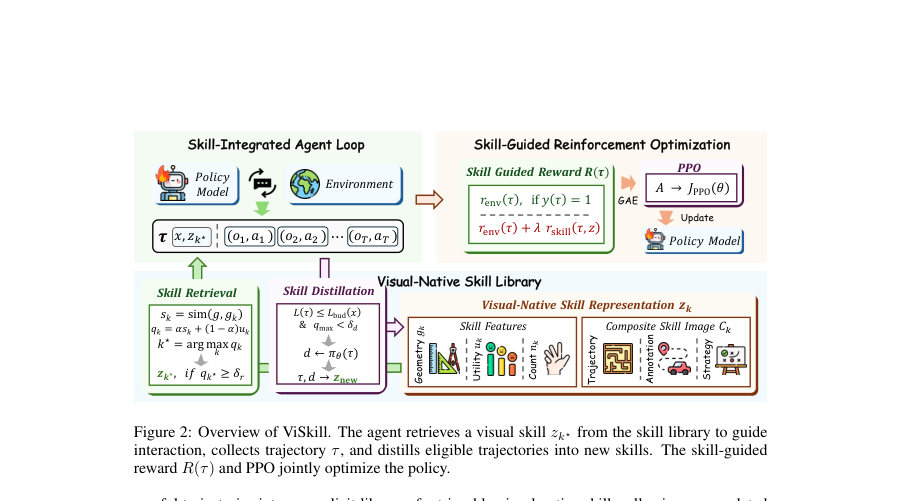
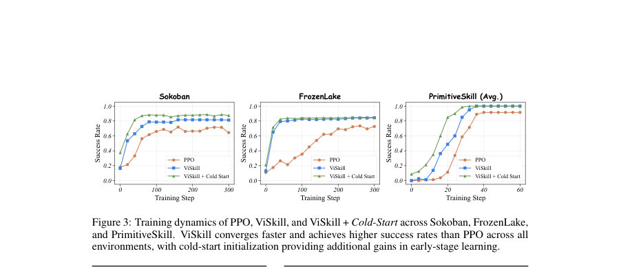

# ViSkill: Reinforcing VLM Agents with Evolving Visual-Native Skills

- **게시일:** 2026-10-11
- **arXiv:** [2610.12403v1](http://arxiv.org/abs/2610.12403v1) · [PDF](https://arxiv.org/pdf/2610.12403v1)
- **저자:** Hongxing Li, Dingming Li, Yixin Li, Yong Du, Wenqi Zhang, Weiming Lu, Jun Xiao, Yueting Zhuang, Yongliang Shen
- **분야:** cs.CV, cs.CL
- **선정 점수:** 3.68
- **선정 이유:** 최근성 0.5, 인용 영향 0.0 (인용 0회), 저자 영향 0.0 (최고 h-index 0), AI 주제 적합성 2.0, 개발자 관심 0.9, 학술 신호 0.3, 오픈 웨이트·주요 연구조직 신호 0.0

[← 2026-10-11 목록으로 돌아가기](../daily/2026-10-11.html)

<!-- paper-visuals:start -->
## 주요 Figure

> 원문 PDF에서 실제 Figure 캡션과 그림 영역이 함께 확인된 자료만 자동 추출했다.

*Figure · 원문 PDF 1쪽 · Figure 1: Text-centric skills linearize spatial ex-*

*Figure · 원문 PDF 3쪽 · Figure 2: Overview of ViSkill. The agent retrieves a visual skill zk⋆from the skill library to guide*

*Figure · 원문 PDF 7쪽 · Figure 3: Training dynamics of PPO, ViSkill, and ViSkill + Cold-Start across Sokoban, FrozenLake,*

<!-- paper-visuals:end -->

## 한 문장 요약

ViSkill은 성공한 상호작용을 공간 정보를 보존하는 합성 시각 스킬 카드로 저장·검색하고, 검색된 스킬을 인퍼런스와 보상 성형에 활용하며 성공 경로를 온라인으로 다시 증류해 스킬 라이브러리와 정책을 공동진화시키는 VLM 에이전트 학습 프레임워크이다.

## 해결하려는 문제

기존의 스킬-증류 방식은 주로 텍스트 중심 표현을 사용해 공간 배치와 행동-상태 대응을 언어로 선형화함으로써 기하학적 구조를 손실하고, 시각적 근거를 일부 도입한 최근 연구들도 스킬 생성·업데이트를 정책 최적화와 분리해 스킬 축적과 정책 개선의 상호 강화 효과를 충분히 탐구하지 못했다. 본문은(1) 시각 환경에서 공간적·절차적 맥락을 잃지 않는 스킬 표현 방법과 (2) 검색·활용·증류가 정책 학습과 함께 상호 보완적으로 동작하도록 하는 학습 루프 설계라는 두 가지 핵심 문제를 다룬다.

## 핵심 기여

- 시각적-네이티브(visual-native) 스킬 카드를 도입해 성공적 상호작용의 주석화된 프레임과 정책이 증류한 전략 서술을 하나의 합성 이미지(Ck)로 구성함으로써 공간·절차 문맥을 VLM 입력으로 직접 제공하는 표현을 제안함.
- 기하학 유사도 기반 스킬 검색과 역사적 유틸리티를 결합한 검색 점수(qk = α sk + (1−α) uk), 검색 임계치(δr), 그리고 스킬-유도 보상(rskill)으로 정책 학습과 스킬 활용을 결합한 폐쇄형 피드백 루프를 설계함.
- 성공 경로의 품질(길이 예산 Lbud)과 다양성(신규성 문턱 δd) 게이트를 통해 온라인으로 스킬을 증류·추가하고(증류 시 정책이 자체로 전략을 요약·렌더링), 라이브러리 용량 초과 시 유틸리티·빈도 기준으로 퇴출 규칙(kevict = arg min uk log(nk+1))을 적용함.
- 초기 학습 가속을 위한 선택적 콜드-스타트(seed) 메커니즘을 제시하여 외부 솔버·외부 모델로부터 다양한 초기 스킬을 채워 빠른 초기 수렴을 유도함.
- Sokoban, FrozenLake, PrimitiveSkill 세 환경에서 정량 실험을 통해 표준 PPO와 여러 공개·비공개 베이스라인 대비 더 빠르게 수렴하고 높은 성공률을 달성함을 보임.

## 접근 방법

* 아키텍처 및 알고리즘(본문 기준):
* 스킬 표현: 각 스킬 zk는 합성 이미지 Ck(주석된 궤적 프레임 + 정책이 증류한 전략 dk 텍스트), 기하학 기술자 gk, 유틸리티 uk, 사용 회수 nk로 구성된다.
* Renderer는 그리드 환경에서는 궤적 프레임과 행동 레이블·경로 오버레이를, 3D 조작 환경에서는 원본 제3자 프레임을 보존해 합성 카드를 만든다.
* 스킬 검색: 에피소드 시작 시 환경별 특징 추출기로 초기 상태의 기하학 기술자 g를 얻고, 각 스킬과의 유사도 sk = sim(g, gk)를 계산한다(이산 환경은 블록별 정확도 평균, 조작 과제는 물체 좌표 기반 연속 거리 유사도).
* 검색 점수 qk = α sk + (1−α) uk로 최고 스킬 k* 선택, qk* ≥ δr일 때만 Ck*를 VLM의 시각 컨텍스트에 추가한다.
* 스킬 활용: 검색된 스킬 카드는 정책 πθ의 입력(시각 컨텍스트)으로 들어가 in-context 시범 역할을 하며, 에피소드 보상에는 스킬-유도 보상 rskill(식(6), 참조 궤적과의 정합도 기반)이 추가되어 실패한 에피소드에도 부분 보상을 부여한다.
* 최종 보상은 환경 보상 + λ rskill(검색된 경우)로 구성되고 λ는 조절 계수이다.
* 스킬 증류 및 라이브러리 관리: 에피소드 종료 후 성공(y(τ)=1)한 궤적은 품질 게이트(L(τ) ≤ Lbud(x))와 신규성 게이트(qmax < δd)를 통과하면 정책이 자체로 추출한 전략을 렌더링해 새 스킬로 추가한다.
* 초기 유틸리티 0.5로 시작하며 라이브러리 용량 초과 시 uk log(nk+1) 기준으로 퇴출한다.
* 콜드-스타트: 선택적으로 외부 솔버로 생성한 후보 궤적과 외부 모델(실험에서는 GPT-5.4-mini)을 이용해 farthest-point 샘플링으로 Ncold 크기만큼 초기 스킬을 채운다(γ로 스케일).
* 학습 루프: Algorithm 1대로 배치 단위로 각 환경 x에 대해 특징 추출→스킬 검색→πθ로 궤적 수집→스킬-유도 보상 계산→유틸리티 업데이트→증류(조건 만족 시)→PPO(클리핑된 목표, GAE로 이점 추정)로 파라미터 업데이트.
* 정책 백본은 Qwen2.5-VL-3B-Instruct, 최적화는 PPO(ϵ=0.2) 사용.

## 주요 결과

- 평가 환경: Sokoban(격자 푸시 퍼즐), FrozenLake(격자 내 목표 회피 네비게이션), PrimitiveSkill(ManiSkill 기반 3D 조작: Place, Stack, Drawer, Align, Swap).
- 주요 정량 성과(본문 표/문장 기준): 전체 평균 성공률 ViSkill = 0.89, ViSkill + Cold-Start = 0.91. 세부: Sokoban 0.82(콜드스타트 0.88), FrozenLake 0.84(콜드스타트 0.85), PrimitiveSkill 평균 1.00(콜드스타트 동일).
- 비교 베이스라인: ViSkill은 AtlasVA(0.87 overall), VAGEN(0.80 overall) 등 다수 공개·상용 모델을 포함한 비교에서 전체/환경별로 우수한 성능을 보였음(테이블 1).
- 학습 동적: ViSkill은 표준 PPO보다 일관되게 더 빠르게 수렴하며 콜드-스타트는 초기 단계에서 추가 이득을 제공(도표 Fig.3).
- 구성요소 제거 실험(본문 Table 3): 스킬-유도 보상 제거 시 성능 하락(−0.05 Sokoban, −0.04 FrozenLake), 전략 문구 제거 시 하락(−0.10 Sokoban, −0.03 FrozenLake), 정책 최적화(공동 최적화)를 제거하면 큰 성능 저하(−0.53 Sokoban, −0.51 FrozenLake)로 공동 진화의 중요성을 확인함(정확한 드롭치는 본문 수치 인용). 성능 민감도: λ 최적값은 0.8으로 보고(테이블 4), 검색 임계치 δr = 0.80, 증류 다양성 문턱 δd = 0.90이 좋은 균형을 보임(Fig.4, Fig.5).

## 한계

- 저자 명시 한계(본문): 실험이 VAGEN 프레임워크가 지원하는 시뮬레이션 환경 집합에 국한되어 있어 더 복잡하거나 개방형 환경에서의 일관된 이득 여부는 검증되지 않음. 또한 스킬-유도 보상은 유용한 부분 진척이 검색된 스킬이 표현하는 상태로 도달할 때만 의미 있는 신호를 주므로, 해법 경로가 검색된 스킬 경로와 분리되는 경우 유도 신호가 약할 수 있음.
- 본문에서 확인되는 제약(분석적): 실험은 Qwen2.5-VL-3B-Instruct 백본과 H100 GPU(실험별 2–4대)를 사용한 설정으로 보고되어 실제 재현·배포 시 상당한 계산 자원이 필요함. 실험에서 품질 게이트(Lbud) 산정을 위해 솔버(최단 경로 등)를 사용했으나 본문은 솔버가 반드시 필요하지 않음을 보이는 대체 실험도 제시(부록 D.3). 또한 기하학 기술자(특징 추출)는 규칙 기반을 사용했으며 학습된 일반 특징(DINOv2) 대체 시에도 약간의 성능 저하가 발생해 수작업 기술자 설계에 의존할 가능성이 존재함(부록 D.4).

## 개발자 관점

- 재현성·구현: 저자들은 코드 공개를 표기하고(본문), 주요 하이퍼파라미터와 알고리즘(Alg.1), 스킬 구조·유사도 함수·증류·보상·PPO 하이퍼파라미터의 상세를 부록에 제공하므로 논문 기반 구현 재현이 가능함(백본: Qwen2.5-VL-3B-Instruct, α=0.9, β=0.1, λ=0.8, δd=0.9, δr=0.8, γ=0.2 등 본문 수치 명시).
- 토큰/입력 예산: 스킬 카드는 이미지 토큰을 추가로 소비하므로 실험은 카드 해상도(스케일)를 줄여 토큰 효율을 평가했으며(그 결과 저해상도 변형도 텍스트 기반 스킬보다 우수), 프로덕션 적용 시 토큰·맥스 프롬프트 길이 제약을 고려해 카드 해상도와 빈도·검색 정책을 조절해야 함(Fig.7).
- 콜드-스타트 전략: 콜드-스타트는 초기 수렴과 조합적 환경(Sokoban)에서 특히 유용하지만 외부 모델·솔버 의존도가 생기므로 완전 자가주도 모드(γ=0)와의 트레이드오프를 설계 시 고려할 것.
- 라이브러리 관리: 증류·신규성 게이트(δd), 품질 예산(Lbud), 유틸리티 EMA(β) 및 유틸리티·빈도 기반 퇴출 규칙을 안정적으로 구현해야 장기 학습에서 라이브러리 붐빔(중복·저품질) 문제를 억제할 수 있음.
- 배포·안전: 실험은 시뮬레이션에 한정되어 실제 로봇·물리 시스템에 적용하려면 안전 제약·인간 감독·추가 검증이 필요함. 또한 라이브러리 자동 축적은 저품질·위험한 전략 축적 가능성이 있으므로 게이트·모니터링 정책을 엄격히 설계할 것.

**근거 범위:** 이 분석은 제출된 논문 PDF 본문(페이지 1–23 및 부록)을 기반으로 작성되었으며, 본문에 명시된 수치·설정·결과만을 인용했습니다. 표 2의 일부 표기(예: '0.63-0.19' 형식)와 같이 해석이 애매한 항목은 본문에 제시된 문장 설명(예: 제거 실험의 절대/감소량)을 우선하여 기술했습니다. 추가 구현 세부사항(정확한 코드 경로·랜덤 시드 세부 범위 등)은 저자 공개 코드와 부록을 참고해야 합니다.
