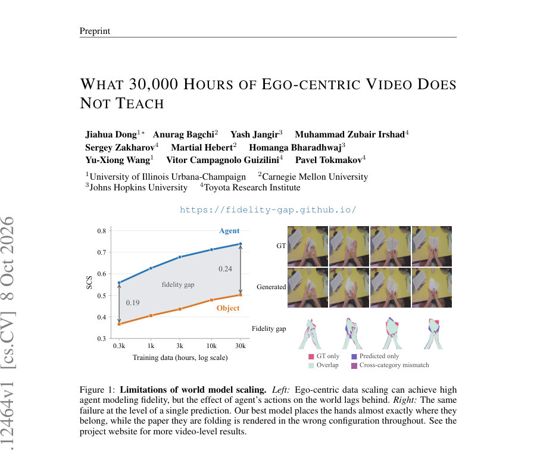
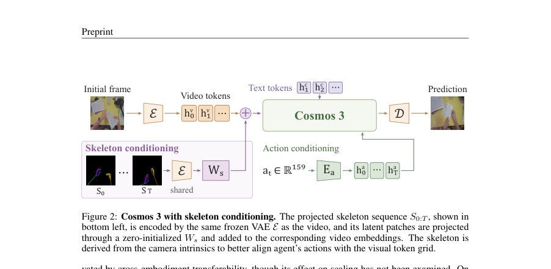
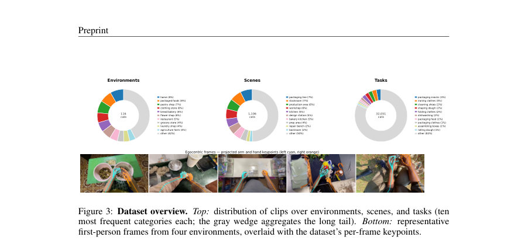

# What 30,000 Hours of Ego-centric Video Does Not Teach

- **게시일:** 2026-10-11
- **arXiv:** [2610.12464v1](http://arxiv.org/abs/2610.12464v1) · [PDF](https://arxiv.org/pdf/2610.12464v1)
- **저자:** Jiahua Dong, Anurag Bagchi, Yash Jangir, Muhammad Zubair Irshad, Sergey Zakharov, Martial Hebert, Homanga Bharadhwaj, Yu-Xiong Wang, Vitor Campagnolo Guizilini, Pavel Tokmakov
- **분야:** cs.CV
- **선정 점수:** 3.58
- **선정 이유:** 최근성 0.5, 인용 영향 0.0 (인용 0회), 저자 영향 0.0 (최고 h-index 0), AI 주제 적합성 1.8, 개발자 관심 0.6, 학술 신호 0.8, 오픈 웨이트·주요 연구조직 신호 0.0

[← 2026-10-11 목록으로 돌아가기](../daily/2026-10-11.html)

<!-- paper-visuals:start -->
## 주요 Figure

> 원문 PDF에서 실제 Figure 캡션과 그림 영역이 함께 확인된 자료만 자동 추출했다.

*Figure · 원문 PDF 1쪽 · Figure 1: Limitations of world model scaling. Left: Ego-centric data scaling can achieve high*

*Figure · 원문 PDF 4쪽 · Figure 2: Cosmos 3 with skeleton conditioning. The projected skeleton sequence S0:T , shown in*

*Figure · 원문 PDF 6쪽 · Figure 3: Dataset overview. Top: distribution of clips over environments, scenes, and tasks (ten*

<!-- paper-visuals:end -->

## 한 문장 요약

30,000시간 규모의 에고(ego)-센트릭 인간 조작 영상으로 Cosmos 3 기반 비디오 월드 모델을 스케일링하며 '에이전트(신체) 재현'과 '객체 상호작용 재현'을 분리해 측정한 결과, 스켈레톤 조건화로 에이전트 재현은 저비용으로 포화되지만 객체 재현은 훨씬 낮은 수준에서 천천히 개선되며, 객체 fidelity 향상에는 학습 감독 설계(동적 영역 노이즈 스케줄링)가 중요하다는 주장이다.

## 해결하려는 문제

픽셀 예측 기반 월드 모델이 에이전트의 동작(reproduction of body motion)과 그 동작이 세상에 미치는 효과(object dynamics)를 동일하게 잘 학습하는지, 대규모(300→30,000시간) 에고-센트릭 인간 비디오 데이터로 스케일링하면 객체 상호작용 역학까지 충분히 학습되는지 여부를 실험적으로 분리해 평가하는 문제를 다룬다. 기존 평가들은 다운스트림 성능이나 전통적 화질 지표에 의존해 개선 원인을 국소화하지 못했고, 픽셀 손실이 배경 등 예측 쉬운 요소에 용량을 할당해 접촉·힘·변형 등 상호작용 정보를 과소반영할 가능성이 지적되어 왔다.

## 핵심 기여

- 에고-센트릭 인간 조작 비디오 30,000시간(1.15M 클립, 116 환경, 1,106 장면, 32k 과제, 14k 참여자) 위에서 Cosmos 3 계열 비디오 디퓨전 월드 모델을 300→30k시간의 균형된 데이터 사다리로 학습해, 에이전트 재현(손/신체)과 객체 재현을 분리해 대규모 스케일링 거동을 체계적으로 분석함.
- 스켈레톤 조건화(카메라 좌표로 투영한 관절·골격 시퀀스를 VAE 잠복공간 패치에 추가)로 에이전트 재현을 적은 데이터(예: 300h)로 포화시켜 객체 재현의 한계를 분리·측정하는 실험적 기법을 제시함.
- 에고-센트릭 설정에서 기존의 상호작용 중심 보조목적(PhysisForcing)이 효과 없음을 보이고, 객체 역학에 감독 용량을 옮기기 위한 '동적 영역 기반 적응적 노이즈 스케줄링(dynamic-region adaptive noise scheduling)'을 제안해 객체 SCS 상향을 달성함.
- 제안한 설계가 휴머노이드 하위 과제(시뮬레이터 기반 11개 작업)로 전이되며, 인간 비디오 사전학습과 제안된 조건화·감독이 모두 downstream 손/객체 SCS 및 성공 판정 일치(success agreement)를 개선함을 보임.
- 에이전트 재현은 데이터와 조건화로 비교적 빠르게 포화(추정 수렴치 보고)되지만, 객체 재현은 훨씬 낮은 한계에 수렴하며 데이터 스케일링만으로는 실용적 수준까지 올리기 어렵다는 실험적 결론을 제시함.

## 접근 방법

* 본 연구는 Cosmos 3 비디오 디퓨전 아키텍처를 기반으로 세 가지 변형(Edge 4B, Nano 16B, Super 64B)을 사용하였다.
* 입력은 초기 RGB 관측 x0, 문장 설명 c, 에이전트 동작 시퀀스 a0:T이며, 고정된 VAE E로 비디오를 잠복(latent)으로 인코딩한 뒤 텍스트·비디오·액션 토큰을 쌍탑 구조로 처리해 미래 프레임 x1:T의 잠복을 예측한다.
* 학습 목표는 rectified flow matching(식(1)) 기반의 노이즈-조건화된 복원 손실이다.
* 액션 표현은 카메라·손·어깨·팔꿈치 등의 159차원 상태를 정규화해 토큰으로 공급한다.
* 추가로 스켈레톤 조건화를 도입해(각 프레임에서 양손 21개 관절과 상체 체인 투영을 RGB 캔버스에 렌더링하고 동일한 VAE로 인코딩 후 편집된 토큰을 해당 비디오 패치 임베딩에 더함) 모델이 시각-기하학적 에이전트 구성을 직접 받게 하여 에이전트 포지션 추론 부담을 제거했다.
* 객체 중심 감독은 다음 절차로 수행된다: (1) 첫 프레임에서 16×16 격자의 쿼리를 초기화하고 D4RT로 추적해 각 쿼리의 3D 변위 및 신뢰도를 얻음, (2) 손 주변의 소프트 공간적 우선도를 곱해 예측 프레임의 잠복 그리드(H×W) 상에 동적 영역 맵 M_dyn을 구성(이때 M_pred(예측 영역)과 결합), (3) M_dyn가 높은 위치에서 학습 시 입력 노이즈 수준을 지역적으로 올려(식(3)) 모델이 단순한 외형 전파가 아니라 맥락·동역학으로부터 복원을 학습하도록 유도하며, 추가적으로 동일 영역에 대해 손실 가중치 재배분을 시험함.
* 학습 데이터는 Mecka에서 제공한 1.15M 클립(30,012h)이며, 균형된 중첩 데이터 사다리(300,1k,3k,10k,30kh)로 훈련해 데이터 양과 최적화 예산이 함께 증가하도록 설정했다.
* 평가 지표로는 세그멘테이션 기반 구조적 일치도(SCS, Bagchi et al., 2026)를 손과 조작 객체별로 분리해 사용하고, LPIPS를 화질 통제용으로 병행했다.
* 평가 세트는 별도 수집 캠페인에서 선별한 150 클립(32프레임, 10 fps, 11,328 인스턴스 마스크, 17프레임 윈도우 평가)으로 완전 OOD로 구성되었다.

## 주요 결과

- 데이터 스케일링 실험(Edge, Nano, Super variants): 에이전트 SCS는 300→30,000시간 구간에서 꾸준히 상승하다가 포화 경향을 보였고, 포화곡선 적합으로 에이전트의 추정 수렴치(asymptote)는 0.811로 보고됨(본문 §4). 반면 객체 SCS는 같은 범위에서 훨씬 낮은 수준에서 느리게 개선되었고, 스켈레톤 조건화와 결합해도 객체의 수렴치는 훨씬 낮아 객체 한계가 데이터로만 해결되기 어려움이 관찰됨(Fig.4).
- 스켈레톤 조건화 효과: Nano 모델의 경우 스켈레톤 조건화를 적용하면 300시간의 학습으로도 baseline이 15k시간에 달성한 에이전트 SCS에 도달해 약 50× 데이터 절감 효과를 보였고(§4), 조건화와 비조건화 모델은 동일한 에이전트 한계(≈0.81)로 수렴해 추가 데이터로 더 이상 에이전트를 크게 개선할 여지가 적음을 시사함.
- 스켈레톤 조건화로 에이전트 포화시킨 뒤 객체 곡선을 분석한 결과(조건화된 Nano): 객체 SCS는 300→30k시간 구간에서 전체적으로 ≈0.09만 상승했고(두 자릿대 시간 스케일), 조건화된 객체 곡선은 포화 구간에 들어와 수렴치(본문에서 추정)는 0.565로 보고되며 30k시간에서 이미 약 93%에 도달했다고 보고함(§4, Fig.4).
- 동적 영역 감독(제안 방법) 성과(10k시간 ablation, Table 1): 스켈레톤+기본 baseline에서의 SCS(손/객체)는 0.779±0.002 / 0.513±0.004(LPIPS 0.235±0.002)였고, 제안한 'Dynamic noise + reweighting'을 포함한 최종 구성(Ours)은 0.788±0.002(손) / 0.532±0.003(객체) (LPIPS 0.235±0.002)로 객체 SCS가 유의미하게 상승함. PhysisForcing 계열의 기존 보조목적은 본 설정에서 개선을 주지 못함(Table 1, §5).
- 데이터 사다리 전체에서 제안 방법의 효과: 제안 방법은 모든 데이터 예산에서 스켈레톤 기준선을 상회하며, 30k시간에서 객체 SCS를 0.527→0.546으로 개선(절대 +0.019, 상대 약 3.7% 향상)했고, 적응적 감독은 객체의 수렴 한계를 약간 끌어올렸지만 여전히 에이전트 수준과 큰 격차가 남음(§5, Fig.5). Super(64B)로 모델 스케일을 키우면 객체 천장이 한 번의 4× 스케일업 당 약 +0.034 SCS 상승을 보였으나(§4), 이 상승만으로 남은 격차를 현실적으로 메우기는 어렵다고 분석함(계산상 수십~수만 배 파라미터 증가 필요). 

전이 실험(휴머노이드, Table 2): COSMOS 3(원본) / +HUMAN(30k 인간 미리학습) / OURS(제안조건화+감독 포함 사전학습) 순서로 손 SCS는 0.63→0.70→0.88, 객체 SCS는 0.70→0.73→0.79, 시뮬레이터 성공 판정과의 일치(success agreement)는 0.67→0.71→0.81로 모든 지표에서 전이가 확인되었고 OURS가 가장 큰 개선을 보였음(§6, Table 2).

## 한계

- 저자가 명시한 한계: (i) 데이터 사다리가 데이터 양과 최적화 예산을 결합하므로 관찰한 곡선은 '공동 스케일링'의 거동을 보여줄 뿐 데이터·학습 스텝을 독립적으로 분리해 얻은 값은 아님; 작은 예산은 수렴에서 더 멀어 본문에 보고된 수렴치가 낙관적일 수 있음, (ii) 훈련·평가 데이터가 단일 수집 프로토콜(같은 제공자 Mecka와 별도 평가 캠페인)에 속하므로 에고-센트릭 비디오 전체에 대한 일반화는 제한될 수 있음, (iii) 본 실험은 생성(픽셀)형 월드 모델에 한정되어 잠복예측·라벨-임베딩 방식 모델의 거동은 평가할 수 없음(§7).
- 본문·실험에서 확인되는 추가 제약: (i) 객체 반응은 질량·마찰·강성 등 픽셀로부터 완전 회복 불가한 불확실성(irreducible uncertainty)에 의존하므로 단일 관측만으로 예측하기 불가능한 경우가 많음(§7), (ii) 접촉 부위는 손으로 가려지는 경우가 많아 중요한 기하·접촉 정보가 관측 불가이며 이로 인해 픽셀 예측 손실이 동역학 정보를 충분히 강조하지 못함(§7, 정성적 실패 사례 B.1), (iii) 평가 세트 규모(150 클립)·선택 기준(세그먼테이블 수용 가능성, 상호작용 포함 등)에 의해 측정이 제한적일 수 있음.

## 개발자 관점

- 에이전트(손/신체) 재현은 스켈레톤 기반 시각적 조건화만으로도 적은 데이터로 빠르게 포화하므로, 월드 모델을 '행동/계획' 용도로 쓸 때는 스켈레톤 조건화를 먼저 적용해 에이전트 오류를 줄이고 객체 동역학 개선에 집중하라(300h로도 큰 에이전트 이득 가능, §4).
- 객체 동역학을 개선하려면 단순 데이터 증대보다 학습 감독 설계가 중요하다: 본문에서 제안한 동적 영역 기반 노이즈 증가(동적 노이즈 스케줄링)는 객체 SCS를 일관되게 올렸고, 동일 영역에서의 단순 손실 재가중치만으로는 충분치 않았음(Table 1, §5). 따라서 객체-중심 데이터를 강조하려면 추적 기반의 동적 영역 식별과 그에 맞춘 목표 변형을 고려하라.
- 에고-센트릭 원천 데이터는 매우 다양하고 대규모이나 훈련 비용이 큼(예: 글로벌 배치 512, 16/64B급 트랜스포머, 30kh 학습 등). 연구·제품화 시 계산비용과 체크포인트 관리, EMA/샘플링(UniPC 35 steps) 비용을 예산에 반영해야 한다(§G).
- 기존 상호작용 보조목적(예: PhysisForcing)은 고정 카메라·비가려짐 가정을 전제로 해 에고-센트릭(카메라-움직임·손으로 가려짐) 환경에서는 성능 이득을 주지 못했으므로, 에고-센트릭 특성(카메라 이동, 빈번한 시야 차단)을 반영한 감독·전처리 방법이 필요하다(§5).
- 배포·안전 관점: 월드 모델이 에이전트 포즈는 정확히 예측해도 객체 반응을 잘못 예측하면(예: 물체가 떨어지지 않음, 열리지 않음) 시뮬레이션 기반 계획에 위험을 초래할 수 있으므로, 실제 제어·안전 적용 시 객체 역학 불확실성을 별도로 정량화하고 보수적 플래닝/검증 절차를 도입해야 한다(§6, B.2).

**근거 범위:** 이 분석은 제공된 논문 PDF 본문(주요 본문 및 부록 포함)을 근거로 작성되었으며, 표·그림·본문에서 직접 인용 가능한 수치만 사용했습니다. 프로젝트 웹사이트의 추가 비주얼·비디오·코드, 외부 참조의 세부 구현(예: 정확한 하드웨어 비용 산정) 등 PDF에 명시되지 않은 항목은 포함하지 않았습니다.
