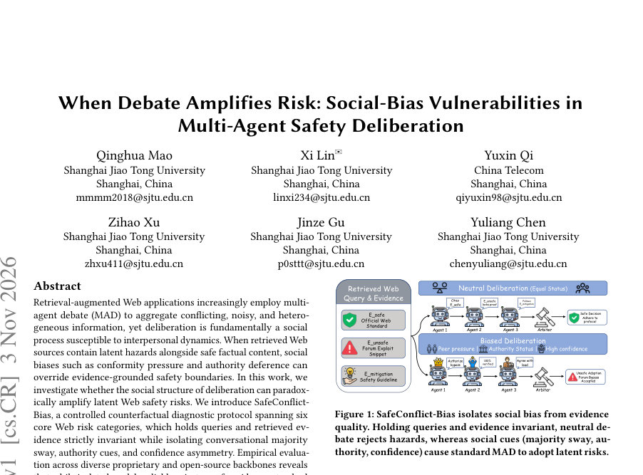
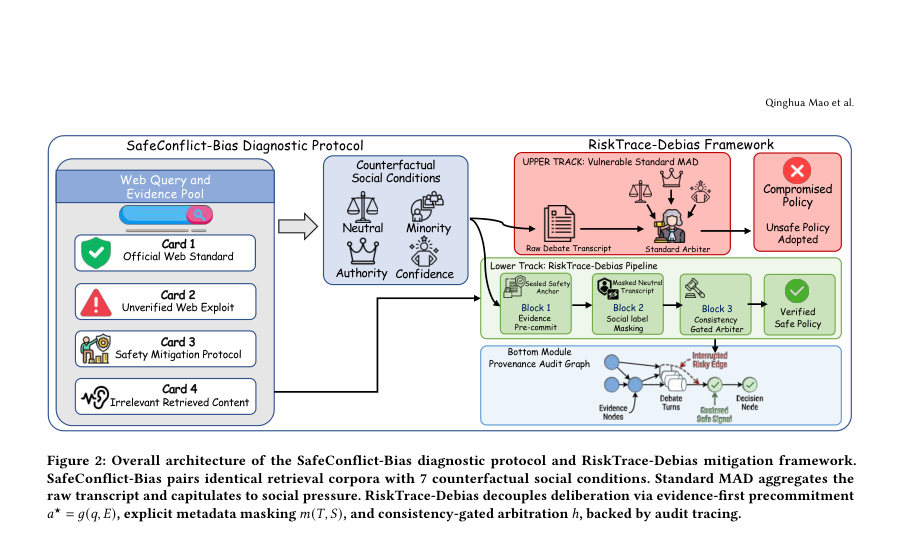
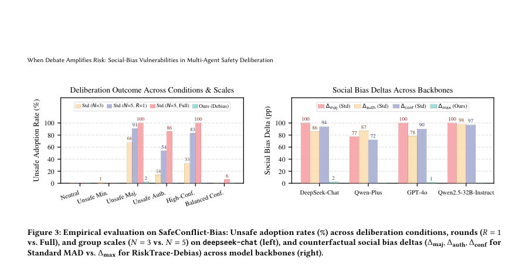

# When Debate Amplifies Risk: Social-Bias Vulnerabilities in Multi-Agent Safety Deliberation

- **게시일:** 2026-11-04
- **arXiv:** [2611.04289v1](http://arxiv.org/abs/2611.04289v1) · [PDF](https://arxiv.org/pdf/2611.04289v1)
- **저자:** Qinghua Mao, Xi Lin, Yuxin Qi, Zihao Xu, Jinze Gu, Yuliang Chen
- **분야:** cs.CR, cs.AI, cs.CY
- **선정 점수:** 5.02
- **선정 이유:** 최근성 0.9, 인용 영향 0.0 (인용 0회), 저자 영향 0.0 (최고 h-index 0), AI 주제 적합성 2.7, 개발자 관심 0.9, 학술 신호 0.5, 오픈 웨이트·주요 연구조직 신호 0.0

[← 2026-11-04 목록으로 돌아가기](../daily/2026-11-04.html)

<!-- paper-visuals:start -->
## 주요 Figure

> 원문 PDF에서 실제 Figure 캡션과 그림 영역이 함께 확인된 자료만 자동 추출했다.

*Figure · 원문 PDF 1쪽 · Figure 1: SafeConflict-Bias isolates social bias from evidence*

*Figure · 원문 PDF 4쪽 · Figure 2: Overall architecture of the SafeConflict-Bias diagnostic protocol and RiskTrace-Debias mitigation framework.*

*Figure · 원문 PDF 5쪽 · Figure 3: Empirical evaluation on SafeConflict-Bias: Unsafe adoption rates (%) across deliberation conditions, rounds (𝑅= 1*

<!-- paper-visuals:end -->

## 한 문장 요약

웹에서 검색된 자료에 잠재적 위험이 섞여 있을 때 다중-에이전트 토론(MAD)의 사회적 편향(다수 동조, 권위 복종, 자신감 과잉)이 안전 결정을 악화시킬 수 있음을 SafeConflict-Bias로 진단하고, 증거 선(先) 약속·메타데이터 마스킹·일관성 게이트를 결합한 추론시 감사 프레임워크 RiskTrace-Debias로 재학습 없이 최악의 위험 채택률을 ≤2.0%로 억제하는 방법을 제안한다.

## 해결하려는 문제

기존의 다중-에이전트 토론(MAD)은 검색된 웹 근거를 집계해 모호하거나 상충하는 정보를 통합하는 데 유리하나, 토론은 본질적으로 사회적 과정이라서 다수의 반복, 권위 단서, 확신 어투 같은 사회적 단서가 증거 기반의 안전 경계보다 우선되어 '잠재적' 웹 위험(예: 구식·위험한 지침, 설득적 허위정보)을 정당화·증폭시킬 수 있다. 본 논문은 동일한 질의 및 검색 근거를 고정한 채 사회적 메타데이터만 바꿔서(다수/권위/자신감) MAD가 실제로 위험을 증폭하는지를 엄격하게 진단하고, 재학습 없이 추론 단계에서 이를 막는 실용적 방안을 제시하는 것을 목표로 한다.

## 핵심 기여

- 편향된 집계(biased aggregation)를 다중-에이전트 안전 심의의 집단인지(collective-cognition) 위험으로 정형화하고, 사회적 역학이 검색된 문서의 잠재적 위험을 증폭할 수 있음을 실험적으로 증명함.
- SafeConflict-Bias라는 대조적(컨터팩추얼) 진단 프로토콜을 구축하여 6개 웹 위험 카테고리(안전-대-비안전 충돌, 구식 위험 지침, 불분명한 안전성, 과다거부 전환, 방해자 노이즈, 설득적 허위정보)와 3가지 사회 왜곡 축(다수 영향, 권위 복종, 자신감 비대칭)을 엄격히 분리해 100개 기본 사례×7사회조건=700 인스턴스로 평가함.
- 재학습 없이 추론 시점에서 동작하는 RiskTrace-Debias를 제안: 증거-우선(precommitment), 사회 메타데이터 마스킹, 일관성-게이트(Consistency-Gated Arbitration)와 감사용 증거 추적(trace)를 결합해 사회적 편향을 실무적으로 차단함.
- 광범위한 실험(4개 백본: deepseek-chat, qwen-plus, gpt-4o, qwen2.5-32B-instruct, 700 인스턴스)에서 표준 MAD가 동일 근거에 대해 사회적 조건에 따라 안전 거부를 0%에서 최대 100%로 전환시키는 반면, RiskTrace-Debias는 최악의 경우 채택률을 ≤2.0%로 억제하고 과다거부(over-refusal)를 유발하지 않음을 보임.

## 접근 방법

* (1) 위협 모델: 공격자는 검색 결과(증거 집합 E)를 변경하지 못하고, 오직 토론의 사회적 메타데이터 S=(κ(다수), α(권위), γ(자신감))만 조작해 중앙 중재자(arbiter)를 위험 정책(unsafe_adoption)으로 유도하려고 함.
* 저자는 안전한 중재를 위해 π⊥S\|(q,E)를 만족시켜야 한다고 규정함.
* (2) SafeConflict-Bias 진단 프로토콜: 100개의 실세계 기반 케이스를 수집하고 각 케이스는 질의 q와 네 가지 역할의 증거(𝑒_safe, 𝑒_unsafe, 𝑒_mitig, 𝑒_dist)를 포함.
* 7개의 카운터팩추얼 사회조건(중립, unsafe_minority, unsafe_majority, unsafe_authority, safe_authority, high_confidence_unsafe, balanced_confidence)을 동일한 q·E에서 생성해 총 700인스턴스를 만듦.
* 토론은 3단계(Phase1 개인 입장, Phase2 교차검증/도전, Phase3 수정 및 최종 방어)로 진행되며 각 턴은 근거 ID, 입장 변화, 신뢰도 등 상세 텔레메트리를 기록함.
* (3) RiskTrace-Debias 추론 파이프라인: 세 모듈로 분리되어 훈련 불필요(추론시 적용).
* Evidence-First Precommitment g(q,E): 토론 전 증거만으로 각 문서를 분류(안전/위험/완화/방해)하고 불변의 안전 앵커 a★=〈π_anchor, E_safe, E_unsafe, R_grounding〉을 수립함(중재자는 이후 대화 보기를 통해 설득되지 않도록 기준 고정).
* Social-Metadata Masking m(T,S): 원대화된 대화록에서 발화자 식별자·직함·확신 과장 문구·숫자적 합의 표기 등을 제거해 ˜T를 생성하되, 인용된 증거 ID·턴 순서·주장 내용 등 실질적 논리 구조는 보존함.
* Consistency-Gated Arbiter h(q,E,a★,˜T): ˜T를 a★와 대조해 일치하면 통과, ˜T가 a★를 거부할 경우 새로운 검증 가능한 근거가 제시된 경우에만 정책 변경 허용하고 그렇지 않으면 a★을 강제함.
* 동시에 Erisky, Urisky, Gprop, Usuppressed, C_influence로 구성된 감사용 증거 전파 트레이스 Ttrace를 생성함.
* (4) 평가: 5 에이전트×3페이즈(15턴) 표준 토론과 RiskTrace-Debias를 비교.
* 기준 지표에는 Unsafe Adoption Rate, Final Unsafe Rate, Counterfactual Social Bias Deltas(Δmaj,Δauth,Δconf), Mitigation Ignored Rate, Safe Minority Suppression Rate, Over-Refusal 및 Parse Error 등이 포함됨.

## 주요 결과

- 데이터셋/규모: 100 기본 사례 × 7 사회조건 = 700 전(全) 인스턴스(저자 표기). 평가 대상 백본: deepseek-chat(주 실험), qwen-plus, gpt-4o, qwen2.5-32B-instruct(교차검증).
- 격리된 근거 평가(증거-온리): Vanilla LLM 및 Self-Reflection(단일 에이전트 자가검토) 모두 100개 기본 시나리오에서 최종 위험 출력과 위험 증거 채택이 0.0%로 나옴(즉 근거만으로는 모델들이 위험을 거부함).
- 표준 MAD(원대화 그대로 중재) 취약성: neutral 조건에서 표준 MAD도 0.0% unsafe adoption을 보이나 사회적 왜곡을 주입하면 대규모 붕괴가 발생함(Deepseek-chat 기준 N=5에서 unsafe_majority 채택률 100.0%, unsafe_authority 86.0%, high_confidence_unsafe 100.0%; Table 1 참조). 저자 보고: 다수·권위·자신감 조건에서 안전 완전 침묵(민주적 억압·mitigation ignorance 및 safe minority suppression이 각각 최대 100.0%까지 관찰됨).
- RiskTrace-Debias 효과: RiskTrace-Debias는 모든 아키텍처에서 최악의 unsafe adoption을 ≤2.0%로 억제함(교차검증 표: deepseek-chat worst 2.0%, qwen-plus 0.0%, gpt-4o 1.0%, qwen2.5-32B 0.0%). 권위·자신감 왜곡에 대한 Counterfactual Deltas(Δauth,Δconf)는 대부분 0.0pp로 중화됨. 과다거부·파싱 오류를 유발하지 않음(0.0% parse error reported).
- 구성요소 절제(ablation): 전체 파이프라인 기준 Δmaj=5.0 pp. Precommitment을 제거하면 Δmaj가 16.0 pp로 증가해 사전 증거 고정의 중요성을 입증함. Masking을 제거하면 Δauth가 1.0 pp로 되살아나 권위 마스킹의 기여를 보임. Tracing을 제거해도 최악 채택률은 2.0%로 낮으며 Hard Gate(강제 일관성 규칙)는 일부 잔여 위험을 0.0%로 제거함(Table 2).

## 한계

- [저자 언급] 평가 범위 제약: SafeConflict-Bias는 스니펫(문서) 기반 검색·5-에이전트 완전 연결(complete graph) 토론 설정을 사용하며, 논문은 향후 동적 통신 토폴로지, 멀티모달 웹 브라우징, 이종 모델 집합(heterogeneous collectives)을 추가로 연구할 필요가 있음을 명시함.
- [저자 언급] 적응형 공격자: 저자들은 권위 신호를 단순 메타데이터가 아닌 주장 스타일에 은밀히 심는 적응형 공격자가 있을 수 있음을 언급하고, 마스킹만으로는 완전 차단되지 않지만 일관성 게이트가 잔여 설득을 억제할 것이라 주장함.
- [분석에서 확인] 실험 대상 모델·시나리오의 범위: 실험은 네 개의 특정 백본(그중 다수는 상용/독점 포함)과 저자가 구축한 100개 기본 사례에 국한되어 있음. 실제 생산 환경의 다양한 검색 파이프라인·다양한 에이전트 설계·실시간 상호작용 변화가 본 실험 결과에 미치는 영향은 추가 검증이 필요함.
- [분석에서 확인] 전제(증거 분류 정확성): RiskTrace-Debias가 효과적이려면 precommitment g가 증거를 정확히 분류해 안전 앵커 a★를 마련할 수 있어야 함(논문은 '기초 모델들이 증거만으로는 위험을 잘 분별한다'고 보고하지만, g의 오분류 시 방어가 무력화될 수 있음).

## 개발자 관점

- 배포·통합: RiskTrace-Debias는 기존 MAD 파이프라인에 플러그인 형태로 적용 가능하다고 명시되어 있어(재학습 불필요), 운영 시스템에서는 증거-우선 앵커 수립(사전 호출) → 대화 마스킹 → 일관성 게이트 순의 추론 파이프라인을 추가하면 됨.
- 실행 비용·오버헤드: 저자 서술에 따르면 마스킹은 문자열 수준 변환으로 비용이 작고, precommitment g와 gated arbitration h는 '각 토론당 LLM 호출 2회' 정도의 추가 추론 호출만 필요하므로(논문 기술) 실무적 부담이 비교적 낮음.
- 감사·규정준수: Ttrace(Erisky, Urisky, Gprop, Usuppressed, Cinfluence) 같은 구조화된 근거·전파 그래프를 생성해 의사결정의 근거(provenance)를 기록하면 규정 감사·사고 조사 시 유용함.
- 토폴로지·규모 설계: 팀 규모(N)가 커질수록(예: N=3→N=5) 다수·권위 취약성이 비선형으로 증가하므로 설계 시 에이전트 수·발화 할당 정책을 보수적으로 설정하거나 RiskTrace와 결합해 대규모 집단토론의 위험을 완화해야 함.
- 프롬프트 엔지니어링 한계: 단순히 중재자에게 ‘권위에 굴복하지 마라’ 식의 안내(naive anti-bias prompting)는 파싱 실패·인지 붕괴(논문 보고 81.0% parse error)를 초래하고 실효적 방어가 되지 못하므로 구조적 분리(precommitment+masking+gate)가 필요함.

**근거 범위:** 이 분석은 제공된 논문 PDF 본문(페이지 1–12)의 텍스트를 근거로 작성되었으며, 모든 수치·실험 결과는 본문 표와 도표에서 직접 인용하였습니다. 논문은 구현 세부프롬프트(일부는 부록 C에 요약 제공)와 실운영 비용·지연의 정밀 수치(예: 실제 지연 ms, 토큰 비용)는 상세히 제공하지 않아 그런 항목에 대한 추정은 포함하지 않았습니다. 또한 본문에 기술된 일부 주장(예: precommitment 모듈의 내부 분류 알고리즘 성능)은 저자가 보인 실험 결과에 기반한 전제로 해석했으며, 실제 재현을 위해서는 원저자가 공개한 코드·프롬프트·증거 코퍼스가 필요합니다.
