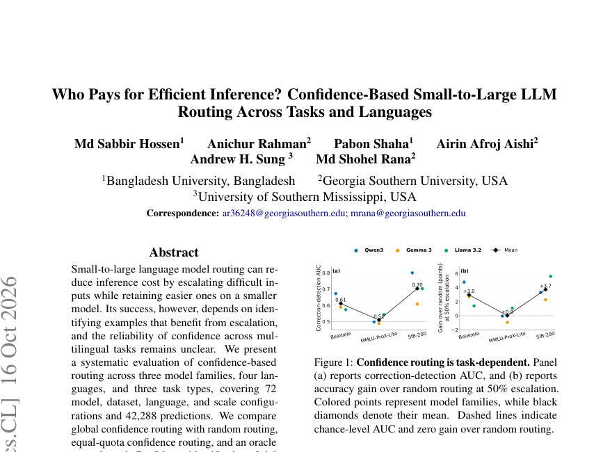
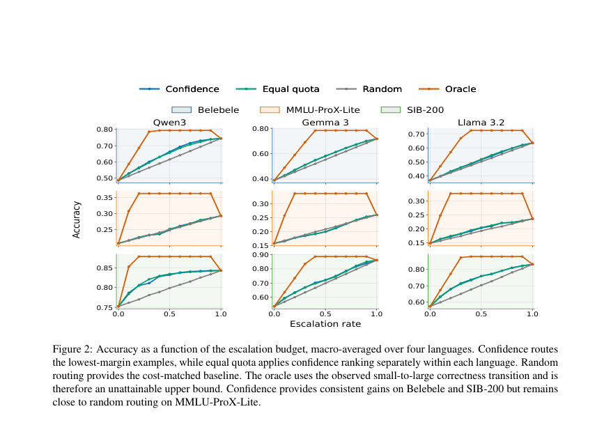
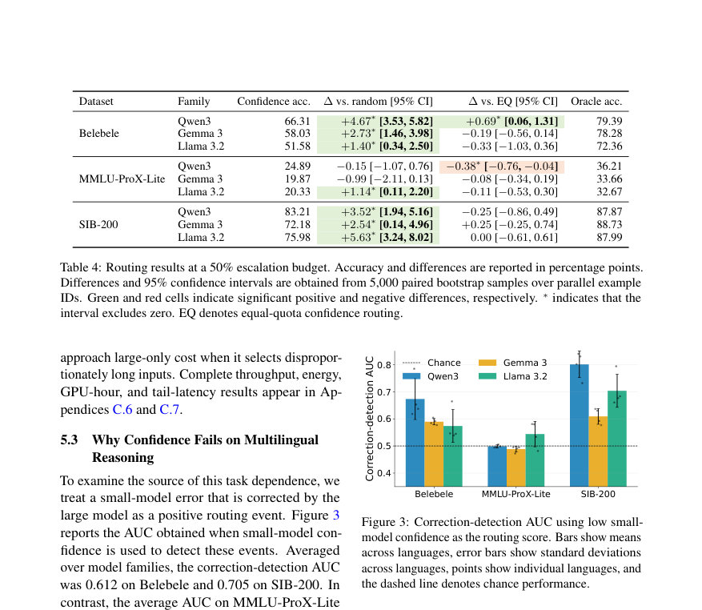

# Who Pays for Efficient Inference? Confidence-Based Small-to-Large LLM Routing Across Tasks and Languages

- **게시일:** 2026-10-19
- **arXiv:** [2610.23249v1](http://arxiv.org/abs/2610.23249v1) · [PDF](https://arxiv.org/pdf/2610.23249v1)
- **저자:** Md Sabbir Hossen, Anichur Rahman, Pabon Shaha, Airin Afroj Aishi, Andrew H. Sung, Md Shohel Rana
- **분야:** cs.CL
- **선정 점수:** 4.87
- **선정 이유:** 최근성 0.4, 인용 영향 0.0 (인용 0회), 저자 영향 0.0 (최고 h-index 0), AI 주제 적합성 3.0, 개발자 관심 0.8, 학술 신호 0.7, 오픈 웨이트·주요 연구조직 신호 0.0

[← 2026-10-19 목록으로 돌아가기](../daily/2026-10-19.html)

<!-- paper-visuals:start -->
## 주요 Figure

> 원문 PDF에서 실제 Figure 캡션과 그림 영역이 함께 확인된 자료만 자동 추출했다.

*Figure · 원문 PDF 1쪽 · Figure 1: Confidence routing is task-dependent. Panel*

*Figure · 원문 PDF 6쪽 · Figure 2: Accuracy as a function of the escalation budget, macro-averaged over four languages. Confidence routes*

*Figure · 원문 PDF 7쪽 · Figure 3: Correction-detection AUC using low small-*

<!-- paper-visuals:end -->

## 한 문장 요약

작은 모델의 신뢰도(확신)를 기준으로 입력을 더 큰 모델로 단계적 에스컬레이션(소→대 라우팅)하여 다국어·다과제 환경에서 비용-정확도 균형과 언어별 할당 불평등을 체계적으로 평가한다.

## 해결하려는 문제

대형 언어 모델(LLM)은 높은 성능을 제공하지만 배포·추론 비용이 크다. 작은 모델로 대부분 질의를 처리하고 일부 어려운 입력만 더 큰 모델로 에스컬레이션하는 소→대 라우팅은 비용을 낮출 수 있지만, 어떤 입력을 에스컬레이션할지 결정하는 신호(특히 작은 모델의 confidence)가 다국어·다과제에서 얼마나 신뢰할지 불명확하다. 또한 전역 신뢰 기반 랭킹이 언어별로 계산 자원 접근을 불균등하게 할당할 위험이 있다. 본 논문은 신뢰(margin) 기반 라우팅의 신뢰성·효율성·언어적 할당 영향을 모델 계열·과제·언어별로 체계적으로 규명한다.

## 핵심 기여

- 72개(모델·데이터셋·언어·스케일) 설정과 42,288개 예측을 포함하는 통제된 다국어 평가를 통해 신뢰 기반 소→대 라우팅의 범용성·한계를 체계적으로 분석함.
- 작업·모델 계열·언어에 따라 신뢰 기반 라우팅의 성능이 크게 달라짐을 실증: 독해(Belebele)와 주제분류(SIB-200)에서는 유의한 개선을 보였으나 지식·추론(MMLU-ProX-Lite)에서는 거의 무작위 수준임을 보고함.
- 전역 신뢰(Global confidence) 라우팅, 균등 쿼터(Equal-quota) 신뢰 라우팅, 무작위 라우팅, 오라클 상한을 비교하여 정확도–에스컬레이션 곡선, correction-detection AUC, 신뢰 5분위 분석, 언어별 할당 격차를 정량화함.
- 언어별 에스컬레이션 격차(최대 30.33 percentage points)를 관찰하고, 균등 쿼터 라우팅이 에스컬레이션 격차는 제거하면서도 집계 정확도 손실은 거의 없음을 보임.

## 접근 방법

* 평가 데이터·모델·라우팅·측정 프로토콜을 통제한 시뮬레이션(오프라인 페어드 예측)을 사용함.
* 데이터: Belebele(독해, 테스트 900/언어), MMLU‑ProX‑Lite(지식·추론, val+test 합쳐 658/언어), SIB‑200(주제분류, 테스트 204/언어).
* 언어: 영어, 방글라(벵갈리), 힌디, 우르두.
* 모델 계열: Qwen3, Gemma 3, Llama 3.2 각각 소형(≈1–1.7B)과 대형(≈3–4B) 페어로 라우팅(동일 계열 내에서만 에스컬레이션).
* 추론: 결정적 next-token 다지선다 스코어링(유효 후보들에 대해 logits를 정규화), 신뢰 신호는 상위 1순위와 2순위 확률의 차이(margin).
* 라우팅 정책: 전역 신뢰(모든 언어 합쳐 margin 오름차순으로 하위 K 선별), 균등 쿼터(언어별로 동일 비율 Kb,ℓ만큼 하위 margin 선별), 무작위(예산 Kb 무작위 선택, 100회 반복 평균), 오라클(gi = large_correct − small_correct로 정렬, 진단적 상한).
* 비용 축척은 에스컬레이션 비율을 주 비용 축으로 사용(실측 latency/energy 보조 측정).
* 통계적 불확실성은 5,000회 페어드 클러스터 부트스트랩(언어간 결속 보존)으로 신뢰구간 산출.

## 주요 결과

- 데이터·모델 평균(4개 언어 매크로평균)에서 큰 모델은 모든 설정에서 작은 모델을 능가했으나 개선폭은 과제별로 크게 다름(Belebele: large−small ≈ +25.81–32.64pp, SIB‑200: +9.07–32.60pp, MMLU‑ProX‑Lite: +8.51–10.22pp) (Table 3).
- correction-detection AUC(작은 모델의 낮은 margin이 ‘대형 모델이 고치는 오류’를 얼마나 잘 탐지하는가): Belebele 평균 AUC 0.612, SIB‑200 평균 AUC 0.705, MMLU‑ProX‑Lite 평균 AUC 0.510(거의 무작위) — 즉 과제 의존적(AUC 값은 표·본문에 세부 가족별·언어별로 보고됨).
- 50% 에스컬레이션에서 전역 신뢰 라우팅이 무작위 대비 개선한 사례(표 4): Belebele에서 Qwen3 +4.67pp, Gemma +2.73pp, Llama +1.40pp(모두 유의); SIB‑200에서 Qwen3 +3.52pp, Gemma +2.54pp, Llama +5.63pp(유의). 반면 MMLU‑ProX‑Lite에서는 대부분의 가족에서 신뢰 라우팅이 무작위보다 유의한 개선을 제공하지 않음(유일한 예외: Llama 3.2에서 +1.14pp).
- 전역 신뢰 라우팅은 언어별 에스컬레이션 할당을 불균형하게 함(50% 명목 예산에서 언어별 에스컬레이션 차이 최대 30.33pp, Table 5). 균등 쿼터 라우팅은 에스컬레이션 격차를 제거하되 집계 정확도 손실은 대부분의 설정에서 통계적으로 유의하지 않음.
- 시스템 측정(1,200 입력, 2×T4, batch=1): 25% 에스컬레이션 시 전역 신뢰 라우팅은 wall time을 모델별로 27.5–58.2% 줄이고 에너지를 26.3–62.6% 절감했으나, 50%에서는 절감폭이 크게 감소(예: 몇몇 설정에서 거의 이득 없음 또는 오히려 비용 증가). 또한 신뢰 라우팅이 선택하는 입력은 길이가 길어 실측 비용이 기대와 다를 수 있음(동일 에스컬레이션 비율이라도 선택된 하위 집합의 토큰 길이 차이로 비용 차이 발생).

## 한계

- (저자 명시) 평가 대역과 모델 범위 제한: 세 개의 공개 모델 계열(≈1B–4B)만 사용했으며, 훨씬 큰·사유 모델이나 MoE 구조에 일반화가 보장되지 않음.
- (저자 명시) 작업·언어 범위 제한: 4개 언어(영어·방글라·힌디·우르두)와 3개 다지선다 벤치마크에 국한되며 대화·생성·요약 등 자유형태 태스크로는 확장되지 않음.
- (저자 명시) 신뢰 신호 한정: 신뢰를 상위 두 후보 확률 마진으로 정의했으므로, 다른 불확실성 추정(예: 생성 기반 self‑eval, consistency, verbalized confidence)은 다른 결과를 보일 수 있음.
- (저자 명시) 비용 축으로 에스컬레이션 비율 사용: 실제 배포에서의 배치·동시성·로드·모델 로딩 비용 등을 반영하지 않음; Gemma 3 4B는 FP16에서 비유한 값 발생으로 FP32로 재평가되어 정밀도 차이가 효율성 비교에 영향줌(따라서 가족 간 절대 효율성 비교는 부적절).

## 개발자 관점

- 소→대 라우팅 구현 시 신뢰 신호가 과제별로 동작이 다르므로 라우팅 설계는 사용하는 태스크의 특성(예: 추론성·지식성 대 독해·분류성)에 맞춰 검증해야 함—다국어 추론에서는 작은 모델이 높은 확신으로 틀릴 가능성이 커 단순 마진 기반 라우팅 불충분.
- 언어별 자원 할당(공정성)을 고려하려면 전역 신뢰 랭킹 대신 균등 쿼터 같은 언어별 할당 제약을 도입하면 에스컬레이션 접근성을 보장할 수 있으며, 논문 결과에서 집계 정확도 손실은 대부분 작음.
- 재현/배포 관점: 체크포인트(허깅페이스 리비전 SHA), 랜덤시드(42), 결정적 next-token 다지선다 스코어링, 예측 캐시 및 페어드 예측 표를 보존하는 워크플로우가 유용함—본 논문은 이런 절차를 적용하여 결과의 재현성을 확보함.
- 정밀도·하드웨어 주의: Gemma 3 4B의 FP16 불안정 사례처럼 실무에서는 모델 정밀도(FP16/FP32)와 디바이스 메모리 이슈를 점검해야 하며, 정밀도 차이로 효율성(시간·에너지) 비교가 왜곡될 수 있음.
- 성능·비용 트레이드오프 모니터링: 동일한 에스컬레이션 비율이라도 선택된 예제의 토큰 길이·계산 난이도에 따라 실제 지연·에너지 소비가 달라짐. 배치·동시 처리·tail latency(95th) 관점에서 라우팅이 오히려 꼬리 지연을 악화시킬 수 있으므로 프로덕션에서는 평균뿐 아니라 P95 등을 관찰해야 함.

**근거 범위:** 이 분석은 사용자 제공 논문 PDF 본문(본문과 부록 포함)에 기초해 작성되었다. 본문에 명시된 표와 수치(예: Table 3–13, 그림, AUC·정확도·절감률 등)를 직접 인용·요약했으며, 저자가 본문에서 명시하지 않은 구현 세부사항이나 외삽 수치는 포함하지 않았다. 일부 시스템 측정은 논문 부록의 표를 근거로 요약했으며, 논문이 참조한 외부 데이터셋·모델 기술서의 내부 구현 내용은 본문 내 언급에 한정해 인용하였다.
