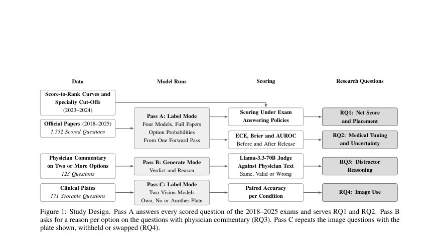
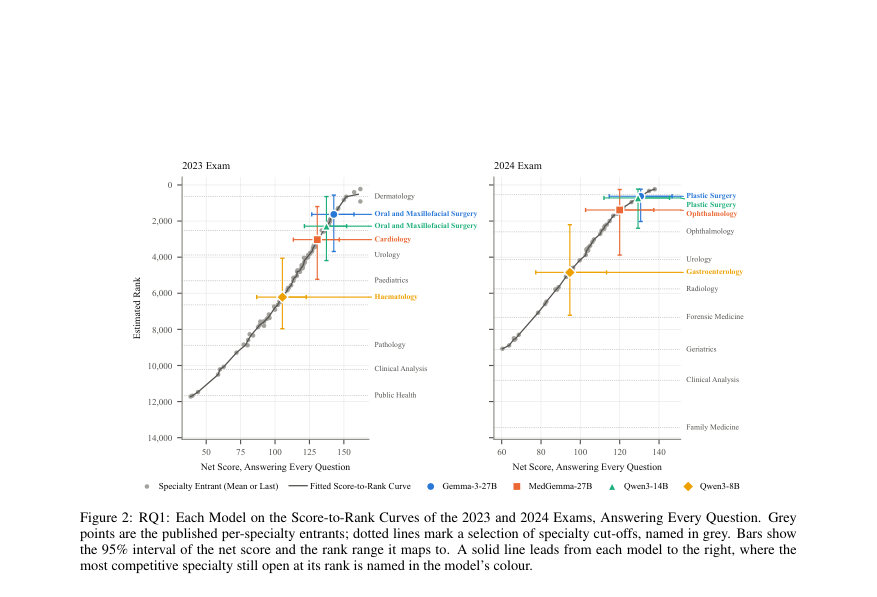
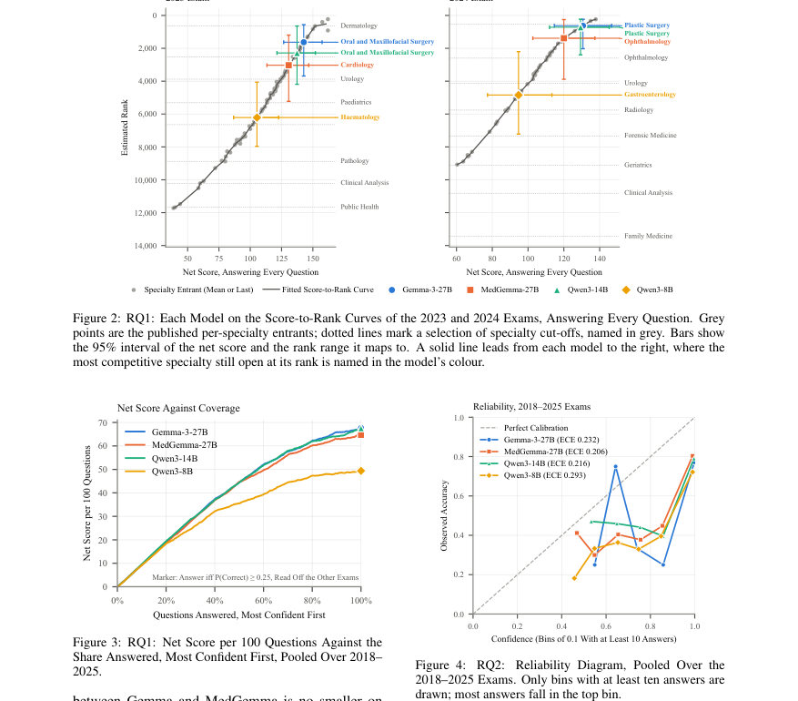

# Would an LLM Match into a Residency? Uncertainty, Reasoning and Image Use of Open Language Models on the Spanish MIR Examination

- **게시일:** 2026-10-25
- **arXiv:** [2610.31586v1](http://arxiv.org/abs/2610.31586v1) · [PDF](https://arxiv.org/pdf/2610.31586v1)
- **저자:** Miguel Fernandez-de-Retana, Unai Zulaika, Ruben Sanchez-Corcuera, Aritz Bilbao-Jayo, Aitor Almeida
- **분야:** cs.CL, cs.AI, cs.CY, cs.LG
- **선정 점수:** 4.68
- **선정 이유:** 최근성 0.5, 인용 영향 0.0 (인용 0회), 저자 영향 0.0 (최고 h-index 0), AI 주제 적합성 2.9, 개발자 관심 0.0, 학술 신호 0.3, 오픈 웨이트·주요 연구조직 신호 1.0

[← 2026-10-25 목록으로 돌아가기](../daily/2026-10-25.html)

<!-- paper-visuals:start -->
## 주요 Figure

> 원문 PDF에서 실제 Figure 캡션과 그림 영역이 함께 확인된 자료만 자동 추출했다.

*Figure · 원문 PDF 5쪽 · Figure 1: Study Design. Pass A answers every scored question of the 2018–2025 exams and serves RQ1 and RQ2. Pass B*

*Figure · 원문 PDF 7쪽 · Figure 2: RQ1: Each Model on the Score-to-Rank Curves of the 2023 and 2024 Exams, Answering Every Question. Grey*

*Figure · 원문 PDF 7쪽 · Figure 3: RQ1: Net Score per 100 Questions Against the*

<!-- paper-visuals:end -->

## 한 문장 요약

스페인 MIR(전문의 시험) 문제 1,552문항을 실제 시험 규칙으로 채점하고, 4개 오픈 모델(8–27B)을 대상으로 불확실성(보정), 의학적 미세조정 효과, 정답 근거의 임상적 타당성, 이미지 사용 여부를 평가했다.

## 해결하려는 문제

기존 연구는 주로 정확도(정답률)만 보고하며 폐쇄형 대형 모델 중심으로 이루어져 있어, 병원이 자체 하드웨어에서 실행할 오픈 모델을 임상에 투입하려면 다음을 알아야 한다: 모델이 스스로 언제 틀릴지 인지하는 능력(불확실성 추정 및 보정), 의학적 미세조정이 이 능력을 개선하는지 여부, 정답이 임상적으로 타당한 추론에 기반했는지(오답 배제 이유의 타당성), 그리고 제시된 임상 이미지를 실제로 이용하는지 여부. MIR는 오답 페널티와 배치(전공·병원 할당) 규칙, 그리고 의사 해설/임상 사진을 포함하므로 이러한 질문들을 현실적 조건에서 검증할 수 있다.

## 핵심 기여

- 공식 MIR 2014–2025 원문에서 추출한 2,595문항 코퍼스(정답표, 의사 해설, 임상판독 이미지 포함)와 2023·2024의 점수-순위(및 전공 컷오프) 자료 제공.
- MIR의 채점·할당 규칙 하에서 Qwen3-8B, Qwen3-14B, Gemma-3-27B, MedGemma-27B(의학적 미세조정 포함) 4개 오픈 모델을 2018–2025년 문제(1,552문항)로 평가하여 실제 배치(순위·가능 전공) 추정.
- 의학적 미세조정 효과를 사전·사후(모델 릴리스 이후인 2025 시험 포함) 비교하여 보정·과신 여부 변화를 통제(훈련 컷오프 오염 통제)한 분석.
- 의사 해설이 있는 문항에서 모델이 각 오답(선지)을 배제한 근거를 Llama-3.3-70B 판정기로 의사 해설과 비교해 정답이 ‘임상적으로 타당한 이유’에 의한 것인지 평가하고, 임상 이미지(판독 사진)를 원본·미노출·무관한 다른 사진으로 바꿔 이미지 사용 여부를 직접 테스트. 

## 접근 방법

* 데이터: 공식 MIR Version 0(2014–2025)에서 문항·정답·의사 해설·이미지·전공 라벨·2023·2024 점수-순위 자료를 파싱(총 2,595문항, RQ1·RQ2용 2018–2025 스코어어블 1,552문항, RQ3용 의사 해설 포함 123문항·의사와 일치하는 경우 108문항, RQ4용 이미지 171문항).
* 모델: Qwen3-8B(8.2B, 16-bit), Qwen3-14B(14.8B, 16-bit), Gemma-3-27B(27.4B, 8-bit) 및 MedGemma-27B(27.4B, 8-bit, Gemma의 의학적 미세조정 버전).
* 하드웨어: 단일 48GB GPU(Quardo RTX 8000).
* 실행은 결정론적.
* 프롬프트·모드: 스페인어 시스템 프롬프트(‘MIR 응시자’로 소개).
* 세 가지 패스: Pass A(label mode) – 각 문항에 대해 정답 선지 번호만 요청하고 응답의 첫 토큰으로부터 각 선택지에 대한 확률(qk) 추출·정규화해 argmax를 답과 신뢰도로 사용(선지 확률 분포를 신뢰도로 이용); Pass B(generate mode) – 의사 해설 있는 문항에서 각 선지에 대해 채점여부(표기)와 한 문장 임상적 이유, 최종 답과 진술 신뢰도를 요청; Pass C(image tests) – 두 비전 모델(Gemma 계열)에 대해 이미지 조건(원본 판독·무노출·다른 문항의 판독)으로 반복.
* 채점·정책: 시험 규칙(+3 정답,−1 오답,0 기권)으로 net score = (총점/3)= c − w/3 기준으로 산출.
* 세 가지 응답 정책 비교: 항상(answer all), 오라클(answer only correct), 보정(calibrated) — calibrated는 새 문항의 신뢰도(p)를 모델의 다른 7개 시험에서 동일 신뢰구간(십분위 그룹)의 실측 정답률로 추정(각 시험의 정책을 그 시험 자체로 적합하지 않도록 함).
* 보정 기반 기권 적용 후 순위 추정은 2023·2024 공개 점수-순위 포인트에 선형 보간하여 수행.
* 불확실성 평가 지표: 정확도, 평균 신뢰도, ECE(10개 등간 빈), 다중 클래스 Brier 점수, 신뢰도가 정답/오답을 구분하는 능력(AUROC).
* RQ3 근거평가: Generate 모드의 모델 이유와 의사 해설을 Llama-3.3-70B-Instruct(판정기, 4-bit)가 비교하여 'same','valid','wrong'으로 라벨링(판정기는 의사 해설과 모델 이유를 보고 해당 선지 배제 이유의 임상적 타당성 판정).
* 통계: 질문 단위 부트스트랩(2,000 리샘플)으로 신뢰구간, McNemar/Fisher/Holm 보정 등 사용.

## 주요 결과

- RQ1(시험 채점·순위): 2018–2025(1,552문항) 풀페이퍼 기준 모델별 net score per 100 questions: Gemma-3-27B 67.7, Qwen3-14B 67.5, MedGemma-27B 64.7, Qwen3-8B 49.4(표3). 2023 시험 매핑 시 Gemma-3-27B 추정 순위 약 1,628(95%간격 561–3,687)로 43/45 전공이 열려 있음; Qwen3-14B·MedGemma·Qwen3-8B도 각기 다른 범위에서 상위 수천·수백위 내 위치(표4).
- Abstention(기권)은 이득이 아님: calibrated 정책이 모든 문항에 답하도록 나타났으며(기권 이득 = 0), 각 모델의 가장 불확실한 10% 문항의 정확도(tenth)는 Gemma 38.7%, MedGemma 36.8%, Qwen14 44.5%, Qwen8 30.3%로 모두 25%를 상회하여 기권이 오히려 점수 하락을 초래(표3, Figure 3).
- RQ2(의학적 미세조정과 불확실성): 모든 모델이 과신(평균 신뢰도 0.91–0.99 vs 정확도 0.62–0.76, ECE 0.21–0.29). MedGemma-27B는 같은 질문에서 Gemma-3-27B보다 정확도 −0.023(즉 약 2.3 퍼센트포인트) 낮음(p=0.027)하고 평균 신뢰도도 낮아 ECE가 약 0.026 개선되었으나 AUROC은 거의 변화 없음(+0.002, 불확실성 랭킹 능력은 개선되지 않음)(표5, Figure 4).
- 오염(컨타미네이션) 징후 없음: 2025(모델 릴리스 이후) 시험에서 정확도는 2018–2024보다 낮거나 같지 않고(오히려 동일하거나 높음, 모델별로 +1.2~+4.9 포인트), 평균 신뢰도도 유사하여 공개 데이터로의 과도한 노출 증거는 관찰되지 않음(표5, Figure 5).
- RQ3(정답인데 잘못된 이유): 의사 해설이 있는 문항(평가 대상 108문항)에서 정답을 맞춘 경우라도 최소 하나의 오답 선지를 임상적으로 잘못된 이유로 배제한 비율은 Qwen3-8B 38%[27,51], Qwen3-14B 19%[12,29], MedGemma-27B 15%[9,25], Gemma-3-27B 13%[7,24]로 보고됨(표6, Figure 6). 모델의 라벨 모드 신뢰도는 '잘못된 이유'가 있는 정답과 '모두 타당한 이유' 정답 간 유의미한 하향 차이를 보이지 않음(차이 범위 −0.004~+0.020, 거의 불특정). 또한 generate mode(이유 요청)는 동일 문항에서 label mode보다 정확도가 낮아(예: Gemma의 경우 label .77 → generate .62) 설명 요청이 답을 바꿀 수 있음(표6). 판정기 오류도 존재(부정형 선지 부정에 대한 판정기 오판 사례 관찰).  ","RQ4(이미지 사용): Gemma-3-27B(vision) 171 이미지 문항에서 원판 67.8%, 무노출 69.6%, 다른판 67.3%로 원판 대비 무노출 차이 −1.8포인트(95%CI [−7.0,+2.9], p=0.65), MedGemma-27B는 원판 62.6%, 무노출 64.9%, 다른판 63.2%로 차이 −2.3포인트([−7.6,+2.4], p=0.50). 즉 임상판독 이미지는 평균 정확도에 유의미한 개선을 주지 않았고(최대 약 3포인트 정도의 상한), 문항의 56–58%는 세 조건 모두에서 정답(텍스트만으로 충분)(Figure 7).

## 한계

- 저자 기재 한계(논문 자체): 판정기(Llama-3.3-70B)의 등급 판정을 의사가 검증하지 않았음(판정기 오류 사례 존재). 순위 추정은 시험 점수와 학업성적을 합한 순위의 전형적 학업성적을 가정한 추정치이며, 2024 곡선은 전공 평균만을 기반으로 해 과대평가 경향이 있어 낙관적일 수 있음. 연구 범위는 8–27B 오픈 모델 4종·스페인어 단일 프롬프트·직접 라벨 출력에 국한됨(더 큰 모델·여타 프롬프트·체인오브톳 등 다를 수 있음). 또한 2017년도 문제는 파싱 문제로 RQ1·RQ2·RQ4에서 제외됨.
- 추가로 본문에서 확인되는 제약: 이미지 데이터는 2019–2025에만 존재하여 이미지 평가 표본이 제한적이고(171문항), MedGemma/Gemma는 8-bit, Qwen 모델은 16-bit로 런타임 정밀도 차이가 존재함. 신뢰도 측정은 선지 확률(응답 첫 토큰 확률 정규화)에 기반하므로 자연어로의 진술형 신뢰도나 샘플링 기반 신뢰도와는 다른 거동을 보일 수 있음.

## 개발자 관점

- 재현성·운영: 실험은 단일 48GB GPU에서 결정론적으로 실행되어 병원 레벨 하드웨어로도 재현 가능함(실제 운영 환경에서 동일 GPU면 동일 결과 기대). 모델별 비트정밀도(Qwen 16-bit vs Gemma 8-bit)와 1 forward-pass에서 첫 토큰 확률을 읽어 선지 확률로 정규화하는 방식이 핵심 구현 디테일이므로 재현 시 동일한 추출 방식 필요.
- 보정·기권 정책: MIR와 같은 약한 페널티 환경에서는 기권이 이득이 되지 않으므로(최소 확신군 정확도 > 25%) 실제 임상 의사결정 지원에서는 더 큰 손해(환자 위해)를 반영한 다른 비용 함수(오답 페널티가 큼)를 사용해야 함. 시험 기반 보정(calibrated)은 다른 시험의 신뢰-정확도 맵을 이용해 p를 추정하는 방식(십분위 그룹)으로 구현됨.
- 의학적 미세조정: 단순히 의학적 미세조정이 과신 완화의 지표가 되지 않음 — 본 사례에서는 평균 신뢰도는 낮아지고 ECE는 개선되었으나 정확도는 하락했고(AUROC 변화 없음) 신뢰도의 분별력 향상은 없었음. 의료용 모델 선택 시 ‘의학적’이라는 라벨만으로 안전성을 가정하지 말고 실제 업무 데이터·불확실성 분별(AUROC)·정답 근거 타당성 등을 비교 평가해야 함.
- 설명·랭귀지 출력의 위험: 정답이라도 13–38% 경우에 오답 선지를 임상적으로 잘못된 이유로 배제함 → 교육용·임상용 설명을 그대로 신뢰하면 안 됨. 설명을 제공하는 인터페이스는 인간 전문가의 검토 프로세스(트라이앵귤레이션)를 반드시 포함해야 함.
- 이미지 처리: VLM이 이미지 입력을 받아도 실제로 이미지 정보를 활용하지 않을 수 있으므로(원판·무노출·다른판 간 평균 정확도 유의미 차이 없음), 이미지 의존 작업은 이미지 영향력(노출·스와핑 실험)에 대해 별도 검증을 수행해야 함. 또한 이미지 사용 여부는 모델의 아키텍처 공개·검증으로 확인 필요. 마지막으로, LLM을 판정자로 쓰는 경우 판정기 성능을 의사 라벨과 교차검증해야 판정기 오류(특히 부정형 선지 해석)로 인한 왜곡을 방지할 것.

**근거 범위:** 이 분석은 제공된 논문 PDF 본문(페이지 1–13, 전체 본문)을 근거로 작성했음. 수치는 본문 표와 도표에서 직접 인용했으며(예: 표3, 표4, 표5, 표6, Figure 2–7), 저자가 명시한 한계와 본문에서 합리적으로 확인 가능한 제약을 구분하여 기술함. 판정기(Llama-3.3-70B) 평가는 논문 내 판정기 라벨링 결과를 바탕으로 재서술했으며 판정기 자체의 정확성(의사 검증 여부)은 논문에서 저자들이 한계로 밝혔음.
