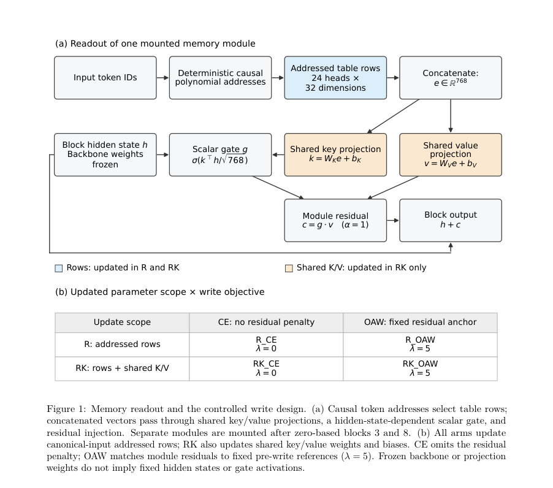
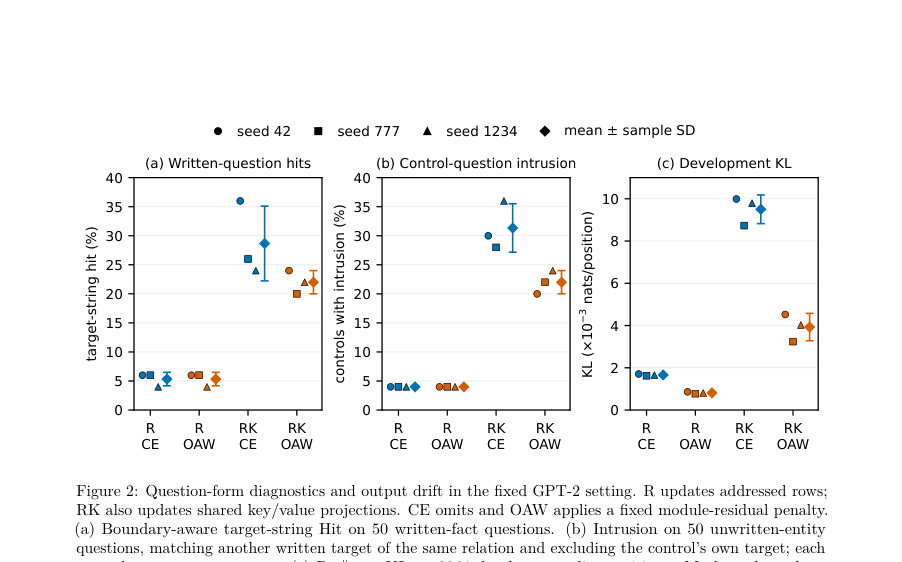

# Writability and the Pathway: A Controlled Study of Knowledge Injection into Addressed Memory

- **게시일:** 2026-10-16
- **arXiv:** [2610.21553v1](http://arxiv.org/abs/2610.21553v1) · [PDF](https://arxiv.org/pdf/2610.21553v1)
- **저자:** Wei Gao, Cheng Tian, Duan Yang, Jianqing Yin
- **분야:** cs.CL
- **선정 점수:** 5.58
- **선정 이유:** 최근성 1.1, 인용 영향 0.0 (인용 0회), 저자 영향 0.0 (최고 h-index 0), AI 주제 적합성 1.5, 개발자 관심 0.2, 학술 신호 0.3, 오픈 웨이트·주요 연구조직 신호 2.5

[← 2026-10-16 목록으로 돌아가기](../daily/2026-10-16.html)

<!-- paper-visuals:start -->
## 주요 Figure

> 원문 PDF에서 실제 Figure 캡션과 그림 영역이 함께 확인된 자료만 자동 추출했다.

*Figure · 원문 PDF 5쪽 · Figure 1: Memory readout and the controlled write design. (a) Causal token addresses select table rows;*

*Figure · 원문 PDF 8쪽 · Figure 2: Question-form diagnostics and output drift in the fixed GPT-2 setting. R updates addressed rows;*

<!-- paper-visuals:end -->

## 한 문장 요약

주소 지정된(주소 기반) 조건부 메모리 모듈에 국소적 쓰기(행 업데이트)와 공유 읽기 투영 업데이트 및 출력-잔차 고정(anchoring)을 교차하는 2×2 통제 실험을 수행해, 어떤 인터페이스가 훈련된 완성문을 재현하고(정형화된 쓰기 성공), 자연질문으로의 전달 및 비표적(언급되지 않은 엔터티) 동작 보존에 미치는 차이를 정량적으로 분석했다.

## 해결하려는 문제

사후 지식 주입(knowledge injection)을 위해 주소 지정된 메모리 행을 직접 수정하는 것은 가능한 접근이지만, 훈련된 완성문을 재현하는 성공이 곧바로 새로운 질문 양식으로의 전달이나 비표적 행동 보존을 보장하지 않음. 어떤 매개변수 표면(행만 vs 행+공유 K/V 투영)을 업데이트해야 하고, 출력 분포(또는 모듈 잔차)의 표류(drift)를 어떻게 제어(예: 출력-잔차 앵커링)해야 하는지가 불명확함.

## 핵심 기여

- 동일한 초기 상태(고정 GPT‑2 기반)에 새로 장착한 메모리 모듈을 붙여 행 업데이트(R)와 행+공유 K/V 투영 업데이트(RK)를 출력-잔차 앵커링(OAW) 유무와 교차하는 2×2 통제 실험 설계로 비교하여 쓰기 경로의 역할을 분해해 분석함.
- 훈련된 50개 합성 사실 문장에 대해 모든 실험군이 2500 업데이트 예산에서 '행 전용' 업데이트만으로도 모든 훈련된 정형 완성문을 100% 재현함을 보이고, 공유 투영을 함께 업데이트하면 자연질문(target-string) 히트율이 크게 증가하지만 출력 분포의 표류도 커진다는 실험적 증거를 제시함.
- 출력-잔차 앵커링(λ=5)을 도입하면 동일 예산 내에서 잔차 MSE와 출력-분포 drift(KL, perplexity 상승)를 낮출 수 있음을 보였고(그럼에도 훈련된 정형 완성문 재현률은 유지됨), 이로써 보존 제약의 한 실용적 방식을 제시함.
- 대규모/운영 모델(Qwen·DeepSeek)에서 보존된 실험 로그를 보관·재분석하여, 로컬 테이블 쓰기가 지명된 ‘첫 답 토큰’의 순위를 변화(승격·유지·회귀)시킬 수 있음을 기록하고, 옵티마이저(Adam vs SPSA)·절차에 따라 결과 차이가 큼을 보이며 단일 토큰 상향만으로 완전 답변 성공을 단정할 수 없음을 강조함.

## 접근 방법

* 제어 실험: 공개 사전학습 GPT‑2(체크포인트 revision 607a30d7)를 백본으로 사용하고, 블록 3과 8 뒤에 새 메모리 모듈을 장착함.
* 각 모듈은 24헤드, 헤드당 400,000행, 행 차원 32(총 e ∈ R768)이며 앞 12헤드는 인과적 2-그램 주소(order=2), 뒤 12헤드는 3-그램 주소(order=3)를 사용해 결정론적 다항식 주소 지정(식 (1),(2), 상수는 Appendix D).
* 모듈의 읽기(readout)는 공유 키/값 투영(WK,WV,bK,bV), 히든 상태 의존 스칼라 게이트 g = σ(k^T h / √768), 그리고 c = g ⊙ v를 백본 출력에 더하는 방식(식 (3)).
* 업데이트 범위: R(주소된 행만 업데이트)와 RK(행 + 공유 K/V 가중치·편향 업데이트)를 비교.
* 출력-잔차 앵커링(OAW)은 각 모듈의 출력 잔차를 고정된 사전-쓰기 참조와 Frobenius MSE로 매 위치 평균해 페널티 항(λ=5)으로 추가(목적식 식 (4): 문장 단위 CE + λ·잔차 MSE).
* 2×2 실험군(R_CE, R_OAW, RK_CE, RK_OAW)을 같은 초기 모델·50 합성 사실·세 개의 최적화 샘플링 시드(42,777,1234)로 반복.
* 최적화는 Adam(행 LR=0.005, 투영 LR=0.0005, betas=(0.9,0.999), eps=1e-8), 배치 크기 8, 총 2500 스텝.
* 평가: 100개 합성 사실(0–49 학습, 50–99 제어), 각 50개에 대해 (i) canonical prefix 완성, (ii) 훈련되지 않은 자연질문 양식, (iii) 제어 엔터티 canonical, (iv) 제어 엔터티 자연질문을 그리디 디코딩(최대 32 토큰)으로 생성·점수화.
* 보전 평가는 모듈 장착 전 상태와 비교하여 고정 회수의 anchor/dev/perplexity 슬라이스(표 2)에서 pre∥post KL, 모듈 잔차 MSE, 퍼플렉서티 변화를 측정.
* 생산(운영) 로그: Qwen(Adam vs SPSA 비교, FP8 테이블, 복원 후 독립 측정), DeepSeek(SPSA) 기록을 보유·분석하여 첫 답 토큰 랭크 변화를 집계.

## 주요 결과

- 통제 GPT‑2 실험에서 모든 네 실험군(각 시드 반복)은 2500 업데이트 예산에서 50개 훈련 문장에 대해 canonical exact match(EM) 100%를 달성함(공통 pre 상태는 0%). 이는 주소된 행(row-only) 업데이트만으로도 훈련된 완성문을 재현함을 보여줌.
- 자연질문(질문 양식)에서의 strict short-answer EM과 prefix hit은 모든 12개 런에서 0%였음. boundary-aware target-string Hit(정확한 토큰열 포함 여부)는 R_CE, R_OAW(행-전용) 각각 평균 5.3% ± 1.2%; RK_CE(행+투영, 무앵커) 28.7% ± 6.4%; RK_OAW 22.0% ± 2.0%. 따라서 공유 투영 업데이트가 질문 양식에서의 표면적 히트를 크게 증가시켰으나 엄격한 정답 점수는 0으로 남음.
- 출력 분포 보전(개발 슬라이스 pre∥post KL 및 perplexity 변화): Dev KL(나츠/위치)는 R_CE (1.663e-3), R_OAW (8.156e-4), RK_CE (9.504e-3), RK_OAW (3.930e-3). 공통 pre 퍼플렉서티 38.76495 대비 평균 증가율은 R_CE 0.0866%, R_OAW 0.0467%, RK_CE 0.3443%, RK_OAW 0.2129%. 앵커링은 동일 시드 내에서 측정된 KL·PPL을 낮추었고, 투영 범위에서 자연질문 target NLL와 히트율은 감소하는 경향을 보였음.
- 제어(미학습) 엔터티에서 canonical EM은 공통 pre 0%에서 R_CE/R_OAW 29.3%±1.2%로 상승, RK_CE/RK_OAW 18.7%±~2.3%로 상승함. 제어 침입(intrusion: 같은 relation의 다른 작성된 타깃과의 일치) 비율은 canonical에서는 R~68–81% 수준, 자연질문에서는 R_CE/R_OAW 약 4% vs RK_CE/RK_OAW 31.3%/22.0% 수준으로 집계되어, 투영 업데이트가 비표적 질문에서 침입을 많이 유발함을 시사함.
- 생산 모델 로그(Qwen): 24-대상 매치 비교에서 SPSA(150 iter)에서는 2개의 신규 승격(new promotions), Adam(150 iter)에서는 13개 신규 승격을 기록(둘 다 동일 반복수지만 절차·계산이 다름). Qwen 풀(132 독립 목표, 각 타깃별 복원 전·후 측정)에서 Adam(60 iter)은 비(초기)top‑1인 93개를 신규 승격시키고 이미 top‑1인 39개는 유지해 총 132 post top‑1을 기록함(평균 로그확률 이득 등 세부 기록 보유). 이는 첫 답 토큰 단위의 성공임을 강조함(전체 답변 성공을 보장하지 않음). DeepSeek(6 SPSA 사례)은 1개 신규 승격, 1개 회귀를 기록함; 일부 진단에서 gradient가 0으로 관찰되는 등 구현·진단 한계 존재함.

## 한계

- 저자가 명시한 한계: RK(행+투영) 개입은 파라미터 수와 주소 간 공유를 동시에 변경하므로 단일 기전(mechanism)을 분리하지 못함; OAW는 추가 전방(anchor) 연산을 요구해 동일 업데이트 횟수가 동일한 계산량을 보장하지 않음.
- 저자가 명시한 한계: 통제 실험은 하나의 백본(GPT‑2), 하나의 모듈 초기화(seed 12345), 하나의 합성 사실 세트(50 학습 항목), 하나의 앵커 계수(λ=0 또는 5)만 사용하고 세 시드로 최적화 샘플링만 변동하였으므로 결과의 보편성(스케일·초기화·데이터 민감성)을 주장하지 않음.
- 추가로 본문에서 합리적으로 확인되는 한계: 보전 측정은 '모듈 장착 전' 고정 참조 slices에 국한되어 있으며 다른 도메인/텍스트 길이/컨텍스트 위치에서의 보전성은 평가되지 않음; 생산 기록은 서로 다른 프로토콜·정밀도(FP8, quantized path)·목표(대체로 첫 토큰)로 수행되어 통제 실험과 직접 비교·일반화 불가.
- 추가로 본문에서 확인되는 제약: 자연질문에서의 'target-string hit' 및 첫 토큰 top‑1 변화는 어휘적(lexical) 일치 진단으로서 의미적·엔터티 특이적 성공을 보장하지 않음(침입, 주소 중복, 문맥 내 위치 재사용 때문에).

## 개발자 관점

- 주소 기반 메모리에의 사후 쓰기는 '무조건적 행 업데이트'만으로도 훈련된 문장 재현을 달성할 수 있으므로 실용적 저장 인터페이스 설계 시 먼저 행-레벨 업데이트 가능성부터 검증할 것.
- 공유 읽기 투영을 함께 업데이트하면 새로운 질문 양식에서 표면적 표출(타깃 문자열 히트)을 더 자주 만들지만 출력 분포 표류(KL·PPL)와 비표적 엔터티 침입률이 증가하므로 배포 시 보존(robustness) 규정이 필요하다.
- 출력-잔차 앵커링(모듈 잔차를 사전-쓰기 참조로 고정하는 MSE 페널티)은 동일 업데이트 횟수에서 보전성(KL, MSE, PPL)을 개선하지만 추가 전방(anchor) 연산으로 계산비용이 증가하므로 실제 시스템에서는 비용·지연을 고려해 λ를 튜닝하거나 대체(출력-KL 규제, 리플레이)와 비교 평가해야 함.
- 운영 환경(FP8/양자화)에서의 쓰기 절차는 구현 세부사항(예: pass-through backward, quantized perturbation 절차, 클램프/스케일)과 옵티마이저(Adam vs SPSA)에 따라 결과가 크게 달라지므로 재현을 위해서는 write‑loader 코드, 스케일러, 클램프 정책, 저장 포맷, 복원 절차, 각 실험의 정확한 iteration·비용을 기록·공개해야 함.
- 측정 시 주의점: '첫 토큰 top‑1'이나 '문자열 포함(hit)' 등 단일 지표만으로는 충분치 않다. 재현 가능한 평가를 위해 원시 생성 연속문장(saved continuations), teacher‑forced 타깃 로그확률, pre∥post 분포 KL, 모듈 잔차 MSE, 제어(주소-중복을 고려한) 케이스 및 리폼(reformulation) 테스트를 함께 저장·보고할 것.

**근거 범위:** 이 분석은 제공된 논문 PDF 본문(모든 본문 페이지, 표 및 부록 포함)을 근거로 작성함. 수치와 결과는 본문 표와 본문 문장(예: Tables 3–13, Section 7 등)에 기초한 것임. 생산(운영) 실험들은 원저자가 보관한 기록(archived logs)을 재분석한 것으로, 일부 원자료(예: 전체 코드·사적 저장파일)는 공개되어 있지 않음을 본문이 명시하므로 그 점은 재현성·일반화 해석 시 주의가 필요함.
