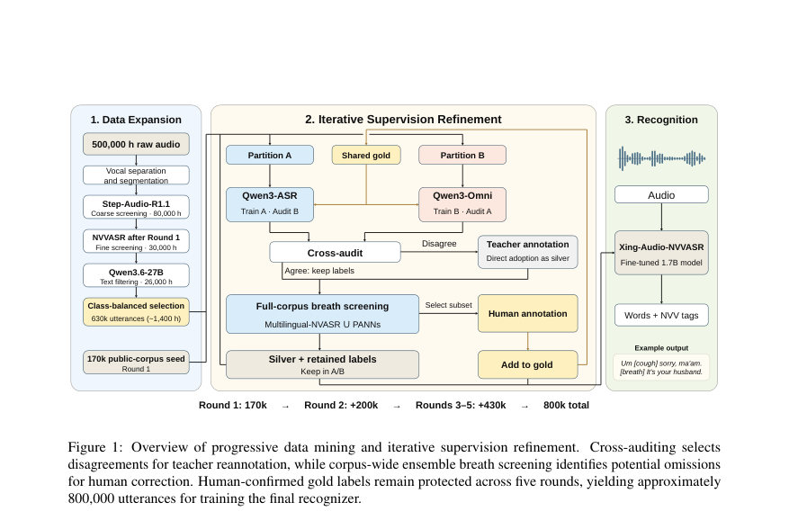
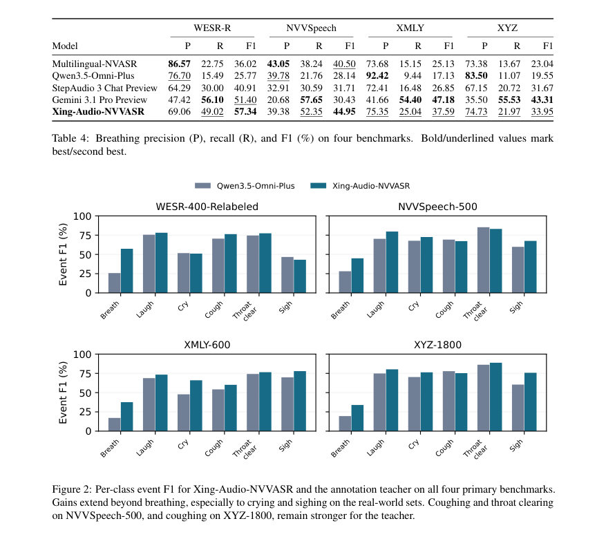

# Xing-Audio-NVVASR: Scaling and Refining Supervision for Joint Recognition of Speech and Non-Verbal Vocalizations

- **게시일:** 2026-11-20
- **arXiv:** [2611.26000v1](http://arxiv.org/abs/2611.26000v1) · [PDF](https://arxiv.org/pdf/2611.26000v1)
- **저자:** Pengyu Xu, Gang Liu, Genliang Zhao, Hongjie Chen, Jian Kang, Jie Lian, Jie Li, Yongxiang Li
- **분야:** cs.CL
- **선정 점수:** 5.19
- **선정 이유:** 최근성 1.1, 인용 영향 0.0 (인용 0회), 저자 영향 0.0 (최고 h-index 0), AI 주제 적합성 2.0, 개발자 관심 0.5, 학술 신호 0.5, 오픈 웨이트·주요 연구조직 신호 1.1

[← 2026-11-20 목록으로 돌아가기](../daily/2026-11-20.html)

<!-- paper-visuals:start -->
## 주요 Figure

> 원문 PDF에서 실제 Figure 캡션과 그림 영역이 함께 확인된 자료만 자동 추출했다.

*Figure · 원문 PDF 4쪽 · Figure 1: Overview of progressive data mining and iterative supervision refinement. Cross-auditing selects*

*Figure · 원문 PDF 9쪽 · Figure 2: Per-class event F1 for Xing-Audio-NVVASR and the annotation teacher on all four primary benchmarks.*

<!-- paper-visuals:end -->

## 한 문장 요약

약 80만 개 발화를 대상으로 점진적 오디오 마이닝과 반복적 감독 정제를 결합해 말과 6종 비언어 발성(NVV)을 동시에 태깅하는 end-to-end ASR(Qwen3-ASR-1.7B)을 학습하고, 교차감사·코퍼스 전역 호흡 스크리닝·선택적 인간 교정을 통해 주석 완전성과 성능을 개선한 연구.

## 해결하려는 문제

공개 코퍼스는 자발적 비언어 발성(NVV)이 희소하고 레이블에 누락·오류가 많아 말과 NVV를 동시에 인식하는 모델 학습에 어려움이 있다. 특히 호흡(breath) 레이블의 체계적 누락과 이벤트 간 혼동이 보고되어 있으며, 모델-레이블 합의는 공통된 누락을 숨길 수 있다. 이 논문은 (1) NVV 사례를 대규모로 확보하면서, (2) 자동화된 교정 절차와 인간 검토를 통해 누락·오류를 복구하여 신뢰할 수 있는 감독(supervision)을 만드는 방법을 묻는다.

## 핵심 기여

- 점진적 오디오 마이닝과 반복적 감독 정제를 결합한 파이프라인을 제안하여 공개 코퍼스 170k 발화를 수리(정제)하고 내부 500k시간 풀에서 채굴한 630k 발화를 순차적으로 통합해 약 800k 발화를 확보함(5회 라운드).
- 두 개의 이질적 분기 모델(Qwen3-ASR, Qwen3-Omni)을 이용한 교차감사(disagreement-based auditing)와, Multilingual-NVASR + PANNs의 전코퍼스 호흡 스크리닝을 결합해 모델 합의로는 탐지되지 않는 공통 누락을 인간 검토 대상으로 선별하는 절차를 도입함. 인간 확인된 gold 레이블은 누적·보호됨.
- 최종적으로 단일 1.7B-파라미터 Qwen3-ASR 모델을 토큰 가중치(=2 for NVV tags)와 분포 안내 재샘플링(quota 기반)으로 미세조정하여 말과 6개 NVV 태그를 inline으로 출력하도록 학습함.
- 사람이 주석한 4개(실제) 벤치마크(WESR-400-Relabeled, NVVSpeech-500, XMLY-600, XYZ-1800)를 구성·공개 예정하고, 9개 모델 비교에서 평균 composite score와 6-class Macro-F1에서 모두 1위 달성(평균 composite score 64.46).
- 호흡 인식 문제와 평가상의 레이블 누락(inter-annotator·기존 레퍼런스 누락)이 성능 측정에 큰 영향을 미침을 실험적으로 입증하고, 'audible breath는 모두 라벨링'하는 명확한 주석 기준을 제시함.

## 접근 방법

* 목표 형식은 음성 입력 x에 대해 어휘 토큰과 C={breath, laugh, cry, cough, throat clearing, sigh}의 원자 태그를 텍스트 시퀀스 y로 생성하는 것(태그는 단일 위치로 삽입, 타임스탬프 없음).
* 파이프라인 구성요소는 다음과 같음: (1) 데이터 준비: 공개 코퍼스에서 170k 시드 샘플을 추출해 라운드1에서 정제하고, 내부 500k시간 풀에서 Demucs v4로 보컬 분리, VAD(pyannote·Silero) 및 세그멘테이션을 거쳐 Step-Audio-R1.1, NVVASR, Qwen3.6-27B 텍스트 필터링과 클래스 균형 샘플링을 통해 630k 발화(약 1,400h)를 점진적으로 선정해 통합.
* (2) 교차감사: 초기와 각 라운드에서 데이터는 두 파티션으로 나뉘어 M_A = Train(Qwen3-ASR, D_A ∪ G)와 M_B = Train(Qwen3-Omni, D_B ∪ G)로 학습 후 상호감사하여 자동 레이블과 감사 모델의 트랜스크립트 불일치 샘플을 교사(teacher) 모델(Qwen3.5-Omni-Plus)에 재주석하게 하고 그 출력을 silver 레이블로 채택함.
* (3) 전코퍼스 호흡 스크리닝: Multilingual-NVASR(문맥 내 호흡 식별)과 PANNs CNN14(발화 수준 호흡 존재 검출)을 전체 코퍼스에 적용해 기존 주석과 합의하더라도 누락 가능성이 있는 샘플을 플래그하고, 이 중 일부를 인간 주석자에게 검토시켜 audible-breath 규칙(듣고 식별 가능한 모든 호흡을 라벨링) 하에 gold 레이블로 확정함.
* (4) 반복 갱신: 인간확인 H(t)는 G(t+1)=G(t)∪H(t)로 누적·보호되며 매 라운드 teacher-generated silver와 자동 레이블이 유지·갱신되어 다섯 라운드 동안 약 30,000건의 인간 리뷰가 수행됨.
* (5) 모델 학습: 최종적으로 Qwen3-ASR-1.7B를 full-finetune, 토큰 손실 가중치wij를 NVV 토큰에 2, 나머지에 1로 설정한 확률적 교차엔트로피(식 (4))로 학습하고 분포-가이드 재샘플링(사이클당 20,000 노출; quota: breath 4,000, laugh 2,000, cry/cough/throat/sigh 각각 1,500, speech-only 8,000)을 적용해 장기 불균형을 완화함.
* 학습·추론 설정(하드웨어, LR, 배치 등)은 부록 B에 기재됨.

## 주요 결과

- 데이터: 공개 코퍼스 170,000 발화 정제 + 내부 마이닝 630,000 발화 통합 → 최종 약 800,000 발화 학습셋(금·은·자동 레이블 혼합).
- 인간 검토 규모: 약 30,000개의 인간 리뷰가 다섯 라운드 동안 누적되어 gold 레이블로 보호됨(본문 기술).
- 최종 모델: Qwen3-ASR-1.7B 단일 모델이 4개(주요) 벤치마크(WESR-400-Relabeled, NVVSpeech-500, XMLY-600, XYZ-1800)에서 9개 모델과 비교하여 평균 composite score 64.46로 1위. 벤치마크별 composite score는 WESR-400-Relabeled 66.40, NVVSpeech-500 68.58, XMLY-600 58.15, XYZ-1800 64.69(표 3).
- 교사 대비 호흡 성능 개선: annotation teacher(Qwen3.5-Omni-Plus) 대비 호흡 F1가 14.40–31.57 percentage point 향상(벤치마크별 개선 범위 본문 명시). 예: XMLY-600에서 교사 호흡 F1 17.13 → Xing-Audio-NVVASR 37.59 (Table 4).
- 교차감사와 전코퍼스 호흡 스크리닝의 효과: teacher의 호흡 예측은 높은 정밀도(precision>83% 예시)와 극단적 저재현율(recall≈9–11%)이 관찰되어 별도 스크리닝으로 누락을 보완함(본문).

## 한계

- 저자가 명시한 한계: (1) 여전히 학습 데이터에 상당한 이벤트 누락(annotations omissions)이 남아 있으며 부분적 보정만 수행되었음, (2) 약 800k 발화 집합 내 개별 샘플의 기여도(data value)를 평가하지 않아 중복 또는 유해 샘플 존재 가능성을 미평가 상태, (3) 연구는 6개 범주에 국한되어 희귀·롱테일 카테고리나 연속적 발성 이벤트로의 확장이 이루어지지 않음(본문의 'Limitations' 섹션).
- 추가로 본문에서 확인되는 제약(합리적 확인): (4) 호흡(recall)은 자연 녹음에서 여전히 낮아 XMLY에서 모델의 호흡 재현율이 약 25% 수준으로 남아 있어 실무적 완전성에는 한계가 있음(예: XMLY R≈25.04%), (5) 내부 500k 시간 소스가 사용되었고 이 풀은 공개되지 않아 동일한 마이닝을 재현하려면 내부 대규모 오디오 자원이 필요함, (6) 평가 민감도는 테스트 레퍼런스의 완전성에 크게 영향받음—원본 WESR 레퍼런스의 누락 때문에 동일한 학습 변화가 성능을 악화시키는 것처럼 보였고, 레이블 수정 후 역전된 사례가 관찰되므로(본문 섹션 5.5 및 Table 5) 평가 데이터 품질이 결과 해석에 결정적임.

## 개발자 관점

- 주석 정책의 명확화: 'audible breath는 모두 라벨링' 같은 구체적·행동 가능한 주석 규칙을 훈련·교사·평가 전 단계에서 일관되게 적용해야 호흡 관련 훈련·평가가 왜곡되지 않음(논문 전반).
- 교차감사 + 전코퍼스 보조검출 조합: 서로 다른 유형의 자동화기(문맥 기반 NVASR과 음향 기반 PANNs)를 결합해 모델 합의가 숨기는 공통 누락을 발견하고 인간 검토 대상을 선별하는 것이 비용 대비 효과적임(본문 절차).
- 데이터 증대는 양보다 질: 소규모 고품질 주석(약 50k 고품질 발화)이 이미 경쟁력 있는 성능을 낼 수 있으며, 대규모 저품질 레이블은 개선을 보장하지 않음(논문 토의 및 경험적 관찰). 따라서 데이터 가치 평가·선택(data valuation/selection) 도구를 도입할 것을 권장.
- 학습 구성: NVV 토큰에 가중치(2)를 부여한 토큰별 손실과 클래스-지향 재샘플링(quota 기반)은 희소 이벤트 학습에 중요하므로 재현 시 동일한 손실 가중·샘플링 전략을 적용해야 함(부록 B, 식(4), Table 8).
- 평가 신뢰성 관리: 테스트셋 레이블 누락 여부를 수동 점검하거나 다중 주석 기반 보정 절차를 거치지 않으면 모델 개선이 오히려 나쁜 점수로 보일 수 있으므로 배포 전 평가 데이터 검증이 필수임(섹션 5.5 사례).

**근거 범위:** 이 분석은 제공된 논문 PDF 본문(본문·그림·표·부록)에 근거해 작성되었음. 표·수치(예: 데이터 규모, 벤치마크 점수, 호흡 P/R/F1, 샘플링 쿼터, 학습 설정 등)는 본문과 부록에서 직접 확인 가능한 값만 사용했다. 내부 오디오 풀의 구체적 성격(비공개)이나 실제 인간 주석 비용 등 본문에 명시되지 않은 세부사항은 추정하지 않았다.
