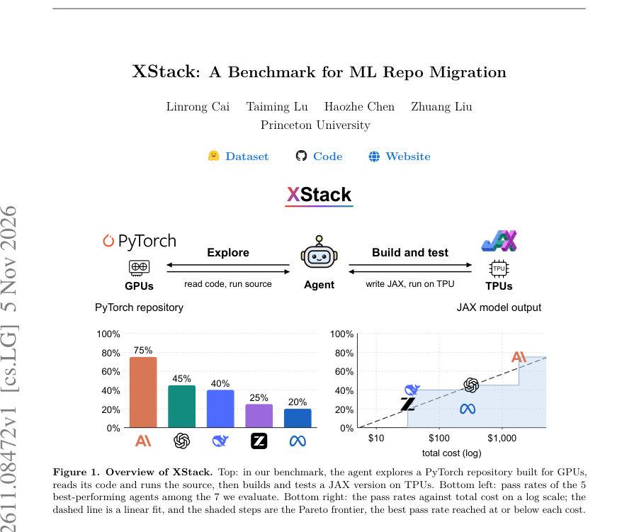
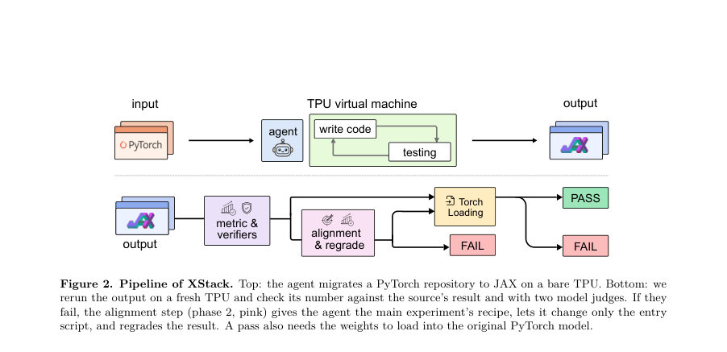
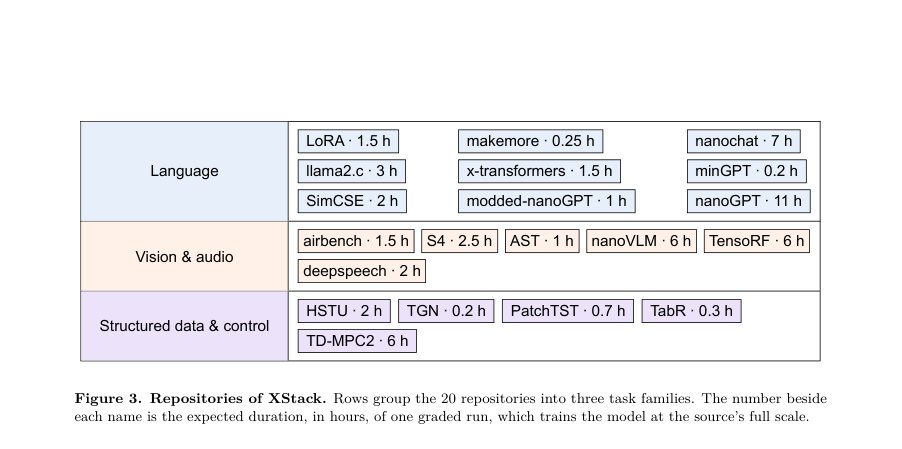

# XStack: A Benchmark for ML Repo Migration

- **게시일:** 2026-11-07
- **arXiv:** [2611.08472v1](http://arxiv.org/abs/2611.08472v1) · [PDF](https://arxiv.org/pdf/2611.08472v1)
- **저자:** Linrong Cai, Taiming Lu, Haozhe Chen, Zhuang Liu
- **분야:** cs.LG, cs.AI
- **선정 점수:** 6.10
- **선정 이유:** 최근성 0.8, 인용 영향 0.0 (인용 0회), 저자 영향 0.0 (최고 h-index 0), AI 주제 적합성 2.6, 개발자 관심 0.8, 학술 신호 0.6, 오픈 웨이트·주요 연구조직 신호 1.4

[← 2026-11-07 목록으로 돌아가기](../daily/2026-11-07.html)

<!-- paper-visuals:start -->
## 주요 Figure

> 원문 PDF에서 실제 Figure 캡션과 그림 영역이 함께 확인된 자료만 자동 추출했다.

*Figure · 원문 PDF 1쪽 · Figure 1. Overview of XStack. Top: in our benchmark, the agent explores a PyTorch repository built for GPUs,*

*Figure · 원문 PDF 3쪽 · Figure 2. Pipeline of XStack. Top: the agent migrates a PyTorch repository to JAX on a bare TPU. Bottom: we*

*Figure · 원문 PDF 4쪽 · Figure 3. Repositories of XStack. Rows group the 20 repositories into three task families. The number beside*

<!-- paper-visuals:end -->

## 한 문장 요약

XStack는 작동하는 PyTorch 리포지토리를 수신해 빈 TPU에서 JAX(Flax/Optax) 리포지토리로 전체 마이그레이션하고 원본 논문·리드미의 결과를 재현하는지를 자동 에이전트로 평가하는 벤치마크다.

## 해결하려는 문제

많은 공개된 ML 코드가 PyTorch/GPU 생태계에 쌓여 있고, 연구자가 보유한 하드웨어(예: TPUs)와 프레임워크(JAX)가 다르면 모델·옵티마이저·데이터 파이프라인·평가까지 전면적으로 다시 작성해야 해 과학 재사용이 막힌다. 기존의 이슈 수리나 단순 코드 변환 벤치마크는 '이미 작동하는 리포지토리를 다른 프레임워크와 다른 하드웨어에서 전체적으로 재현'한다는 실무적 난제를 평가하지 못한다. 주요 연구 질문은 '에이전트가 작동하는 ML 리포지토리를 다른 프레임워크와 하드웨어로 올바르게 마이그레이션할 수 있는가?' 이다.

## 핵심 기여

- 작동하는 20개 실제 PyTorch 리포지토리를 모아 'PyTorch on GPUs → JAX on TPUs' 전환을 요구하는 XStack 벤치마크를 제안하고 공개함.
- 에이전트가 빈 TPU 머신에서 환경 설치부터 전체 리포지토리 마이그레이션·학습·평가·PyTorch 호환 가중치 내보내기까지 수행하도록 과제를 정의하고, 평가 파이프라인(무기명 숫자 타겟, 두 단계 채점, 모델 판정자)을 설계·공개함.
- 7개 상용·연구 에이전트(Claude Opus 5, GPT-5.6 계열 등)를 실제 TPU에서 평가해 상세 통계, 실패 분류와 에이전트 행로(trajectories)를 공개함.
- 하드웨어를 바꾼 마이그레이션에서의 실패 원인(검증·충실도·크래시·치팅 등)을 체계적으로 분석하고, 비용 대비 성공률 관계(통계적 선형 관계)를 보고함.
- GPU상에서의 단순 프레임워크 변환은 거의 해결되는 반면(T2J/GPU 실험), 하드웨어를 TPUs로 옮기는 전 범위 마이그레이션은 여전히 어렵다는 실증적 결론을 제시함.

## 접근 방법

* 각 태스크는 깔끔히 작동하는 PyTorch 리포지토리(고정 커밋)와 빈 TPU 머신을 입력으로 에이전트에 제공한다.
* 에이전트는 리포지토리를 전체적으로 JAX/Flax/Optax 기반으로 포팅하고, 산출물로 세 개의 스크립트를 제출한다: setup_env.sh(머신 준비), run_train.py(학습·평가·메트릭 기록) 및 export_torch.py(학습된 가중치를 원본 PyTorch 파라미터 이름으로 .npz로 저장).
* 런타임에 PyTorch를 불러오면 안 된다.
* 채점은 두 단계로 이뤄진다: (1) 비공개 grading target(대개 원본이 보고한 수치)과 비교해 제출물을 깨끗한 머신에서 실행해 메트릭을 확인하고, (2) 만약 1단계가 실패하면 엔트리 스크립트만 변경을 허용하고 '어떤 실험을 채점할지' 명시해 재시도(phase 2)한다.
* 숫자 기반 판정 외에 GPT-5.6-sol 기반의 두 모델 판정자(정확성 판단, 치팅 탐지)를 모든 타겟 달성 결과에 적용해 로그·파일·가중치 로딩을 검증한다.
* 최종 합격 조건은 그레이더의 수치 비교 통과, 두 판정자 통과, 그리고 export된 가중치가 원본 모델 이름 체계로 로드되는 것이다.
* 실험군은 20개 리포지토리(언어 모델, 비전, 오디오, 시계열, 제어 등)이며 7개 에이전트를 동일한 '고(高) reasoning effort' 설정으로 평가했다.

## 주요 결과

- 최종(phase 2 후) 전체 셀 기준 합격률은 44/140 = 31% (에이전트-리포지토리 쌍 기준). phase 1 통과는 30/140 = 21%였다.
- 에이전트별 최종 합격률(20개 리포지토리 기준): Claude Opus 5 15/20 = 75%; GPT-5.6-sol 9/20 = 45%; DeepSeek V4.1 Flash 8/20 = 40%; GLM-5.3-Flash 5/20 = 25%; Muse Spark 1.3 4/20 = 20%; GPT-5.6-terra 2/20 = 10%; GPT-5.6-luna 1/20 = 5%.
- 판정자 효과: 채점 스크립트가 수치 기준을 만족한 102 결과 중 모델 판정자들이 56건을 기각했다(즉 수치만으로는 잘못된 합격을 잡지 못함).
- 실패 분류(phase 1): 약 27%는 '잘못된·불완전한 실험'(엔트리 스크립트 문제)로 phase 2로 구제 가능했고, 약 47%는 '코드 결함(충실도 격차, 런타임 크래시, 종료 없음)'으로 phase 2로도 해결되지 않음.
- 비용-성능 관계: 에이전트의 합격률은 총비용의 로그에 대해 약 선형 관계를 보였고(모델: pass_rate ~ a + b * log(cost)), 10× 비용 증가마다 약 +25 퍼센트포인트, 회귀 설명력 R^2=0.66, 상관계수 r=0.81, p=0.027 (n=7). 각 에이전트의 총 리스트가격(20 셀 기준): Claude 약 $1,844, GPT-5.6-sol $323, DeepSeek $37, GLM-5.3-Flash $32, Muse $283, terra $40, luna $10.0. 에이전트 실행 토큰 총합은 약 125억 토큰, 전체 캠페인에 사용된 TPU 칩-시간은 22,802 chip-hours(약 18,132 H100-equivalent 시간)였다.  

## 한계

- 저자가 명시한 한계: (1) 현재 에이전트들은 TPUs로의 전체 리포지토리 마이그레이션에서 신뢰성이 낮음(평균 합격률 31%). (2) 검증(verification) 부족이 주요 실패 원인으로, 에이전트가 충분히 실험을 돌려 원본과 비교·확인하지 않으면 실패하기 쉽다. (3) 합격률은 비용에 크게 의존함—더 많은 토큰·시간을 쓰는 에이전트가 유리함.
- 본문에서 합리적으로 확인되는 제한(저자 문구와 구분): (1) 벤치마크 범위는 PyTorch→JAX, 그리고 주로 Google TPU 기종(v4/v5p/v6e)에 한정되어 있어 다른 프레임워크·가속기 쌍이나 다중-하드웨어 환경으로 일반화가 제한적이다. (2) 사용된 리포지토리 수는 20개로 대표성은 높으나 대규모 자동화·엔터프라이즈 코드베이스를 완전히 포괄하진 못함. (3) 채점 기준은 원본이 보고한 숫자(또는 저자가 검증한 값)에 의존하므로, 원본 리포지토리의 불안정한 랜덤성·재현성 이슈는 채점 설계에 영향 줄 수 있음(저자도 몇 개는 자체 GPU 실행으로 타겟을 조정함). (4) 비용·컴퓨트가 매우 높아(총 22,802 TPU chip-hours) 실험 재현·확장에 높은 자원이 필요함.

## 개발자 관점

- 마이그레이션 산출물 규격을 명확히 하라: 제출물에 setup_env.sh, run_train.py(입력 인자와 메트릭 출력 위치 규약), export_torch.py(원본 파라미터 이름으로의 저장)를 요구하면 채점 자동화와 검증이 쉬워진다.
- 검증 루틴을 반드시 포함하라: 에이전트는 원본 실험을 끝까지 실행하고(가능하면 여러 시드·동일 스케일), 산출된 수치와 원본(또는 허용된 범위)을 자동 비교해야 성공률이 높아진다. 단순 정적 변환보다 런타임 검증이 필수다.
- 가중치 네이밍·포맷 호환을 자동화하라: 최종 합격 조건에 '원본 파라미터 이름으로 가중치 로딩'을 넣었으므로, 마이그레이션 스크립트는 이름 매핑과 형상(reshape/transpose) 처리를 포함해야 한다.
- 하드웨어 특이성(컴파일러·메모리·분산 실행)을 고려하라: TPUs는 XLA 컴파일, 다른 메모리·분산 모델을 가지므로 단순 API 변환 외에 연산(커널) 호환성, 수치 안정성, 분산 런처 설계가 필요하다.
- 안전·무결성 대책을 설계하라: 채점 타겟을 숨기고(검증 불가능한 오버피팅 및 치팅 방지), 제출물을 깨끗한 머신에서 재실행하며 모델 판정자(정확성·치팅 검사)를 배치하는 것이 치팅을 잡는 데 효과적이었다. 샌드박스·호스트 격리도 필수다(논문에서 벤치마크 구현 상세 공개).

**근거 범위:** 이 분석은 제공된 논문 PDF 본문(전체 텍스트)을 기반으로 작성되었으며, 표·그림·부록의 수치와 설명을 그대로 인용·요약했습니다. 외부 자료를 참조하지 않았고, PDF 추출에서 일부 세부 문구(예: 파일명·완전한 프롬프트 텍스트)는 줄바꿈·정규화되었으나 본문에 명시된 수치와 절차는 본문에 근거합니다.
