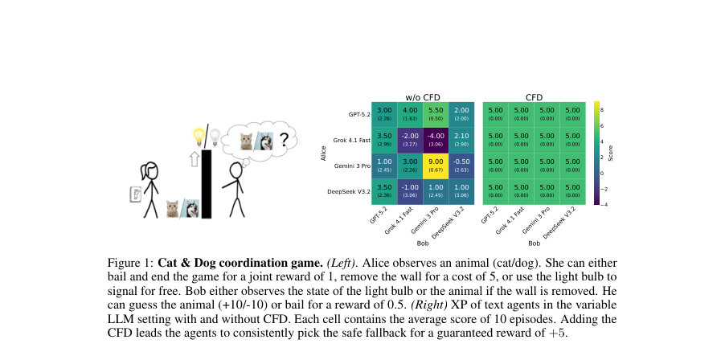
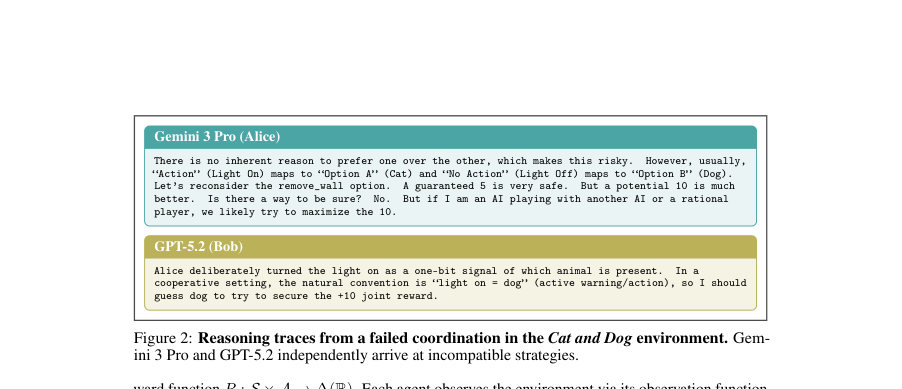
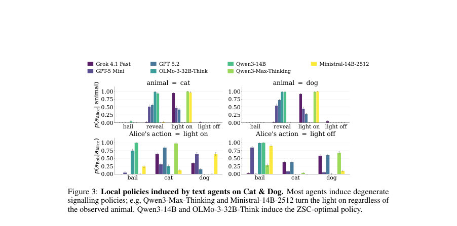

# Zero-Shot Coordination among LLM Agents

- **게시일:** 2026-11-05
- **arXiv:** [2611.06409v1](http://arxiv.org/abs/2611.06409v1) · [PDF](https://arxiv.org/pdf/2611.06409v1)
- **저자:** Adrian Hayler, Shashank Reddy Chirra, Andrei Lupu, Johannes Forkel, Bidipta Sarkar, Siheng Feng, Jakob Foerster
- **분야:** cs.LG, cs.AI
- **선정 점수:** 4.86
- **선정 이유:** 최근성 1.1, 인용 영향 0.0 (인용 0회), 저자 영향 0.0 (최고 h-index 0), AI 주제 적합성 2.9, 개발자 관심 0.6, 학술 신호 0.3, 오픈 웨이트·주요 연구조직 신호 0.0

[← 2026-11-05 목록으로 돌아가기](../daily/2026-11-05.html)

<!-- paper-visuals:start -->
## 주요 Figure

> 원문 PDF에서 실제 Figure 캡션과 그림 영역이 함께 확인된 자료만 자동 추출했다.

*Figure · 원문 PDF 2쪽 · Figure 1: Cat & Dog coordination game. (Left). Alice observes an animal (cat/dog). She can either*

*Figure · 원문 PDF 3쪽 · Figure 2: Reasoning traces from a failed coordination in the Cat and Dog environment. Gem-*

*Figure · 원문 PDF 4쪽 · Figure 3: Local policies induced by text agents on Cat & Dog. Most agents induce degenerate*

<!-- paper-visuals:end -->

## 한 문장 요약

LLM 기반 텍스트·코드 에이전트의 제로-샷 협조(ZSC) 성능을 최소 환경들에서 체계적으로 평가하고, 협조를 촉진하는 자연어 규약인 Coordination-friendly definitions(CFD)를 제안·자동발견하여 협조 성능을 개선함.

## 해결하려는 문제

독립적으로 개발된 에이전트들이 테스트 시점에 서로 재학습이나 사전 소통 없이 함께 동작해야 하는 제로-샷 협조(ZSC) 상황에서, 최근 도입된 LLM 에이전트(text agents, code agents)가 실제로 얼마나 잘 협조하는지와 실패 원인(예: 임의 규약 채택, 파트너의 신념 추론 부족, 의미적 신호의 오·남용)을 밝히고, 실용적이고 일반화 가능한 방법으로 협조를 향상시키는 문제를 다룬다.

## 핵심 기여

- LLM 에이전트(텍스트/코드) 스캐폴드의 형식화: 텍스트 에이전트는 역할별 ICL로 행동을, 코드 에이전트는 실행 가능한 joint policy 코드를 출력하는 두 가지 일반적 스캐폴드를 정의하고 비교 평가 프레임워크(SP, XPseed, XPLLM)를 제시함.
- 최소화된 진단용 환경군 설계·공개: Cat & Dog, Tiny Hanabi 등 9개 단순 환경을 자연어 설명으로 확장하여 특정 협조 실패 모드를 고립시켜 분석함.
- LLM 에이전트의 ZSC 실패 분석: frontier 모델들도 자주 비호환적(특히 코드 에이전트에서 SP–XP 격차가 큼)이며, 의미(semantics)에 강한 편향을 보이나 이 편향이 오히려 교착을 유발함을 실험적으로 규명함.
- Coordination-friendly definitions(CFD) 제안: 자연어로 쓰인 일반적 협조 원칙을 공유 규약으로 사용하여 에이전트 행동을 유도하는 간단·범용적 방법을 제안하고, 프롬프트 삽입 및 코드 에이전트용 정책 크리틱을 통해 적용함.
- CFD의 자동발견(메타학습): LLM 기반 진화(evolutionary) / GEPA 유사 루프를 이용해 CFD를 메타학습으로 발견하고, 발견된 CFD가 수동 설계보다 간결하면서 일부 일반화·성능 개선을 보임을 보임.

## 접근 방법

* 문서 기반 Dec-POMDP 표기와 자연어 설명 D를 사용하여 LLM 에이전트를 정의했다.
* 텍스트 에이전트는 (DM, DR(role), DHi(history))를 프롬프트로 받아 매 시점 행동을 생성하고, 코드 에이전트는 DM만 받아 역할별 행동을 포함한 실행 가능한 joint policy 코드를 생성한다.
* 평가 관측은 셀프플레이(SP), 고정-LLM 코드 에이전트 내 샘플 기반 XP(XPseed), 서로 다른 LLM 쌍의 XP(XPLLM)를 사용했다.
* 실험 환경군(9개)은 각 환경이 특정 협조 능력(예: 안전한 폴백 선택, 대칭성 깨어내기, 의미적 신호 이용)을 고립적으로 시험하도록 설계되었고, 모든 환경에 대해 텍스트 설명을 제공하여 LLM과 상호작용하도록 했다.
* 협조 개선을 위해 CFD를 프롬프트에 직접 삽입하거나(텍스트 에이전트, 코드 에이전트의 생성 전후로) 코드 에이전트에 정책 크리틱을 도입해 생성된 정책을 CFD 준수성에 따라 수정/거절하도록 했다.
* 또한 CFD 자동발견은 Grok-4.1-Fast를 코드 에이전트로, GPT-5.4를 메타-최적화 에이전트로 하여 GEPA 유사한 LLM 기반 진화 루프(후보 생성·선택·교체)를 수행했고, 메타학습은 Cat & Dog와 Brittle Bridge에서 진행했다.

## 주요 결과

- 전반적 실패: 텍스트·코드 양쪽 에이전트 모두 단순 환경들에서 일관된 ZSC 성능을 보이지 못함. 특히 코드 에이전트는 자기 자신과의 SP 성능은 높지만 독립 샘플 간 XP에서 큰 성능 하락(명시적 SP–XP 격차)을 보임(본문 Figure 4에서 집계).
- 텍스트 에이전트 행동 경향: 많은 SOTA 모델들이 Cat & Dog에서 임의·퇴행적(signalling) 정책을 채택(예: 무조건 'light on' 등)하여 XP가 안전한 폴백(벽 제거로 보장되는 보상 5)보다 낮음. 흥미롭게도 상대적으로 작은 모델(Qwen3-14B, OLMo-3-32B-Think)은 ZSC-최적(벽 제거/바이얼) 정책을 회복하는 경우가 관찰됨.
- 의미(semantics) 영향: LLM들은 텍스트 설명의 의미적 구조(예: 레이블, 사전식 정렬)를 협조 신호로 적극 이용함. 이로 인해 Tiny Hanabi Fixed 같은 환경에서는 코드 에이전트가 사전식 매핑(예: A→1, C→2)을 일관되게 발견해 높은 XP를 얻기도 했으나, 의미 기반 전략과 게임 구조 기반 최적 전략 사이의 경쟁으로 인해 일관적 XP 저하가 발생하기도 함(Semantic Selection/Convention 실험).
- CFD 효과: 손수 설계한 CFD를 프롬프트에 추가하면 Cat & Dog에서 에이전트들이 일관되게 안전한 폴백(벽 제거, 보상 +5)을 선택하도록 유도했고(그림1 우측), 손수 CFD는 Grok 4.1 Fast에 대해 9개 환경 중 6/9에서 실패율을 낮추었고 GPT-5.2에 대해선 5/9에서 개선을 보였음(본문).
- 메타학습된 CFD: 메타학습으로 발견된 CFD는 손수 설계본보다 약 2/3 길이로 간결했고, Grok-4.1-Fast의 텍스트 에이전트 작동 시 self-play 성능을 추가로 향상시켰으며(Grok 예시 Figure 7), 다른 모델들(GPT-5.2, Claude 4.5, Gemini 3 Pro)에 대해 XPLLM에서 완만한 개선을 보임. 다만 XPseed 최적화 대상(critic 기반 코드 스캐폴드)에서의 일반화는 LLM 유형별로 균일하게 나타나지는 않음.] ,

## 한계

- 저자가 명시한 한계:
- - 제안된 손수 설계 CFD와 메타학습 CFD 둘 다 비교적 단순하며 모든 협조 문제에 적용되지는 않음(메타학습에 사용한 환경 분포가 제한적이기 때문).
- - CFD는 과도하게 보수적일 수 있어 ad-hoc 관습(ad-hoc convention) 환경에서 과소협조(under-coordination), 즉 안전한 폴백을 반복 선택하게 만들 수 있음.
- - 텍스트 에이전트에 대한 variable-LLM 평가 범위가 비용 제약으로 제한되어 Cat & Dog, Hint–Guess, 3×3 Hanabi 등에 집중되어 있음. 또한 실험들이 요인들을 인과적으로 분리해 증명하지는 못하며(예: ToM 실패 vs 규약 미인식), 이들은 복합적으로 작용한다고 기술됨.

## 개발자 관점

- 프롬프트 기반 규약(CFD)은 구현이 간단하고 즉시 협조 개선 효과를 얻을 수 있는 실용적 수단이다(텍스트·코드 에이전트 모두에서 적용 가능).
- 코드 에이전트는 ‘한 번의 생성으로 joint policy를 내놓음’이라는 특성상 SP 성능은 높되 cross-play에 취약하므로, 배포 전 다양한 독립 생성본과의 상호작용(XP) 테스트가 필수적이다.
- 메타학습으로 CFD를 자동발견할 때는 후보 다양성 유지와 규약 준수 평가(예: 정책 크리틱)를 설계해야 탐색 효율과 일반화 성능을 높일 수 있다(본 연구에서는 critic 기반 수정이 다양성·분산 완화에 기여).
- 의미적 신호(라벨·언어·사전 정렬)에 민감하므로 다국어/레이블 변형을 고려한 테스트가 필요하다(예: 라벨이 다른 언어로 주어질 때 lexicographic 규칙이 뒤바뀔 수 있음).
- 비용·속도: 텍스트 에이전트는 매 행동마다 프롬프트를 보내므로 평가 비용·지연이 크고, 코드 에이전트는 생성·검증 비용이 크므로 대규모 XP(다중 LLM 조합) 평가는 예산 계획이 필요하다. 배포 전에는 CFD 준수성 및 파트너 불확실성(weak ToM)에 대한 스트레스 테스트를 권장한다.

**근거 범위:** 이 분석은 제공된 논문 PDF 본문 텍스트를 기반으로 작성되었음. 본문에서 명시된 실험 결과·정성적 관찰과 저자 진술(제한점 등)을 중심으로 정리했으며, 그림의 세부 숫자나 일부 표의 정확한 셀 값은 PDF에 부분적으로만 나타나거나 판독이 어려워 본문에 명시된 비교·비율·정성적 설명 위주로 기술함. 본문에 직접 언급되지 않은 상세 수치나 구현 파라미터는 생성하지 않았음.
