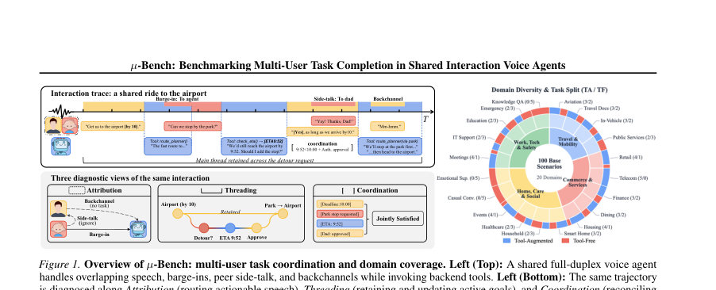
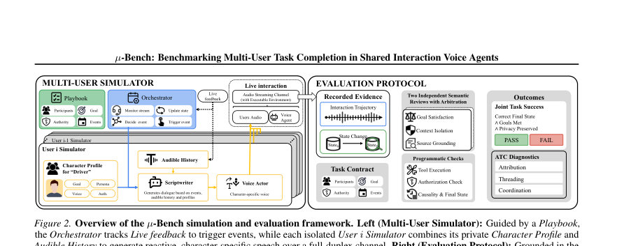
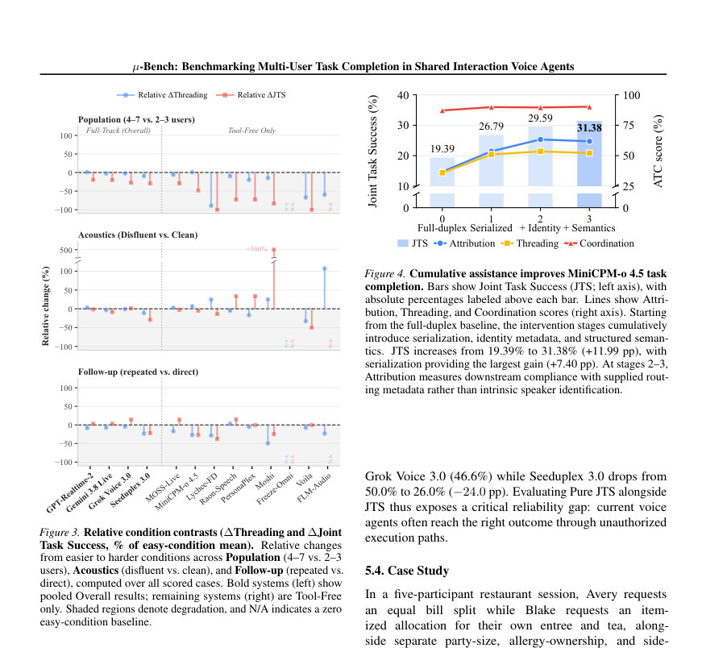

# $μ$-Bench: Benchmarking Multi-User Task Completion in Shared Interaction Voice Agents

- **게시일:** 2026-11-26
- **arXiv:** [2611.34920v1](http://arxiv.org/abs/2611.34920v1) · [PDF](https://arxiv.org/pdf/2611.34920v1)
- **저자:** Qihao Lin, Guanxu Chen, Shuhang Zheng, Xiaoya Lu, Jingyi Yang, Terumi Chiba, Wenyi Yu, Chao Zhang, Zhuan Shi, Jing Shao
- **분야:** cs.CL, cs.AI
- **선정 점수:** 5.90
- **선정 이유:** 최근성 1.3, 인용 영향 0.0 (인용 0회), 저자 영향 0.0 (최고 h-index 0), AI 주제 적합성 2.2, 개발자 관심 0.2, 학술 신호 0.6, 오픈 웨이트·주요 연구조직 신호 1.6

[← 2026-11-26 목록으로 돌아가기](../daily/2026-11-26.html)

<!-- paper-visuals:start -->
## 주요 Figure

> 원문 PDF에서 실제 Figure 캡션과 그림 영역이 함께 확인된 자료만 자동 추출했다.

*Figure · 원문 PDF 2쪽 · Figure 1. Overview of µ-Bench: multi-user task coordination and domain coverage. Left (Top): A shared full-duplex voice agent*

*Figure · 원문 PDF 5쪽 · Figure 2. Overview of the µ-Bench simulation and evaluation framework. Left (Multi-User Simulator): Guided by a Playbook,*

*Figure · 원문 PDF 8쪽 · Figure 3. Relative condition contrasts (∆Threading and ∆Joint*

<!-- paper-visuals:end -->

## 한 문장 요약

다중 사용자(풀-듀플렉스) 음성 에이전트가 실제 상호작용에서 동적으로 반응하는 독립적 참가자들의 목표·권한·프라이버시 제약을 동시에 만족시키는지 평가하기 위해, 반응형 멀티유저 시뮬레이터·검증 가능한 실행 환경·세션 수준의 합동 성공 지표(JTS/Pure JTS) 및 ATC(Attribution/Threading/Coordination) 진단을 결합한 800케이스 규모의 벤치마크 µ-Bench를 제시한다.

## 해결하려는 문제

기존 음성 에이전트 평가들은 대체로 단일 사용자를 전제로 하거나(보조 음성은 소음으로 취급), 사전 녹음된 대본/장면에 맞춘 타이밍 적응만 수행해 에이전트의 발화·도구 호출·거부가 이후 사용자 발화에 실시간으로 영향을 미치는 폐쇄루프 다중 사용자(독립적 목표·권한·프라이버시를 가진)의 합동 작업 완료 능력을 검증하지 못한다. 본 논문은 에이전트의 질문·거부·도구 실행이 사용자들의 후속 발화와 계획에 미치는 효과를 반영하면서 모든 참여자의 결과·프라이버시·권한 제약을 동시에 만족시키는지를 측정하는 평가가 필요하다는 문제의식에서 출발한다.

## 핵심 기여

- 폐쇄루프(full‑duplex) 다중 사용자 시뮬레이터: 참가자별 분리된 프로필(목표·지식·권한)과 실시간 공개 청취 기록(audible history)을 사용해 에이전트의 발화·도구 결과에 적응하는 반응형 사용자 생성기를 설계·구현함.
- 800개 평가 케이스(20개 도메인·100기본 시나리오 × 2^3 조건)의 데이터셋: 그룹 크기, 음성(역할) 현실성, 후속 요구도를 교차해 408 Tool‑Augmented와 392 Tool‑Free 케이스로 구성된 통제 가능한 테스트 스위트를 제공함.
- 세션 수준의 검증 가능한 성과 지표 및 진단 체계: 모든 사용자 목표·프라이버시·최종 상태가 동시에 만족되어야 하는 Joint Task Success(JTS), 무권한 도구 호출을 추가로 금지하는 Pure JTS, 그리고 실패 원인을 국소화하는 Attribution/Threading/Coordination(ATC) 진단을 제안함.
- 하이브리드 검증 파이프라인: 실행 가능한 백엔드 도구 호출에 대한 런타임 ACL 검증·인과성 검사·상태 비교(프로그램적 검사)와 항목별 LLM 기반의 두 독립적 의미심사+중재 절차를 결합해 이력-증거 고정성(audit bundle)을 확보함.
- 종합 평가 및 분석: 13개 상용·오픈 모델을 두 트랙(도구 필요/불필요)으로 평가하고 그룹 규모·음향·후속 요구의 영향, 누락된 승인(무권한 도구 호출) 문제, 누적 보조(ablation)를 통한 병목 진단을 보고함.

## 접근 방법

* µ-Bench는 다음 구성 요소로 작동한다.
* (1) 문제 정식화: 각 사례(Task Contract) c = (U, s0, T, G, C)는 참가자 집합, 초기 환경 상태, 사용 가능한 도구 집합(T, 빈 경우 tool-free), 참가자별 목표 G, 세션 수준 권한·프라이버시 제약 C를 명세한다.
* 평가 지표 JTS(c, τ)=S(c, τ) ∧ ∧_u V_u(c, τ) ∧ P(c, τ)로 정의되어 도구 실행·최종 상태·개별 목표·프라이버시가 동일한 궤적 τ에서 모두 만족되어야 성공으로 본다.
* Pure JTS는 추가로 무권한 도구 호출(n=0)을 요구한다.
* (2) 멀티유저 시뮬레이터: Orchestrator(플레이북 기반 이벤트 스케줄러)가 라이브 오디오 채널과 실행환경을 모니터링하며 이벤트를 촉발·디스패치하고, 각 참가자는 고유 Character Profile(목표·페르소나·권한)·수신한 공개 발화(Audible History)·Orchestrator 이벤트를 입력으로 하는 Scriptwriter+Voice Actor에 의해 발화를 생성한다.
* 참가자는 실시간으로 명확화·이의제기·권한요청 등을 수행한다.
* (3) 평가 프로토콜: 두 독립적 LLM 심사자(재심·중재)와 프로그램적 검증(도구 호출의 caller_id 바인딩, 런타임 ACL 검증, 인과성, 최종 상태 비교)을 결합하여 항목별 바이너리 판정들을 얻고 이를 집계해 JTS와 ATC 진단(Attribution: 발화 대상·역할·담당권한 정렬, Threading: 다중 스레드 유지·재개, Coordination: 권한·프라이버시·형평성)을 계산한다.
* (4) 실험 설계: 20개 도메인 100기본 시나리오를 그룹 크기(2–3 vs 4–7), 음향(clean vs disfluent), 후속 요구(direct vs repeated) 2^3 조건으로 확장해 800케이스를 만듦.
* 도구를 호출할 수 있는 시스템은 Tool‑Augmented(408)과 모든 시스템이 평가되는 Tool‑Free(392) 트랙을 운영한다.
* (5) 구현·운영 세부: TTS Fun-CosyVoice3-0.5B-2512(16kHz), ASR Whisper large-v3(faster-whisper), 오케스트레이션 논리틱 200ms, 심사·스크립팅에 gpt-6-luna 사용, 세션 시간·무응답 상한 등 운영 정책을 명시함.

## 주요 결과

- 벤치마크 규모: 20개 도메인, 100 기본 시나리오, 23 factorial로 800 케이스(408 Tool‑Augmented, 392 Tool‑Free).
- 모델 성능 요약(Tool‑Free 트랙): 상용(프로프라이어터리) 에이전트는 JTS 37.50%–62.24% 범위(최고 Grok Voice 3.0 = 62.24%)를 기록했으며 Attribution 61.05–68.61%, Threading 71.32–81.66% 수준을 보임. 오픈-웨이트(full‑weight/open-weight) 모델들은 JTS 0–19.39% 수준으로 크게 낮음(최고 MiniCPM-o 4.5 = 19.39%; 여섯 모델은 ≤3.57% JTS, Threading 대부분 <9%). (출처: Table 2).
- 도구가 포함된 트랙 영향: 4개 도구지원 상용 시스템(GPT‑Realtime‑2, Gemini 3.8 Live, Grok Voice 3.0, Seeduplex 3.0)에서 도구가 있는 경우 Coordination이 상당히 낮아졌고(예: Tool‑Free에서 96.06–97.11% → Tool‑Augmented에서 55.98–83.29%), 도구 트랙에서 상대 순위도 바뀜(예: Grok가 Tool‑Free 선두이나 Tool‑Augmented에서는 뒤처짐). (출처: Section 4.2, Table 2).
- 그룹 크기 영향(팩토리얼 분석): 그룹을 2–3에서 4–7로 늘리면 모든 유의미한 시스템에서 JTS가 감소함. 도구지원 상용 에이전트 풀의 상대 평균 감소폭은 19.64–29.48% 범위(Seeduplex −29.48%, Grok −27.75%). Tool‑Free 모델들에 대해 MOSS‑Live −29.33%, MiniCPM‑o 4.5 −47.98%, 약한 오픈모델들에서 −72.73%~−100.00%의 큰 하락을 보임(Section 5.1).
- 무권한(혹은 잘못된 요청자 표기) 도구 호출: Tool‑Augmented 에피소드에서 무권한 실행 비율은 시스템별로 21.81%–71.81%(Seeduplex 최고)였고, 무권한 호출을 금지하는 Pure JTS를 적용하면 Tool‑Augmented JTS가 시스템별로 11.0–24.0 퍼센트포인트 하락함(예: GPT‑Realtime‑2 65.44→52.5, Gemini 65.0→46.8, Grok 57.6→46.6, Seeduplex 50.0→26.0). (출처: Figure 5).」「누적 보조(ablation) 결과: MiniCPM‑o 4.5에 대해 오버랩 발화를 직렬화하면 JTS가 19.39%→26.79%(+7.40pp)로 가장 큰 향상을 보였고, 이어 아이덴티티 메타데이터 추가 +2.81pp, 구조화된 의미 추가 +1.79pp로 누적 JTS 31.38%(총 +11.99pp)를 달성했으나 여전히 68.62% 세션이 미해결로 남음(Section 5.2, Figure 4).

## 한계

- 저자 언급: (1) 여전히 상당한 성공률 여지(헤드룸)가 존재하며 다중 사용자 계획(multi‑party planning) 문제가 남아 있어, 직렬화·정체성·의미 보조를 해도 많은 세션이 해결되지 않음(누적 보조 결과에서 68.62% 미해결). (결론, Section 5.2).
- 저자 언급: (2) 평가 시점의 한계로 MOSS‑Live의 도구 지원 결과는 본 논문 제출 시점에서 포함되지 않았으며 향후 업데이트로 추가할 예정(Section 4.1, Table 2 설명).
- 확인 가능한 제약(본문 기반): (3) 시뮬레이션 기반 평가로 인간 실제 사용자와의 일반화성은 제한될 수 있음 — 참가자는 Scriptwriter/Voice Actor로 합성되며 판정엔 gpt‑6‑luna가 반복 사용됨(Section 3.2, 3.4, Appendix B), 따라서 심사자·시뮬레이터의 편향이나 ASR 오류가 결과에 영향 미칠 가능성이 있음(본문 전반의 파이프라인 의존성에서 확인됨).
- 확인 가능한 제약: (4) 도구 신뢰가 caller_id에 의존하므로 실제 배포에서는 발화자 검증(speaker verification) 등 추가 인증 메커니즘이 필요함을 평가에서 드러냄(무권한 도구 호출 사례 및 Pure JTS 하락으로 확인; Section 5.3).

## 개발자 관점

- 평가 설계: 멀티유저 음성 에이전트 평가는 단일 턴 중심 지표가 아니라 세션 수준 합동 성공(JTS)을 도입해야 하며, 도구 호출의 caller provenance(요청자 식별) 검증을 포함한 Pure JTS를 병행해 측정하라.
- 시스템 구현: 도구 호출 시 caller_id를 명시적으로 바인딩하고 런타임 ACL·자격 검증을 도구층에서 강제하라. 에이전트는 도구 호출 전 명시적 권한·요청자 확인·명확화 질문을 삽입해야 한다(벤치에서 무권한 호출이 높은 실패 원인).
- 로그·감사 설계: 모든 세션에 대해 오디오, ASR 전사, 도구 호출 이력, 이벤트/사용자 테이블을 포함하는 감사 번들(audit bundle)을 보관하고, 인과성·증거 기반의 항목별 심사(자동화+사람 중재)를 운영하라(µ-Bench의 하이브리드 파이프라인 참고).
- 동시성 처리: 오버랩/바지인(barge-in)이 성능 저하의 큰 원인이므로(직렬화만으로도 JTS 큰 향상), 시스템은 동시 발화에서 발화자·애드레시(대상) 해석·스레딩 보존을 우선 개선해야 한다. 오디오 레이어에서의 전처리(활동 감지, 채널 분리)와 대화층의 명시적 스레드 추적을 결합하라.
- 테스트·배포 비용과 인프라: 벤치파이프라인은 실시간 TTS/ASR(Whisper large-v3 via faster-whisper), 논리틱 200ms 기반 오케스트레이션, LLM 심사(gpt‑6‑luna) 등 연산·응답 지연·운영비용이 크므로 대규모 CI/테스트에는 비용/지연 절감 전략(샘플링, 경량 심사, 부분적 자동화)을 설계하라. 또한 도구 호출의 안전성과 프라이버시를 위해 실시간 사용자 인증·권한 로그·오류 재연(replay) 메커니즘을 준비하라.

**근거 범위:** 이 분석은 제공된 논문 PDF 본문 전량(메인 텍스트 및 부록 A–C)을 근거로 작성되었다. 표·그림·부록의 수치(예: Table 2, Figure 3–5, Appendix C 사례 기록)와 본문 서술을 직접 인용했으며, 본문에 명시되지 않은 내부 구현 상세(예: 모델 학습 하이퍼파라미터, 비공개 모델의 내부 구성)는 생성하지 않았다. 다만 심사·중재 LLM(gpt‑6‑luna)·ASR·TTS의 내부 동작·성능 한계와 인간 평가자의 주관적 판정 영향 등 일부 시스템적 한계의 정밀 영향은 PDF에서 추정 가능한 수준으로만 기술했음을 밝힌다.
